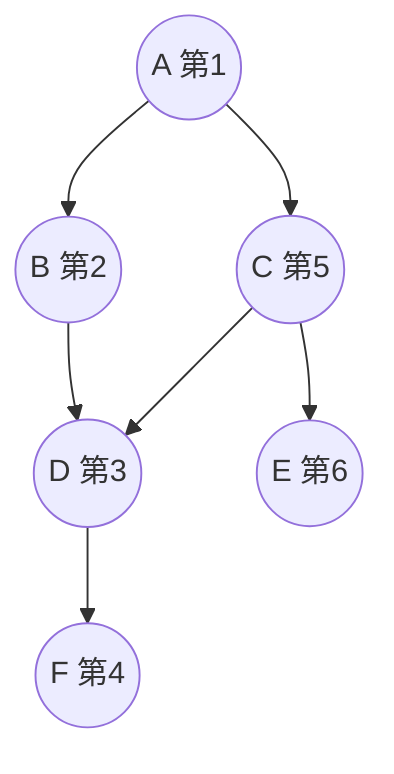

# 深度优先搜索（DFS）

> **免责声明**：本文是“河洛序”知识图谱 K2 批次的**初稿**，由 AI 辅助整理，仅供学习参考，不构成任何承诺或保证。版本信息截至 2026-10-14；文中示例已在 Python 3.15.0（数据结构与算法，纯标准库）或 Python 3.13 + 所列库版本（AI/ML 库与数学）下**实际运行**，输出为真实结果，但换机器、换版本时数字（尤其是耗时）会不同。
>
> 标注说明：**【有据可查】** 附官方文档 / 原始出处链接；**【社区共识】** 为业界普遍做法，没有唯一权威出处；**【待考察/推测】** 为未能核实或作者推断，请勿当作定论。

## 一句话定义

DFS 从起点出发，**一条路走到底，走不通再退回上一个岔路口**换一条继续。可以用递归（系统调用栈）或显式栈实现，复杂度 $O(V+E)$。

## 为什么重要

- **环检测、拓扑排序、连通分量、岛屿计数**等图问题的基础。
- **回溯（backtracking）**：全排列、组合、数独、N 皇后本质是对“决策树”做 DFS。
- 树的前序/中序/后序遍历都是 DFS（见 [[k2.ds.tree]]）。

## 原理 / 图解

示例图：A→B、A→C、B→D、C→D、C→E、D→F。



访问顺序 A → B → D → F（到底）→ 回退到 A → C → E（D 已访问，跳过）。

**三色标记法判环**（有向图）：白=未访问、灰=正在访问（在当前路径上）、黑=已完成。DFS 中遇到**灰色**节点，说明找到了一条回到当前路径的边，即存在环。

| | BFS | DFS |
|---|---|---|
| 数据结构 | 队列 | 栈 / 递归 |
| 访问顺序 | 按层 | 一条路到底 |
| 无权最短路 | 能 | 不能保证 |
| 内存 | 宽图时大 | 深图时大（递归深） |
| 典型用途 | 最短路、按层扩展 | 判环、拓扑、回溯、连通性 |

## 可运行示例

递归与显式栈两种 DFS、三色判环、网格岛屿计数、回溯生成全排列（Python 3.15.0 实际运行）：

```python
# 文件：examples/23_dfs.py
# 深度优先搜索 DFS：一条路走到底再回溯（递归 / 栈）。用于连通性、环检测、回溯搜索
import sys
sys.setrecursionlimit(10_000)

graph = {"A": ["B", "C"], "B": ["D"], "C": ["D", "E"], "D": ["F"], "E": [], "F": []}
order = []
def dfs(u, seen=None):
    seen = seen if seen is not None else set()
    seen.add(u); order.append(u)
    for v in graph[u]:
        if v not in seen: dfs(v, seen)
dfs("A"); print("递归 DFS 访问顺序:", order)

def dfs_iter(start):
    seen, stack, out = set(), [start], []
    while stack:
        u = stack.pop()
        if u in seen: continue
        seen.add(u); out.append(u)
        stack.extend(reversed(graph[u]))      # 逆序压栈，保持与递归版相同的顺序
    return out
print("显式栈 DFS 访问顺序:", dfs_iter("A"))

# 有向图环检测（三色标记）：依赖是否循环？
def has_cycle(g):
    WHITE, GRAY, BLACK = 0, 1, 2
    color = {u: WHITE for u in g}
    def visit(u):
        color[u] = GRAY
        for v in g[u]:
            if color[v] == GRAY or (color[v] == WHITE and visit(v)): return True
        color[u] = BLACK; return False
    return any(color[u] == WHITE and visit(u) for u in g)
print("graph 有环:", has_cycle(graph), "| 加一条 F->A 后有环:", has_cycle({**graph, "F": ["A"]}))

# 岛屿数量（连通分量）
sea = ["11000", "11010", "00100", "00011"]
seen = set()
def flood(r, c):
    if not (0 <= r < len(sea) and 0 <= c < len(sea[0])) or sea[r][c] == "0" or (r, c) in seen: return
    seen.add((r, c)); [flood(r+dr, c+dc) for dr, dc in ((1,0),(-1,0),(0,1),(0,-1))]
islands = 0
for r in range(len(sea)):
    for c in range(len(sea[0])):
        if sea[r][c] == "1" and (r, c) not in seen: flood(r, c); islands += 1
print("岛屿数量:", islands)

# 回溯：全排列（DFS 的典型应用）
def permutations(items, path=()):
    if not items: yield path; return
    for i, x in enumerate(items): yield from permutations(items[:i] + items[i+1:], path + (x,))
print("abc 全排列:", ["".join(p) for p in permutations("abc")])
```

输出：

```text
递归 DFS 访问顺序: ['A', 'B', 'D', 'F', 'C', 'E']
显式栈 DFS 访问顺序: ['A', 'B', 'D', 'F', 'C', 'E']
graph 有环: False | 加一条 F->A 后有环: True
岛屿数量: 4
abc 全排列: ['abc', 'acb', 'bac', 'bca', 'cab', 'cba']
```

两种实现的访问顺序一致（显式栈版需把邻居**逆序**压栈）；加一条 F→A 后三色法检测出环。

## 常见误区

- **深图用递归**：节点链很长时触发 `RecursionError`（见 [[k2.ds.stack]]），改用显式栈。
- **回溯忘记“撤销选择”**：递归返回后要把状态恢复，否则结果互相污染。
- **无向图判环用三色法**：无向图里父节点会被误判为环，要排除来时的边或用并查集。
- **以为 DFS 能找最短路径**：DFS 找到的第一条路径不一定最短。

## 与 AI 开发的关系

- **计算图的拓扑序**：反向传播需要按拓扑逆序遍历计算图，常用 DFS 后序实现（见 [[k2.ds.graph]]）。
- **代码与文档的递归处理**：遍历 AST、目录树、嵌套 JSON。
- **搜索式推理**：思维树（Tree of Thoughts）可以用 BFS 或 DFS 策略探索推理分支。【有据可查】<https://arxiv.org/abs/2305.10601>
- **约束求解与规划**：带剪枝的回溯是 Agent 规划、排班等问题的基础解法。

## 延伸阅读

- 维基百科：深度优先搜索 <https://en.wikipedia.org/wiki/Depth-first_search>
- VisuAlgo 图遍历：<https://visualgo.net/en/dfsbfs>
- 《算法导论》第 22 章“基本图算法”。

## 无法核实 / 待考察点

- 暂无需要特别标注的不确定事实。
