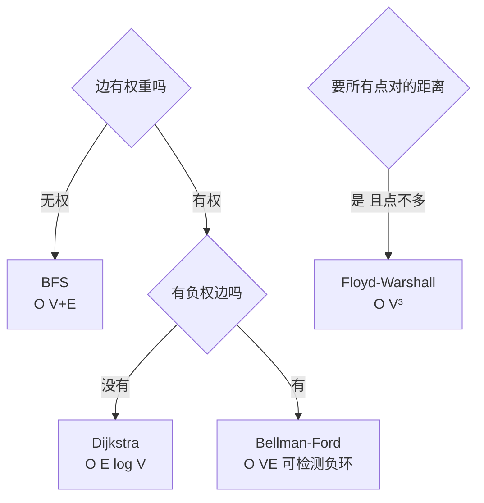

# 最短路径问题总览（BFS / Bellman-Ford / Floyd-Warshall）

> **免责声明**：本文是“河洛序”知识图谱 K2 批次的**初稿**，由 AI 辅助整理，仅供学习参考，不构成任何承诺或保证。版本信息截至 2026-10-14；文中示例已在 Python 3.15.0（数据结构与算法，纯标准库）或 Python 3.13 + 所列库版本（AI/ML 库与数学）下**实际运行**，输出为真实结果，但换机器、换版本时数字（尤其是耗时）会不同。
>
> 标注说明：**【有据可查】** 附官方文档 / 原始出处链接；**【社区共识】** 为业界普遍做法，没有唯一权威出处；**【待考察/推测】** 为未能核实或作者推断，请勿当作定论。

## 一句话定义

最短路径问题是在图中找**两点之间总代价（边权之和）最小的路径**。不同条件（是否有权、是否有负权、单源还是所有点对）对应不同算法。Dijkstra 单独成篇（见 [[k2.algo.dijkstra]]）。

## 为什么重要

- 地图导航、网络路由、物流调度、游戏寻路都要用到。
- 选错算法会**静默地给出错误答案**：有权图用 BFS，或负权图用 Dijkstra。

## 原理 / 图解

所有最短路算法共享一个核心操作——**松弛（relaxation）**：

$$
\text{若 } d[u] + w(u,v) < d[v]，\text{ 则 } d[v] \leftarrow d[u] + w(u,v)
$$



| 算法 | 问题 | 负权 | 复杂度 | 思想 |
|---|---|---|---|---|
| BFS | 单源，无权 | — | $O(V+E)$ | 按层扩展 |
| Dijkstra | 单源，非负权 | 不支持 | $O((V+E)\log V)$ | 贪心 + 优先队列 |
| Bellman-Ford | 单源 | 支持，可判负环 | $O(VE)$ | 对所有边松弛 $V-1$ 轮 |
| Floyd-Warshall | 所有点对 | 支持（无负环） | $O(V^3)$ | 动态规划 |

Floyd-Warshall 的递推（允许经过前 $k$ 个点作中转）是典型的动态规划（见 [[k2.algo.dynamic-programming]]）：

$$
d_k[i][j] = \min\big(d_{k-1}[i][j],\ d_{k-1}[i][k] + d_{k-1}[k][j]\big)
$$

【有据可查】Bellman（1958）、Ford（1956）与 Floyd（1962）算法概述：<https://en.wikipedia.org/wiki/Bellman%E2%80%93Ford_algorithm> 、<https://en.wikipedia.org/wiki/Floyd%E2%80%93Warshall_algorithm>

## 可运行示例

BFS 跳数、含负权边的 Bellman-Ford 与负环检测、Floyd-Warshall 距离矩阵，以及 BFS 在有权图上出错的反例（Python 3.15.0 实际运行）：

```python
# 文件：examples/24_shortest_path.py
# 最短路径问题家族：不同的图用不同算法
from collections import deque
import math

# 1) 无权图：BFS
g = {"A": ["B", "C"], "B": ["D"], "C": ["D"], "D": ["E"], "E": []}
dist, q = {"A": 0}, deque(["A"])
while q:
    u = q.popleft()
    for v in g[u]:
        if v not in dist: dist[v] = dist[u] + 1; q.append(v)
print("无权图 BFS 跳数:", dist)

# 2) 有负权边（无负环）：Bellman-Ford，O(V·E)
edges = [("S", "A", 4), ("S", "B", 5), ("B", "A", -3), ("A", "T", 2)]
V = {"S", "A", "B", "T"}
d = {v: math.inf for v in V}; d["S"] = 0
for _ in range(len(V) - 1):
    for u, v, w in edges:
        if d[u] + w < d[v]: d[v] = d[u] + w
print("Bellman-Ford（含负权）:", dict(sorted(d.items())))
neg_cycle = any(d[u] + w < d[v] for u, v, w in edges)
print("存在负环:", neg_cycle)

# 3) 全源最短路：Floyd-Warshall，O(V^3)
nodes = ["A", "B", "C", "D"]
W = {("A","B"): 3, ("B","C"): 1, ("A","C"): 7, ("C","D"): 2, ("B","D"): 6}
D = {(i, j): 0 if i == j else W.get((i, j), math.inf) for i in nodes for j in nodes}
for k in nodes:
    for i in nodes:
        for j in nodes:
            D[i, j] = min(D[i, j], D[i, k] + D[k, j])
print("Floyd-Warshall 距离矩阵:")
for i in nodes: print("  ", i, [D[i, j] if D[i, j] < math.inf else "∞" for j in nodes])

# 4) 非负权单源：Dijkstra（见下一篇），对比 BFS 在有权图上的错误
wg = {"S": [("A", 1), ("B", 10)], "A": [("C", 1)], "C": [("B", 1)], "B": []}
hops, q = {"S": 0}, deque(["S"])
while q:
    u = q.popleft()
    for v, _ in wg[u]:
        if v not in hops: hops[v] = hops[u] + 1; q.append(v)
print(f"BFS 按跳数选 S→B 直达（{hops['B']} 跳，代价 10）；真实最短是 S→A→C→B（3 跳，代价 1+1+1=3）← 有权图不能用 BFS")
```

输出：

```text
无权图 BFS 跳数: {'A': 0, 'B': 1, 'C': 1, 'D': 2, 'E': 3}
Bellman-Ford（含负权）: {'A': 2, 'B': 5, 'S': 0, 'T': 4}
存在负环: False
Floyd-Warshall 距离矩阵:
   A [0, 3, 4, 6]
   B ['∞', 0, 1, 3]
   C ['∞', '∞', 0, 2]
   D ['∞', '∞', '∞', 0]
BFS 按跳数选 S→B 直达（1 跳，代价 10）；真实最短是 S→A→C→B（3 跳，代价 1+1+1=3）← 有权图不能用 BFS
```

- Bellman-Ford：S→B→A 的代价 5−3=2 比直达 A 的 4 更小，负权边被正确处理。
- 最后一行：BFS 选了“跳数最少”的 S→B（代价 10），真实最短路 S→A→C→B 只需 3。

## 常见误区

- **把“最短”理解为“经过的边最少”**：只有无权图才成立。
- **负环存在时还求最短路**：可以无限绕环让代价趋于负无穷，问题无解；Bellman-Ford 第 $V$ 轮仍能松弛即说明有负环。
- **大图用 Floyd-Warshall**：$O(V^3)$，1 万个点就是 $10^{12}$ 次运算。
- **工程中手写**：生产环境优先用 `scipy.sparse.csgraph` 或 NetworkX。【有据可查】<https://docs.scipy.org/doc/scipy/reference/sparse.csgraph.html>

## 与 AI 开发的关系

- **知识图谱推理**：实体之间的最短关系路径可作为可解释的推理链。
- **强化学习与规划**：值迭代（value iteration）的 Bellman 方程与 Bellman-Ford 的松弛形式相似，都基于“最优子结构”。【社区共识】
- **嵌入空间中的流形距离**：Isomap 降维先建近邻图，再用最短路径近似测地距离。【有据可查】<https://scikit-learn.org/stable/modules/manifold.html#isomap>

## 延伸阅读

- SciPy 图算法：<https://docs.scipy.org/doc/scipy/reference/sparse.csgraph.html>
- NetworkX 最短路径：<https://networkx.org/documentation/stable/reference/algorithms/shortest_paths.html>
- 《算法导论》第 24、25 章。

## 无法核实 / 待考察点

- 【待考察/推测】Bellman-Ford 算法的署名与年份（Shimbel 1955、Ford 1956、Bellman 1958、Moore 1959）在不同资料中说法不一，本文未查原始文献。
