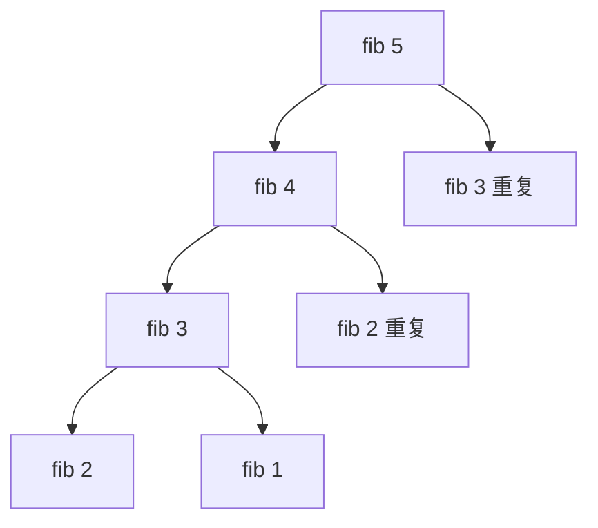

# 动态规划（Dynamic Programming）

> **免责声明**：本文是“河洛序”知识图谱 K2 批次的**初稿**，由 AI 辅助整理，仅供学习参考，不构成任何承诺或保证。版本信息截至 2026-10-14；文中示例已在 Python 3.15.0（数据结构与算法，纯标准库）或 Python 3.13 + 所列库版本（AI/ML 库与数学）下**实际运行**，输出为真实结果，但换机器、换版本时数字（尤其是耗时）会不同。
>
> 标注说明：**【有据可查】** 附官方文档 / 原始出处链接；**【社区共识】** 为业界普遍做法，没有唯一权威出处；**【待考察/推测】** 为未能核实或作者推断，请勿当作定论。

## 一句话定义

动态规划把一个问题拆成**相互重叠的子问题**，每个子问题只算一次并把结果存起来（记忆化或填表），再由小问题的最优解组合出大问题的最优解。

## 为什么重要

- 能把指数级的暴力搜索降到多项式级：朴素递归斐波那契 $O(2^n)$ → DP $O(n)$。
- 文本相似度（编辑距离）、序列比对（DNA）、资源分配（背包）、语音识别与分词（Viterbi）、强化学习（Bellman 方程）都是 DP。

## 原理 / 图解

【有据可查】“动态规划”一词由 Richard Bellman 于 1950 年代提出：<https://en.wikipedia.org/wiki/Dynamic_programming>

适用 DP 的两个条件：**最优子结构**（大问题的最优解由子问题最优解构成）和**重叠子问题**（同一子问题被反复求解）。



朴素递归把 fib(3)、fib(2) 算了多次；记忆化后每个只算一次。

**编辑距离**（把字符串 $a$ 变成 $b$ 的最少插入/删除/替换次数）的状态转移方程：

$$
D[i][j] = \min\begin{cases}
D[i-1][j] + 1 & \text{删除}\\
D[i][j-1] + 1 & \text{插入}\\
D[i-1][j-1] + [a_i \ne b_j] & \text{替换或相同}
\end{cases}
$$

**0/1 背包**（容量 $C$，物品重量 $w_i$、价值 $v_i$）：

$$
\text{best}[c] = \max\big(\text{best}[c],\ \text{best}[c - w_i] + v_i\big)
$$

DP 解题四步：① 定义状态 ② 写转移方程 ③ 确定初始值/边界 ④ 确定计算顺序。

## 可运行示例

斐波那契的朴素递归 vs `functools.cache` 记忆化、编辑距离与 DP 表、“显存背包”选择微调方案、最长公共子序列（Python 3.15.0 实际运行）：

```python
# 文件：examples/26_dynamic_programming.py
# 动态规划：把问题拆成重叠子问题，记住子问题的答案，避免重复计算
from functools import cache
import time

calls = 0
def fib_naive(n):
    global calls; calls += 1
    return n if n < 2 else fib_naive(n - 1) + fib_naive(n - 2)
t0 = time.perf_counter(); fib_naive(27); t_naive = time.perf_counter() - t0
@cache
def fib_memo(n): return n if n < 2 else fib_memo(n - 1) + fib_memo(n - 2)
t0 = time.perf_counter(); fib_memo(27); t_memo = time.perf_counter() - t0
print(f"fib(27): 朴素递归调用 {calls:,} 次 {t_naive*1000:.0f} ms | 记忆化 {fib_memo.cache_info().misses} 次 {t_memo*1e6:.0f} µs")

# 编辑距离（Levenshtein）：拼写纠错、文本相似度、评测 WER/CER 的基础
def edit_distance(a, b):
    dp = [[0] * (len(b) + 1) for _ in range(len(a) + 1)]
    for i in range(len(a) + 1): dp[i][0] = i
    for j in range(len(b) + 1): dp[0][j] = j
    for i in range(1, len(a) + 1):
        for j in range(1, len(b) + 1):
            dp[i][j] = min(dp[i-1][j] + 1,                       # 删除
                           dp[i][j-1] + 1,                       # 插入
                           dp[i-1][j-1] + (a[i-1] != b[j-1]))    # 替换/相同
    return dp
dp = edit_distance("kitten", "sitting")
print("kitten → sitting 编辑距离:", dp[-1][-1])
print("DP 表:\n     " + "  ".join(" sitting"))
for ch, row in zip(" kitten", dp): print(f"  {ch}  " + "  ".join(map(str, row)))

# 0/1 背包：在显存预算内选择收益最大的模块组合
items = [("LoRA-A", 3, 40), ("LoRA-B", 4, 50), ("Adapter", 2, 15), ("Prefix", 5, 60)]   # (名, 显存GB, 收益)
cap = 8
best = [0] * (cap + 1); choice = [[] for _ in range(cap + 1)]
for name, w, v in items:
    for c in range(cap, w - 1, -1):                # 倒序：每件物品只用一次
        if best[c - w] + v > best[c]:
            best[c] = best[c - w] + v; choice[c] = choice[c - w] + [name]
print(f"显存 {cap}GB 内最优组合: {choice[cap]}，总收益 {best[cap]}")

# 最长公共子序列 LCS（diff 工具的核心）
@cache
def lcs(a, b):
    if not a or not b: return ""
    if a[-1] == b[-1]: return lcs(a[:-1], b[:-1]) + a[-1]
    return max(lcs(a[:-1], b), lcs(a, b[:-1]), key=len)
print("LCS('ABCBDAB', 'BDCABA') =", lcs("ABCBDAB", "BDCABA"))
```

输出：

```text
fib(27): 朴素递归调用 635,621 次 26 ms | 记忆化 28 次 13 µs
kitten → sitting 编辑距离: 3
DP 表:
        s  i  t  t  i  n  g
     0  1  2  3  4  5  6  7
  k  1  1  2  3  4  5  6  7
  i  2  2  1  2  3  4  5  6
  t  3  3  2  1  2  3  4  5
  t  4  4  3  2  1  2  3  4
  e  5  5  4  3  2  2  3  4
  n  6  6  5  4  3  3  2  3
显存 8GB 内最优组合: ['LoRA-A', 'Prefix']，总收益 100
LCS('ABCBDAB', 'BDCABA') = BCBA
```

- fib(27)：朴素递归 63 万次调用，记忆化只要 28 次。
- DP 表右下角的 3 就是 kitten → sitting 的编辑距离（k→s 替换、e→i 替换、末尾插入 g）。
- 背包例子的“显存/收益”数字是虚构的，只为演示 DP 如何在约束下选最优组合。

## 常见误区

- **状态定义不清**：DP 最难的一步。先用自然语言写清“`D[i][j]` 表示什么”。
- **记忆化缓存可变参数**：`functools.cache` 要求参数可哈希，传 list 会报错（见 [[k2.ds.hash-table]]）。
- **0/1 背包内层循环方向写错**：一维数组时容量要**从大到小**遍历，否则同一物品会被重复选。
- **以为 DP 一定比贪心好**：DP 正确但可能更慢；问题有贪心选择性质时贪心更简单（见 [[k2.algo.greedy]]）。

## 与 AI 开发的关系

- **文本评估**：编辑距离用于 OCR/ASR 的字错率（CER/WER）计算；LCS 是 ROUGE-L 指标的基础。【有据可查】ROUGE 论文：<https://aclanthology.org/W04-1013/>
- **Viterbi 解码**：HMM/CRF 序列标注（分词、命名实体识别）用 DP 求最优标签序列。【有据可查】<https://en.wikipedia.org/wiki/Viterbi_algorithm>
- **强化学习**：Bellman 方程、值迭代、策略迭代都是 DP 思想。
- **CTC 损失**：语音识别中用前向-后向 DP 对所有对齐路径求和。【有据可查】<https://distill.pub/2017/ctc/>
- **缓存 LLM 子任务结果**：Agent 中对重复子问题缓存结果，本质也是记忆化。

## 延伸阅读

- `functools.cache` / `lru_cache`：<https://docs.python.org/3/library/functools.html#functools.cache>
- 维基百科：动态规划 <https://en.wikipedia.org/wiki/Dynamic_programming>
- 维基百科：编辑距离 <https://en.wikipedia.org/wiki/Levenshtein_distance>

## 无法核实 / 待考察点

- 【待考察/推测】Bellman 自述选用“dynamic programming”一词是为了避开当时官员对“研究”一词的反感，此说法来自其自传，未查原书。
