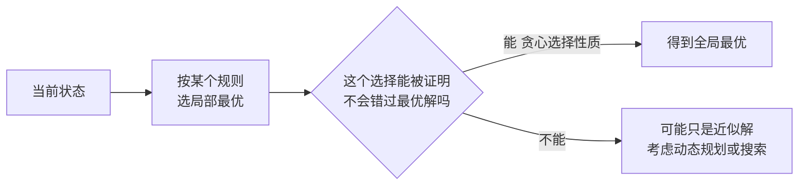

# 贪心算法（Greedy）

> **免责声明**：本文是“河洛序”知识图谱 K2 批次的**初稿**，由 AI 辅助整理，仅供学习参考，不构成任何承诺或保证。版本信息截至 2026-10-14；文中示例已在 Python 3.15.0（数据结构与算法，纯标准库）或 Python 3.13 + 所列库版本（AI/ML 库与数学）下**实际运行**，输出为真实结果，但换机器、换版本时数字（尤其是耗时）会不同。
>
> 标注说明：**【有据可查】** 附官方文档 / 原始出处链接；**【社区共识】** 为业界普遍做法，没有唯一权威出处；**【待考察/推测】** 为未能核实或作者推断，请勿当作定论。

## 一句话定义

贪心算法每一步都做**当前看起来最好**的选择，并且不回头。它简单、快速，但只有在问题满足“贪心选择性质”时才能得到全局最优解。

## 为什么重要

- 很多经典算法本质是贪心：Dijkstra（每次取最近的点）、Huffman 编码、Prim/Kruskal 最小生成树、区间调度。
- **知道贪心何时失效同样重要**：例如 LLM 的贪心解码不一定得到整体概率最高的句子。

## 原理 / 图解



| 问题 | 贪心规则 | 是否最优 |
|---|---|---|
| 区间调度（最多会议） | 按**结束时间**最早选 | 是（可证明） |
| 找零（人民币面额） | 每次取最大面额 | 是（该面额体系下） |
| 找零（面额 1,3,4） | 每次取最大面额 | **否** |
| 哈夫曼编码 | 每次合并频率最小的两个 | 是 |
| LLM 贪心解码 | 每步取概率最大的 token | **否**（序列概率不一定最大） |

【有据可查】Huffman, “A Method for the Construction of Minimum-Redundancy Codes”, *Proceedings of the IRE*, 1952：<https://doi.org/10.1109/JRPROC.1952.273898>

贪心解码失败的原因：序列概率是各步条件概率的乘积，局部最大不等于乘积最大：

$$
P(y_1, y_2) = P(y_1)\,P(y_2 \mid y_1),\qquad 0.6 \times 0.5 = 0.30 \;<\; 0.4 \times 0.9 = 0.36
$$

## 可运行示例

区间调度、两种面额体系下的找零（贪心 vs DP）、哈夫曼编码、贪心解码的反例（Python 3.15.0 实际运行）：

```python
# 文件：examples/27_greedy.py
# 贪心：每一步都选"当前看起来最好"的。对某些问题能得到最优解，对另一些不能
# 1) 活动选择（会议室安排）：按结束时间最早贪心 → 可证明最优
meetings = [("A", 1, 4), ("B", 3, 5), ("C", 0, 6), ("D", 5, 7), ("E", 3, 9), ("F", 5, 9), ("G", 6, 10), ("H", 8, 11)]
chosen, end = [], -1
for name, s, e in sorted(meetings, key=lambda m: m[2]):
    if s >= end: chosen.append(name); end = e
print("最多能安排的会议:", chosen)

# 2) 找零：人民币面额下贪心最优；换一套面额就可能失败
def greedy_change(amount, coins):
    out = []
    for c in sorted(coins, reverse=True):
        while amount >= c: amount -= c; out.append(c)
    return out
def dp_change(amount, coins):
    best = [0] + [None] * amount
    for a in range(1, amount + 1):
        opts = [best[a - c] for c in coins if c <= a and best[a - c] is not None]
        best[a] = min(opts) + 1 if opts else None
    return best[amount]
print("人民币面额 [1,5,10,20,50,100] 凑 88:", greedy_change(88, [1, 5, 10, 20, 50, 100]))
print("面额 [1,3,4] 凑 6：贪心", greedy_change(6, [1, 3, 4]), f"用 {len(greedy_change(6, [1,3,4]))} 枚；动态规划最优只需 {dp_change(6, [1,3,4])} 枚 (3+3)")

# 3) 哈夫曼编码：反复合并频率最小的两个节点 → 最优前缀码（压缩、BPE 的近亲思想）
import heapq
from collections import Counter
text = "abracadabra"
heap = [[f, i, {ch: ""}] for i, (ch, f) in enumerate(Counter(text).items())]
heapq.heapify(heap); uid = len(heap)
while len(heap) > 1:
    f1, _, c1 = heapq.heappop(heap); f2, _, c2 = heapq.heappop(heap)
    merged = {k: "0" + v for k, v in c1.items()} | {k: "1" + v for k, v in c2.items()}
    heapq.heappush(heap, [f1 + f2, uid, merged]); uid += 1
codes = heap[0][2]
bits = sum(len(codes[ch]) for ch in text)
print("哈夫曼编码:", dict(sorted(codes.items())), f"| 共 {bits} bit，定长编码需 {len(text)*3} bit")

# 4) LLM 的贪心解码：每步取概率最大的 token，不一定得到整体概率最大的句子
p = {"": {"我": 0.6, "你": 0.4}, "我": {"们": 0.5, "很": 0.5}, "你": {"好": 0.9, "们": 0.1}}
g1 = max(p[""], key=p[""].get); g2 = max(p[g1], key=p[g1].get)
print(f"贪心解码: {g1+g2} 概率 {p[''][g1]*p[g1][g2]:.2f} | 全局最优: 你好 概率 {0.4*0.9:.2f}")
```

输出：

```text
最多能安排的会议: ['A', 'D', 'H']
人民币面额 [1,5,10,20,50,100] 凑 88: [50, 20, 10, 5, 1, 1, 1]
面额 [1,3,4] 凑 6：贪心 [4, 1, 1] 用 3 枚；动态规划最优只需 2 枚 (3+3)
哈夫曼编码: {'a': '0', 'b': '110', 'c': '100', 'd': '101', 'r': '111'} | 共 23 bit，定长编码需 33 bit
贪心解码: 我们 概率 0.30 | 全局最优: 你好 概率 0.36
```

- 面额 [1,3,4] 凑 6：贪心选 4+1+1（3 枚），最优是 3+3（2 枚）。
- `abracadabra` 用哈夫曼编码只需 23 bit，定长 3 bit 编码需 33 bit。
- 第一步选“我”（0.6）看似更好，但“我们”总概率只有 0.30，不如“你好”的 0.36。

## 常见误区

- **没证明就用贪心**：贪心“看起来对”最容易出错，至少要用反例检验或给出交换论证。
- **区间调度按开始时间或长度排序**：都会出错，正确规则是按结束时间。
- **把贪心和 DP 对立**：许多问题先想 DP，再发现可以简化为贪心；两者都依赖最优子结构。

## 与 AI 开发的关系

- **解码策略**：`do_sample=False` 时是贪心解码（确定、可复现）；束搜索（beam search）是保留多个候选的“宽一点的贪心”；采样（temperature/top-p）引入随机性（见 [[k2.math.probability]]）。【有据可查】<https://huggingface.co/docs/transformers/generation_strategies>
- **BPE 分词训练**：每轮贪心地合并出现次数最多的符号对。【有据可查】Sennrich 等 2016：<https://arxiv.org/abs/1508.07909>
- **特征选择**：前向逐步选择每次加入使指标提升最多的特征（sklearn `SequentialFeatureSelector`）。
- **上下文压缩**：在 token 预算内按“相关度/长度”贪心挑选文档片段，是 RAG 中常见的近似做法。【社区共识】

## 延伸阅读

- 维基百科：贪心算法 <https://en.wikipedia.org/wiki/Greedy_algorithm>
- Hugging Face 生成策略文档：<https://huggingface.co/docs/transformers/generation_strategies>
- 《算法导论》第 16 章“贪心算法”。

## 无法核实 / 待考察点

- 【待考察/推测】“人民币面额下贪心找零总是最优”是基于该面额体系（典范币制）的已知性质，本文仅对示例金额验证，未给出证明。
