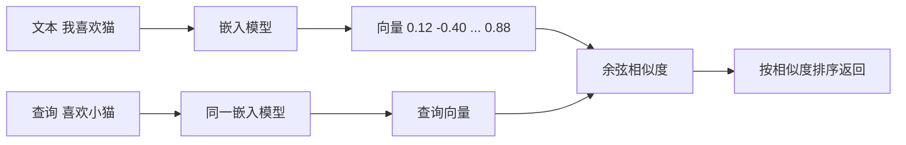

# 向量：范数、点积与余弦相似度

> **免责声明**：本文是“河洛序”知识图谱 K2 批次的**初稿**，由 AI 辅助整理，仅供学习参考，不构成任何承诺或保证。版本信息截至 2026-10-14；文中示例已在 Python 3.15.0（数据结构与算法，纯标准库）或 Python 3.13 + 所列库版本（AI/ML 库与数学）下**实际运行**，输出为真实结果，但换机器、换版本时数字（尤其是耗时）会不同。
>
> 标注说明：**【有据可查】** 附官方文档 / 原始出处链接；**【社区共识】** 为业界普遍做法，没有唯一权威出处；**【待考察/推测】** 为未能核实或作者推断，请勿当作定论。

## 一句话定义

向量是**一组有序的数**，既可以看作空间中的一个点或箭头（有大小和方向），也可以看作一个对象的特征表示。AI 中的“嵌入（embedding）”就是用向量表示词、句子、图片。

## 为什么重要

- **语义搜索 / RAG 的核心**：把文本变成向量，用余弦相似度找“意思相近”的内容。
- 范数是正则化（见 [[k2.math.regularization]]）和归一化（见 [[k2.math.normalization]]）的基础。
- 点积是注意力机制里“查询与键有多匹配”的计算方式。

## 原理 / 图解

| 概念 | 公式 | 直觉 |
|---|---|---|
| L2 范数（长度） | $\lVert \mathbf{a} \rVert_2 = \sqrt{\sum_i a_i^2}$ | 箭头有多长 |
| L1 范数 | $\lVert \mathbf{a} \rVert_1 = \sum_i \lvert a_i \rvert$ | 城市街区距离 |
| 点积 | $\mathbf{a}\cdot\mathbf{b} = \sum_i a_i b_i$ | 方向一致程度 × 长度 |

点积的几何意义与余弦相似度：

$$
\mathbf{a}\cdot\mathbf{b} = \lVert \mathbf{a} \rVert\,\lVert \mathbf{b} \rVert \cos\theta
\quad\Rightarrow\quad
\cos\theta = \frac{\mathbf{a}\cdot\mathbf{b}}{\lVert \mathbf{a} \rVert\,\lVert \mathbf{b} \rVert} \in [-1, 1]
$$

$\mathbf{b}$ 在 $\mathbf{a}$ 方向上的投影：

$$
\text{proj}_{\mathbf{a}}\mathbf{b} = \frac{\mathbf{a}\cdot\mathbf{b}}{\mathbf{a}\cdot\mathbf{a}}\,\mathbf{a}
$$



## 可运行示例

用 NumPy 验证范数、点积、余弦、正交、投影；用玩具词向量演示 king − man + woman ≈ queen；观察高维随机向量“几乎都正交”（Python 3.13 + numpy 实际运行）：

```python
# 文件：examples/29_vector.py
# 向量：有大小和方向的量；在 AI 中，一切（词、图片、用户）都被表示成向量
import numpy as np
np.set_printoptions(precision=4, suppress=True)
a, b = np.array([3., 4.]), np.array([4., 3.])

print("加法 a+b =", a + b, "| 数乘 2a =", 2 * a)
print("L2 范数 ||a|| =", np.linalg.norm(a), "= sqrt(3²+4²)")
print("L1 范数 =", np.linalg.norm(a, 1), "| 无穷范数 =", np.linalg.norm(a, np.inf))

dot = a @ b
cos = dot / (np.linalg.norm(a) * np.linalg.norm(b))
print(f"点积 a·b = {dot} = 3*4+4*3 | 余弦相似度 = {cos:.4f} | 夹角 = {np.degrees(np.arccos(cos)):.2f}°")
print("正交向量点积:", np.array([1., 0.]) @ np.array([0., 5.]))

# 投影：b 在 a 方向上的分量
proj = (a @ b) / (a @ a) * a
print("b 在 a 上的投影:", proj, "| 残差与 a 正交:", np.isclose((b - proj) @ a, 0))

# 单位向量化后，点积 = 余弦相似度（向量检索的常用技巧）
na, nb = a / np.linalg.norm(a), b / np.linalg.norm(b)
print("单位化后点积:", round(na @ nb, 4), "== 余弦:", np.isclose(na @ nb, cos))

# 词向量类比的玩具示例：king - man + woman ≈ queen
E = {"king": np.array([0.9, 0.8, 0.1]), "queen": np.array([0.9, 0.1, 0.8]),
     "man": np.array([0.1, 0.9, 0.1]), "woman": np.array([0.1, 0.1, 0.9]), "apple": np.array([0.5, 0.5, 0.5])}
q = E["king"] - E["man"] + E["woman"]
best = max((w for w in E if w not in ("king", "man", "woman")),
           key=lambda w: E[w] @ q / np.linalg.norm(E[w]) / np.linalg.norm(q))
print("king - man + woman 最接近:", best)

# 高维诅咒：随机高维向量几乎两两正交
rng = np.random.default_rng(0)
for d in [2, 100, 4096]:
    V = rng.normal(size=(200, d)); V /= np.linalg.norm(V, axis=1, keepdims=True)
    c = V @ V.T; off = c[~np.eye(200, dtype=bool)]
    print(f"维度 {d:>4}: 随机向量两两余弦的平均绝对值 {np.abs(off).mean():.3f}")
```

输出：

```text
加法 a+b = [7. 7.] | 数乘 2a = [6. 8.]
L2 范数 ||a|| = 5.0 = sqrt(3²+4²)
L1 范数 = 7.0 | 无穷范数 = 4.0
点积 a·b = 24.0 = 3*4+4*3 | 余弦相似度 = 0.9600 | 夹角 = 16.26°
正交向量点积: 0.0
b 在 a 上的投影: [2.88 3.84] | 残差与 a 正交: True
单位化后点积: 0.96 == 余弦: True
king - man + woman 最接近: queen
维度    2: 随机向量两两余弦的平均绝对值 0.635
维度  100: 随机向量两两余弦的平均绝对值 0.079
维度 4096: 随机向量两两余弦的平均绝对值 0.012
```

- $\mathbf{a}=(3,4)$ 的长度为 5，余弦 0.96 对应夹角约 16°。
- 词向量类比使用的是**手工构造的玩具向量**，只演示运算方式；真实嵌入中类比关系是否成立因模型而异。
- 维度从 2 升到 4096，随机向量之间的平均 |余弦| 从 0.64 降到 0.012：高维空间中随机方向几乎都互相正交，这也是为什么相似度阈值不能跨模型照搬。

## 常见误区

- **用欧氏距离比较未归一化的嵌入**：长度差异会干扰语义比较；单位化后欧氏距离与余弦等价（$\lVert \hat a - \hat b \rVert^2 = 2 - 2\cos\theta$）。
- **余弦为负就是“意思相反”**：不一定，很多嵌入模型的余弦集中在一个较窄的正区间。【社区共识】
- **不同模型的向量混用**：不同嵌入模型的向量空间不可比较。
- **把余弦相似度阈值（如 0.8）当通用标准**：要在自己的数据上标定。

## 与 AI 开发的关系

- **RAG 检索**：向量数据库按余弦或点积返回 Top-k 文档（见 [[k2.ds.heap]]）。
- **注意力分数**：$\mathbf{q}\cdot\mathbf{k}/\sqrt{d}$，除以 $\sqrt{d}$ 是为了抵消高维点积方差随维度增大。【有据可查】<https://arxiv.org/abs/1706.03762>
- **词向量**：word2vec 类比现象的原始论文：<https://arxiv.org/abs/1301.3781>

## 延伸阅读

- 3Blue1Brown：向量是什么 <https://www.3blue1brown.com/lessons/vectors>
- Sentence Transformers 语义搜索文档：<https://sbert.net/examples/sentence_transformer/applications/semantic-search/README.html>
- word2vec 论文：<https://arxiv.org/abs/1301.3781>

## 无法核实 / 待考察点

- 【待考察/推测】“很多嵌入模型的余弦相似度集中在窄的正区间（各向异性）”为社区与部分论文的观察，不同模型差异大。
