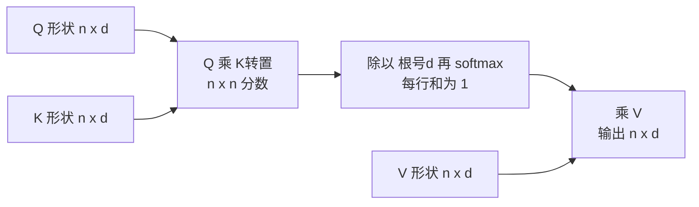

# 矩阵与矩阵运算

> **免责声明**：本文是“河洛序”知识图谱 K2 批次的**初稿**，由 AI 辅助整理，仅供学习参考，不构成任何承诺或保证。版本信息截至 2026-10-14；文中示例已在 Python 3.15.0（数据结构与算法，纯标准库）或 Python 3.13 + 所列库版本（AI/ML 库与数学）下**实际运行**，输出为真实结果，但换机器、换版本时数字（尤其是耗时）会不同。
>
> 标注说明：**【有据可查】** 附官方文档 / 原始出处链接；**【社区共识】** 为业界普遍做法，没有唯一权威出处；**【待考察/推测】** 为未能核实或作者推断，请勿当作定论。

## 一句话定义

矩阵是**按行和列排列的数表**，可以表示一批数据（每行一个样本），也可以表示一个线性变换。矩阵乘法是神经网络里最核心、最耗算力的运算。

## 为什么重要

- 神经网络一层的前向计算是 $XW$；一批 32 个样本 × 768 维输入 × 3072 维输出，就是 7500 万次乘法。
- 自注意力是三次矩阵乘法加一次 softmax。
- LoRA 用两个小矩阵的乘积近似大矩阵的变化（见 [[k2.ml.peft]]）。

## 原理 / 图解

矩阵乘法 $C = AB$（$A$ 为 $m\times n$，$B$ 为 $n\times p$）：

$$
C_{ij} = \sum_{k=1}^{n} A_{ik} B_{kj},\qquad C \in \mathbb{R}^{m\times p}
$$

计算量约 $m \cdot n \cdot p$ 次乘法。重要性质：

$$
AB \ne BA,\qquad (AB)^\top = B^\top A^\top,\qquad A A^{-1} = I,\qquad \operatorname{tr}(A)=\sum_i A_{ii}
$$

缩放点积注意力：

$$
\operatorname{Attention}(Q,K,V) = \operatorname{softmax}\!\left(\frac{QK^\top}{\sqrt{d_k}}\right) V
$$



| 运算 | NumPy / PyTorch | 注意 |
|---|---|---|
| 矩阵乘法 | `A @ B` | 内维必须相等 |
| 逐元素乘 | `A * B` | 形状相同或可广播 |
| 转置 | `A.T` | 高维张量用 `swapaxes`/`transpose` |
| 逆 | `np.linalg.inv(A)` | 只对方阵且可逆 |

【有据可查】Attention 公式出自 Vaswani 等 2017：<https://arxiv.org/abs/1706.03762>

## 可运行示例

用 NumPy 验证不可交换、逐元素乘与矩阵乘的区别、转置性质、逆矩阵、迹与行列式、批量线性层的形状和计算量、注意力权重每行和为 1、低秩分解的参数量（Python 3.13 + numpy 实际运行）：

```python
# 文件：examples/30_matrix.py
# 矩阵：数字的二维表格，也是"线性变换"。AI 中的权重、注意力分数、图片都是矩阵
import numpy as np
np.set_printoptions(precision=3, suppress=True)
A = np.array([[1., 2.], [3., 4.]]); B = np.array([[0., 1.], [1., 0.]])

print("A @ B =\n", A @ B, "\nB @ A =\n", B @ A, "\n→ 矩阵乘法不满足交换律")
print("逐元素乘 A * B =\n", A * B)
print("转置 Aᵀ =\n", A.T, "\n(AB)ᵀ == BᵀAᵀ:", np.allclose((A @ B).T, B.T @ A.T))

Ainv = np.linalg.inv(A)
print("逆矩阵 A⁻¹ =\n", Ainv, "\nA @ A⁻¹ == I:", np.allclose(A @ Ainv, np.eye(2)))
print("迹 tr(A) =", np.trace(A), "| 行列式 det(A) =", round(np.linalg.det(A), 3))

# 形状规则：(m,k) @ (k,n) -> (m,n)
X = np.ones((32, 768)); W = np.ones((768, 3072))
print("批量 (32,768) @ (768,3072) ->", (X @ W).shape)
print("乘法次数 ≈ 32*768*3072 =", f"{32*768*3072:,}")

# 注意力分数：Q Kᵀ / sqrt(d)，再按行 softmax
rng = np.random.default_rng(0)
L, d = 4, 8
Q, K, V = (rng.normal(size=(L, d)) for _ in range(3))
S = Q @ K.T / np.sqrt(d)
P = np.exp(S - S.max(axis=1, keepdims=True)); P /= P.sum(axis=1, keepdims=True)
print("注意力权重矩阵 (每行和为 1):\n", P, "\n行和:", P.sum(axis=1))
print("输出 = P @ V 形状:", (P @ V).shape)

# 低秩近似：LoRA 的数学基础 —— 用 (d,r)@(r,d) 代替 (d,d)
d, r = 1024, 8
print(f"全量矩阵参数 {d*d:,} | 秩 {r} 分解参数 {2*d*r:,}（{2*d*r/(d*d):.2%}）")
```

输出：

```text
A @ B =
 [[2. 1.]
 [4. 3.]] 
B @ A =
 [[3. 4.]
 [1. 2.]] 
→ 矩阵乘法不满足交换律
逐元素乘 A * B =
 [[0. 2.]
 [3. 0.]]
转置 Aᵀ =
 [[1. 3.]
 [2. 4.]] 
(AB)ᵀ == BᵀAᵀ: True
逆矩阵 A⁻¹ =
 [[-2.   1. ]
 [ 1.5 -0.5]] 
A @ A⁻¹ == I: True
迹 tr(A) = 5.0 | 行列式 det(A) = -2.0
批量 (32,768) @ (768,3072) -> (32, 3072)
乘法次数 ≈ 32*768*3072 = 75,497,472
注意力权重矩阵 (每行和为 1):
 [[0.302 0.472 0.081 0.145]
 [0.329 0.069 0.247 0.354]
 [0.32  0.388 0.233 0.059]
 [0.102 0.031 0.684 0.183]] 
行和: [1. 1. 1. 1.]
输出 = P @ V 形状: (4, 8)
全量矩阵参数 1,048,576 | 秩 8 分解参数 16,384（1.56%）
```

1024×1024 的矩阵有 104.9 万个参数，用秩 8 的 $BA$ 表示只要 16,384 个（1.56%）——这正是 LoRA 省参数的来源。

## 常见误区

- **形状对不上**：`(32,768) @ (3072,768)` 报错，要转置成 `(768,3072)`。调试时先打印 `.shape`。
- **`*` 和 `@` 混用**：广播会让错误的逐元素乘“静默成功”，结果完全错误。
- **随手求逆**：大多数场景不需要显式求逆，解方程用 `solve`。
- **忽略内存布局**：转置后的张量在 PyTorch 中可能不连续，`view` 会报错，需 `.contiguous()` 或 `reshape`。

## 与 AI 开发的关系

- **算力估算**：Transformer 训练 FLOPs 的常用估算约为 $6 \times \text{参数量} \times \text{token 数}$，来源于前向和反向中的矩阵乘法。【有据可查】Kaplan 等 2020 Scaling Laws：<https://arxiv.org/abs/2001.08361>
- **量化**：把矩阵元素从 16 位压到 8/4 位以减少显存和带宽。
- **批处理**：把多个样本堆成矩阵一起算，比逐个算快得多（GPU 并行）。

## 延伸阅读

- 3Blue1Brown：矩阵乘法与线性变换的复合 <https://www.3blue1brown.com/lessons/matrix-multiplication>
- 《动手学深度学习》注意力机制：<https://zh.d2l.ai/chapter_attention-mechanisms/index.html>
- NumPy 广播规则：<https://numpy.org/doc/stable/user/basics.broadcasting.html>

## 无法核实 / 待考察点

- 【待考察/推测】“6 × 参数量 × token 数”是忽略注意力项等细节的近似，长上下文时偏差会变大。
