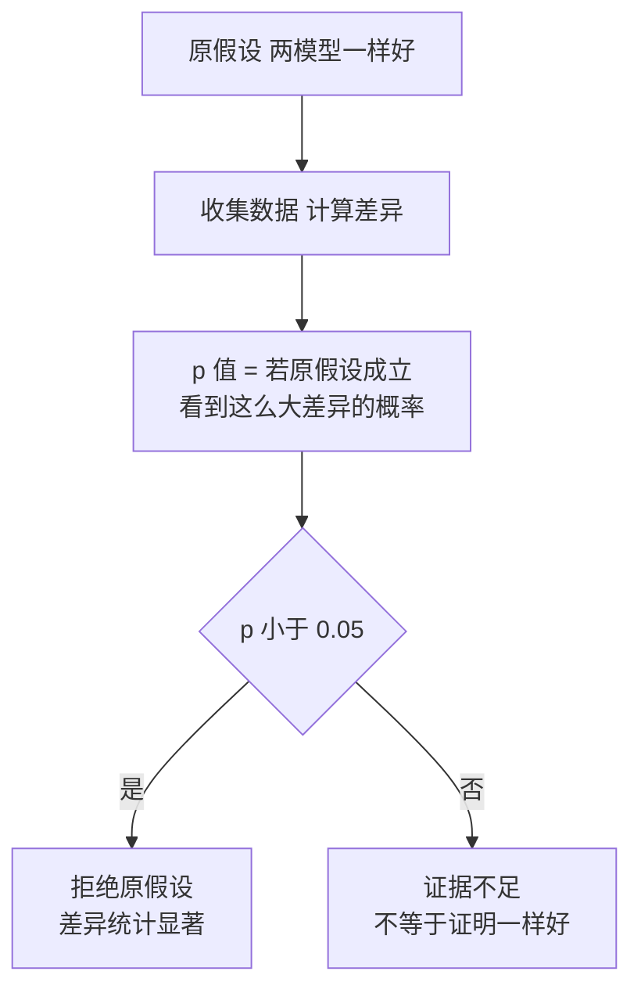

# 统计学：描述统计、置信区间与假设检验

> **免责声明**：本文是“河洛序”知识图谱 K2 批次的**初稿**，由 AI 辅助整理，仅供学习参考，不构成任何承诺或保证。版本信息截至 2026-10-14；文中示例已在 Python 3.15.0（数据结构与算法，纯标准库）或 Python 3.13 + 所列库版本（AI/ML 库与数学）下**实际运行**，输出为真实结果，但换机器、换版本时数字（尤其是耗时）会不同。
>
> 标注说明：**【有据可查】** 附官方文档 / 原始出处链接；**【社区共识】** 为业界普遍做法，没有唯一权威出处；**【待考察/推测】** 为未能核实或作者推断，请勿当作定论。

## 一句话定义

统计学研究**如何从有限的样本数据中总结规律并对总体做出推断**，同时量化这种推断有多不确定。

## 为什么重要

- **判断“模型 A 是否真的比 B 好”**：在 200 道题上高 7.5 个百分点，可能只是运气。
- **监控线上服务**：延迟要看 P90/P99，而不是平均值。
- **数据探索**：均值、方差、相关系数是理解数据集的第一步（配合 [[k1.lib.pandas]]）。

## 原理 / 图解

| 指标 | 公式 / 含义 | 特点 |
|---|---|---|
| 均值 | $\bar x = \frac{1}{n}\sum x_i$ | 受极端值影响大 |
| 中位数 | 排序后中间的值 | 稳健 |
| 标准差 | $s = \sqrt{\frac{1}{n-1}\sum (x_i-\bar x)^2}$ | 离散程度 |
| 分位数 P90/P99 | 90%/99% 的数据不超过它 | 看长尾 |

**中心极限定理（CLT）**：样本均值的分布近似正态，标准误为

$$
\operatorname{SE}(\bar x) = \frac{\sigma}{\sqrt{n}}
$$

由此得到均值差的 95% 置信区间（近似）：

$$
(\hat p_A - \hat p_B) \pm 1.96 \sqrt{\frac{\hat p_A(1-\hat p_A)}{n_A} + \frac{\hat p_B(1-\hat p_B)}{n_B}}
$$



【有据可查】`scipy.stats` 文档：<https://docs.scipy.org/doc/scipy/reference/stats.html> ；美国统计协会关于 p 值的声明（2016）：<https://doi.org/10.1080/00031305.2016.1154108>

## 可运行示例

模拟 API 延迟的描述统计与分位数、验证 CLT 的标准误、两个模型准确率的置信区间 / t 检验 / bootstrap、一个异常点对相关系数的影响（Python 3.13 + numpy + scipy 实际运行）：

```python
# 文件：examples/33_statistics.py
# 统计学：从样本推断总体。描述统计 + 推断统计（置信区间、假设检验）
import numpy as np
from scipy import stats
rng = np.random.default_rng(0)

latency = rng.lognormal(mean=0, sigma=0.6, size=1000) * 800    # 模拟 API 延迟(ms)，右偏
print(f"均值 {latency.mean():.0f} ms | 中位数 {np.median(latency):.0f} ms | 标准差 {latency.std(ddof=1):.0f}")
print(f"P90 {np.percentile(latency, 90):.0f} ms | P99 {np.percentile(latency, 99):.0f} ms  ← 偏态数据看分位数比看均值更有意义")

# 中心极限定理：样本均值的分布接近正态，标准误 = σ/√n
means = rng.lognormal(0, 0.6, (10_000, 50)).mean(axis=1)
print(f"50 个样本均值的标准差 实测 {means.std():.4f} | 理论 σ/√n = {np.sqrt((np.exp(0.36)-1)*np.exp(0.36))/np.sqrt(50):.4f}")

# 两个模型在 200 道题上的准确率：差异显著吗？
n = 200
a = rng.random(n) < 0.78     # 模型 A 真实准确率 78%
b = rng.random(n) < 0.72
pa, pb = a.mean(), b.mean()
se = np.sqrt(pa*(1-pa)/n + pb*(1-pb)/n)
print(f"\n模型A {pa:.3f} vs 模型B {pb:.3f}，差 {pa-pb:.3f}，95% CI [{pa-pb-1.96*se:.3f}, {pa-pb+1.96*se:.3f}]")
t, pval = stats.ttest_ind(a.astype(float), b.astype(float))
print(f"t 检验 p 值 = {pval:.3f} → {'显著' if pval < 0.05 else '在 0.05 水平下不显著'}")

# 自助法 bootstrap 求置信区间（不依赖分布假设）
boots = [rng.choice(a, n).mean() - rng.choice(b, n).mean() for _ in range(5000)]
print(f"bootstrap 95% CI [{np.percentile(boots, 2.5):.3f}, {np.percentile(boots, 97.5):.3f}]")

# 相关 ≠ 因果；以及皮尔逊相关对异常值敏感
x = rng.normal(size=100); y = 0.5 * x + rng.normal(size=100)
print(f"\n皮尔逊 r = {stats.pearsonr(x, y)[0]:.3f} | 斯皮尔曼 ρ = {stats.spearmanr(x, y)[0]:.3f}")
x2, y2 = np.append(x, 20), np.append(y, -20)
print(f"加入一个异常点后：皮尔逊 r = {stats.pearsonr(x2, y2)[0]:.3f} | 斯皮尔曼 ρ = {stats.spearmanr(x2, y2)[0]:.3f}")
```

输出：

```text
均值 921 ms | 中位数 765 ms | 标准差 581
P90 1673 ms | P99 3045 ms  ← 偏态数据看分位数比看均值更有意义
50 个样本均值的标准差 实测 0.1116 | 理论 σ/√n = 0.1115

模型A 0.780 vs 模型B 0.705，差 0.075，95% CI [-0.010, 0.160]
t 检验 p 值 = 0.087 → 在 0.05 水平下不显著
bootstrap 95% CI [-0.005, 0.160]

皮尔逊 r = 0.428 | 斯皮尔曼 ρ = 0.421
加入一个异常点后：皮尔逊 r = -0.709 | 斯皮尔曼 ρ = 0.380
```

- 延迟数据右偏：均值 921ms 大于中位数 765ms，P99 达 3 秒。
- 样本均值标准差实测 0.1116，与理论 $\sigma/\sqrt n$ = 0.1115 几乎一致。
- 模型 A 比 B 高 7.5 个百分点，但置信区间包含 0、p=0.087：**不能断言 A 更好**，需要更多测试题。
- 加入一个异常点，皮尔逊相关从 0.43 变成 −0.71，斯皮尔曼（基于排名）几乎不变。

## 常见误区

- **p 值是“原假设为真的概率”**：不是。它是在原假设成立的前提下观察到这么极端数据的概率。
- **不显著 = 没差异**：只是证据不足。
- **多次比较不校正**：同时比较 20 组，偶然出现一个 p<0.05 很正常（需 Bonferroni 等校正）。
- **只报均值不报分布**：偏态数据报中位数和分位数。
- **相关即因果**：相关系数只说明线性（皮尔逊）或单调（斯皮尔曼）关系。

## 与 AI 开发的关系

- **模型评测**：基准分数应带置信区间；小测试集上的排行榜差异常常不显著。【有据可查】Anthropic《Adding Error Bars to Evals》：<https://arxiv.org/abs/2411.00640>
- **线上监控**：LLM 服务的首 token 延迟、总延迟看 P50/P95/P99。
- **数据质量**：用分位数和 z-score 发现异常样本（见 [[k2.math.normalization]]）。
- **A/B 实验**：提示词或模型版本上线前，用统计检验判断改进是否真实。

## 延伸阅读

- `scipy.stats`：<https://docs.scipy.org/doc/scipy/reference/stats.html>
- 《Adding Error Bars to Evals》：<https://arxiv.org/abs/2411.00640>
- Seeing Theory：<https://seeing-theory.brown.edu/>

## 无法核实 / 待考察点

- 【待考察/推测】示例中两个模型的答题结果是**独立模拟**的，所以用了独立样本 t 检验（把 0/1 当连续变量是常见近似）。真实评测中两个模型做的是同一套题，《Adding Error Bars to Evals》建议用**逐题配对差**计算标准误（【有据可查】<https://arxiv.org/abs/2411.00640> 第 4.2 节），本文未演示配对版本。
