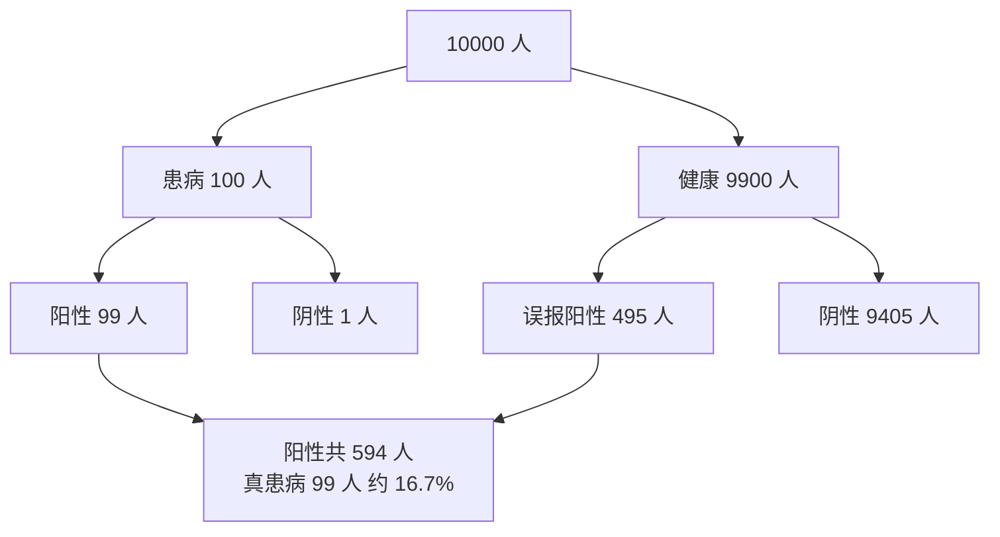

# 贝叶斯定理与贝叶斯推断

> **免责声明**：本文是“河洛序”知识图谱 K2 批次的**初稿**，由 AI 辅助整理，仅供学习参考，不构成任何承诺或保证。版本信息截至 2026-10-14；文中示例已在 Python 3.15.0（数据结构与算法，纯标准库）或 Python 3.13 + 所列库版本（AI/ML 库与数学）下**实际运行**，输出为真实结果，但换机器、换版本时数字（尤其是耗时）会不同。
>
> 标注说明：**【有据可查】** 附官方文档 / 原始出处链接；**【社区共识】** 为业界普遍做法，没有唯一权威出处；**【待考察/推测】** 为未能核实或作者推断，请勿当作定论。

## 一句话定义

贝叶斯定理告诉我们**如何用新证据更新原有的信念**：后验 ∝ 似然 × 先验。

$$
P(H\mid E) = \frac{P(E\mid H)\,P(H)}{P(E)},\qquad P(E) = \sum_h P(E\mid h)P(h)
$$

## 为什么重要

- 纠正“基础比率谬误”：检测准确率 99%，阳性也不代表 99% 患病。
- 朴素贝叶斯分类器、贝叶斯优化（调超参）、贝叶斯 A/B 测试都以此为基础。
- 正则化可以理解为给参数加了先验（见 [[k2.math.regularization]]）。

## 原理 / 图解

疾病检测例子：患病率 1%，灵敏度 99%，误报率 5%。设想 10000 人：



$$
P(\text{病}\mid +) = \frac{0.99 \times 0.01}{0.99\times 0.01 + 0.05 \times 0.99} = \frac{0.0099}{0.0594} \approx 0.1667
$$

**序贯更新**：第一次的后验成为第二次的先验，再阳性一次，概率升到约 0.80。

**Beta-二项共轭**：点击率先验 $\text{Beta}(\alpha,\beta)$，观察到 $k$ 次点击 / $n$ 次展示后：

$$
\text{后验} = \text{Beta}(\alpha + k,\ \beta + n - k)
$$

【有据可查】贝叶斯定理概述：<https://en.wikipedia.org/wiki/Bayes%27_theorem> ；sklearn 朴素贝叶斯：<https://scikit-learn.org/stable/modules/naive_bayes.html>

## 可运行示例

公式计算与 200 万人模拟验证检测例子、序贯更新、手写朴素贝叶斯垃圾邮件分类（对数概率 + 拉普拉斯平滑）、Beta 后验可信区间随数据量收窄（Python 3.13 + numpy + scipy 实际运行）：

```python
# 文件：examples/34_bayes.py
# 贝叶斯定理：P(H|E) = P(E|H) P(H) / P(E) —— 用证据更新信念
import numpy as np
rng = np.random.default_rng(0)

# 经典例子：疾病检测。患病率 1%，检测灵敏度 99%，误报率 5%
prior, sens, fpr = 0.01, 0.99, 0.05
p_pos = sens * prior + fpr * (1 - prior)
posterior = sens * prior / p_pos
print(f"检测阳性后真正患病的概率（公式）= {posterior:.4f}")
N = 2_000_000
sick = rng.random(N) < prior
pos = np.where(sick, rng.random(N) < sens, rng.random(N) < fpr)
print(f"模拟 {N:,} 人验证 = {sick[pos].mean():.4f}  ← 远低于直觉的 99%（基础比率谬误）")
p2 = sens * posterior / (sens * posterior + fpr * (1 - posterior))
print(f"再测一次仍阳性 → {p2:.4f}（上一次的后验成为这一次的先验）")

# 朴素贝叶斯垃圾邮件分类（拉普拉斯平滑）
train = [("免费 领取 红包", 1), ("点击 免费 中奖", 1), ("明天 开会 讨论", 0), ("项目 进度 讨论", 0), ("红包 明天 发", 0)]
vocab = sorted({w for t, _ in train for w in t.split()})
counts = {c: np.ones(len(vocab)) for c in (0, 1)}
priors = {c: np.mean([y == c for _, y in train]) for c in (0, 1)}
for t, y in train:
    for w in t.split(): counts[y][vocab.index(w)] += 1
def predict(text):
    scores = {}
    for c in (0, 1):
        lik = counts[c] / counts[c].sum()
        scores[c] = np.log(priors[c]) + sum(np.log(lik[vocab.index(w)]) for w in text.split() if w in vocab)
    m = max(scores.values()); ps = {c: np.exp(s - m) for c, s in scores.items()}; z = sum(ps.values())
    return {("垃圾" if c else "正常"): round(float(p / z), 3) for c, p in ps.items()}
for msg in ["免费 红包", "明天 讨论 项目", "红包 讨论"]:
    print(f"'{msg}' →", predict(msg))

# Beta-二项共轭：用点击数据更新对点击率的信念
from scipy import stats
a, b = 1, 1                          # 均匀先验
for clicks, views in [(3, 10), (30, 100), (300, 1000)]:
    post = stats.beta(a + clicks, b + views - clicks)
    lo, hi = post.ppf([0.025, 0.975])
    print(f"观察 {clicks}/{views}: 后验均值 {post.mean():.3f}, 95% 可信区间 [{lo:.3f}, {hi:.3f}]  ← 数据越多越确定")
```

输出：

```text
检测阳性后真正患病的概率（公式）= 0.1667
模拟 2,000,000 人验证 = 0.1656  ← 远低于直觉的 99%（基础比率谬误）
再测一次仍阳性 → 0.7984（上一次的后验成为这一次的先验）
'免费 红包' → {'正常': 0.265, '垃圾': 0.735}
'明天 讨论 项目' → {'正常': 0.943, '垃圾': 0.057}
'红包 讨论' → {'正常': 0.765, '垃圾': 0.235}
观察 3/10: 后验均值 0.333, 95% 可信区间 [0.109, 0.610]  ← 数据越多越确定
观察 30/100: 后验均值 0.304, 95% 可信区间 [0.219, 0.396]  ← 数据越多越确定
观察 300/1000: 后验均值 0.300, 95% 可信区间 [0.272, 0.329]  ← 数据越多越确定
```

- 公式 0.1667，模拟 0.1656，一致。
- 观察 3/10 时，95% 可信区间为 [0.11, 0.61]，很宽；到 300/1000 时收窄到 [0.27, 0.33]。

## 常见误区

- **忽略先验（基础比率）**：罕见事件即使检测很准，阳性中也可能大部分是误报。
- **朴素贝叶斯的“朴素”被当真**：它假设特征条件独立，现实中几乎不成立，但分类效果常常仍然可用。
- **概率连乘不取对数**：很多小概率相乘会下溢为 0，要在对数空间求和。
- **未见过的词概率为 0**：需要拉普拉斯平滑。
- **把可信区间与置信区间混为一谈**：贝叶斯可信区间可以直接解释为“参数落在此区间的概率为 95%”，频率学派置信区间不能这样解释。

## 与 AI 开发的关系

- **垃圾信息与文本分类基线**：朴素贝叶斯训练极快，适合作为基线（见 [[k2.ml.sklearn]]）。
- **贝叶斯优化**：用高斯过程等代理模型选择下一个要尝试的超参数。【有据可查】Optuna 等工具文档中的 TPE 采样器：<https://optuna.readthedocs.io/en/stable/reference/samplers/generated/optuna.samplers.TPESampler.html>
- **不确定性**：在 Agent 决策中，把“模型说了什么”当作证据而非结论，结合先验判断可信度。【社区共识】
- **正则化 = 先验**：L2 正则对应高斯先验，L1 对应拉普拉斯先验（MAP 估计）。

## 延伸阅读

- 3Blue1Brown：贝叶斯定理 <https://www.3blue1brown.com/lessons/bayes-theorem>
- sklearn 朴素贝叶斯：<https://scikit-learn.org/stable/modules/naive_bayes.html>
- 《Think Bayes》（免费在线）：<https://allendowney.github.io/ThinkBayes2/>

## 无法核实 / 待考察点

- 【待考察/推测】示例的检测参数（1%、99%、5%）是教学用的假设数字，不对应任何真实检测。
