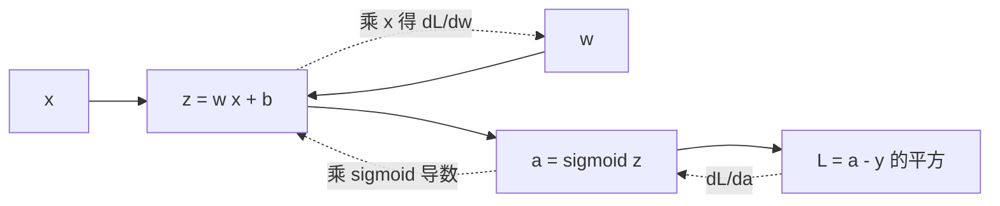

# 梯度与反向传播

> **免责声明**：本文是“河洛序”知识图谱 K2 批次的**初稿**，由 AI 辅助整理，仅供学习参考，不构成任何承诺或保证。版本信息截至 2026-10-14；文中示例已在 Python 3.15.0（数据结构与算法，纯标准库）或 Python 3.13 + 所列库版本（AI/ML 库与数学）下**实际运行**，输出为真实结果，但换机器、换版本时数字（尤其是耗时）会不同。
>
> 标注说明：**【有据可查】** 附官方文档 / 原始出处链接；**【社区共识】** 为业界普遍做法，没有唯一权威出处；**【待考察/推测】** 为未能核实或作者推断，请勿当作定论。

## 一句话定义

梯度是多元函数对每个变量的**偏导数组成的向量**，指向函数值**增长最快**的方向；它的反方向就是下降最快的方向。神经网络训练就是反复“算梯度 → 沿负梯度走一小步”。

## 为什么重要

- **所有深度学习训练的核心**：`loss.backward()` 算的就是损失对每个参数的梯度（见 [[k2.ml.pytorch]]）。
- 理解梯度才能理解学习率、梯度消失/爆炸、梯度裁剪等训练问题。

## 原理 / 图解

对 $f(x,y) = x^2 + 3y^2 + 2xy$：

$$
\nabla f = \begin{bmatrix} \dfrac{\partial f}{\partial x} \\[2mm] \dfrac{\partial f}{\partial y} \end{bmatrix}
= \begin{bmatrix} 2x + 2y \\ 6y + 2x \end{bmatrix},\qquad \nabla f(1,2) = \begin{bmatrix} 6 \\ 14 \end{bmatrix}
$$

沿单位方向 $\mathbf{u}$ 的变化率（方向导数）是 $\nabla f \cdot \mathbf{u}$，当 $\mathbf{u}$ 与梯度同向时最大。梯度下降的更新规则：

$$
\boldsymbol{\theta} \leftarrow \boldsymbol{\theta} - \eta\, \nabla_{\boldsymbol{\theta}} L
$$

**反向传播**是对计算图高效地应用链式法则：从损失出发，把“上游梯度 × 本地导数”逐层传回去。



$$
\frac{\partial L}{\partial w} = \underbrace{2(a-y)}_{\partial L/\partial a}\cdot \underbrace{\sigma(z)(1-\sigma(z))}_{\partial a/\partial z} \cdot \underbrace{x}_{\partial z/\partial w}
$$

【有据可查】反向传播经典论文：Rumelhart, Hinton & Williams, *Nature* 1986：<https://doi.org/10.1038/323533a0>

## 可运行示例

解析梯度 vs 数值梯度、沿不同方向的变化量、梯度下降收敛、手写一个神经元的反向传播并用数值差分验证、sigmoid 链式连乘导致的梯度消失（Python 3.13 + numpy 实际运行）：

```python
# 文件：examples/35_gradient.py
# 梯度：多元函数对每个变量的偏导数组成的向量，指向函数增长最快的方向
import numpy as np
np.set_printoptions(precision=5, suppress=True)

def f(p): x, y = p; return x**2 + 3*y**2 + 2*x*y          # 一个碗形函数
def grad_analytic(p): x, y = p; return np.array([2*x + 2*y, 6*y + 2*x])
def grad_numeric(f, p, h=1e-6):                           # 中心差分
    g = np.zeros_like(p)
    for i in range(len(p)):
        e = np.zeros_like(p); e[i] = h
        g[i] = (f(p + e) - f(p - e)) / (2 * h)
    return g

p = np.array([1.0, 2.0])
print("解析梯度:", grad_analytic(p), "| 数值梯度:", grad_numeric(f, p), "| 一致:", np.allclose(grad_analytic(p), grad_numeric(f, p)))

# 梯度方向是最陡上升方向：沿不同方向走一小步，比较函数增量
g = grad_analytic(p); step = 1e-3
for name, d in [("梯度方向", g / np.linalg.norm(g)), ("负梯度方向", -g / np.linalg.norm(g)), ("x 轴方向", np.array([1., 0.])), ("随机方向", np.array([0.6, -0.8]))]:
    print(f"  沿{name:<6}走 {step}: f 变化 {f(p + step*d) - f(p):+.6f}")

# 梯度下降：沿负梯度迭代
p = np.array([1.0, 2.0])
for t in range(1, 101):
    p = p - 0.1 * grad_analytic(p)
    if t in (1, 10, 50, 100): print(f"第 {t:>3} 步: p={p}, f={f(p):.6f}")

# 链式法则 + 反向传播：y = sigmoid(w*x + b) 的梯度
x, w, b, target = 2.0, 0.5, -0.3, 1.0
z = w * x + b; y = 1 / (1 + np.exp(-z)); L = (y - target) ** 2
dL_dy = 2 * (y - target); dy_dz = y * (1 - y)
dL_dw, dL_db = dL_dy * dy_dz * x, dL_dy * dy_dz
num_w = ((1/(1+np.exp(-((w+1e-6)*x+b))) - target)**2 - (1/(1+np.exp(-((w-1e-6)*x+b))) - target)**2) / 2e-6
print(f"\n反向传播 dL/dw = {dL_dw:.6f} | 数值验证 {num_w:.6f} | dL/db = {dL_db:.6f}")

# 梯度消失：多层 sigmoid 连乘，导数最大只有 0.25
print("10 层 sigmoid 导数连乘上界: 0.25^10 =", 0.25 ** 10)
```

输出：

```text
解析梯度: [ 6. 14.] | 数值梯度: [ 6. 14.] | 一致: True
  沿梯度方向  走 0.001: f 变化 +0.015235
  沿负梯度方向 走 0.001: f 变化 -0.015228
  沿x 轴方向 走 0.001: f 变化 +0.006001
  沿随机方向  走 0.001: f 变化 -0.007599
第   1 步: p=[0.4 0.6], f=1.720000
第  10 步: p=[ 0.04213 -0.01743], f=0.001218
第  50 步: p=[ 0.00029 -0.00012], f=0.000000
第 100 步: p=[ 0. -0.], f=0.000000

反向传播 dL/dw = -0.294268 | 数值验证 -0.294268 | dL/db = -0.147134
10 层 sigmoid 导数连乘上界: 0.25^10 = 9.5367431640625e-07
```

- 解析梯度 [6, 14] 与数值梯度一致——**梯度检查（gradient check）**是验证手写反向传播的标准方法。
- 同样走 0.001，沿梯度方向 f 增加最多，沿负梯度方向减少最多。
- 反向传播结果 −0.294268 与数值差分完全一致。
- sigmoid 导数最大 0.25，10 层连乘上界约 $10^{-6}$：梯度消失的直观原因。

## 常见误区

- **梯度指向最小值**：它指向**局部**上升最快方向；负梯度只保证局部下降，不直接指向全局最小值。
- **梯度为 0 就是最小值**：也可能是最大值或鞍点（高维中鞍点很常见）。
- **学习率随便设**：太大发散，太小太慢（见 [[k2.math.optimization]]）。
- **数值梯度用于训练**：每个参数都要前向两次，太慢，只用于检查。

## 与 AI 开发的关系

- **自动微分框架**：PyTorch autograd、JAX `grad`、TF `GradientTape` 都在自动做反向传播（见 [[k2.ml.jax]]）。
- **梯度裁剪**：大模型训练中限制梯度范数防止爆炸（`torch.nn.utils.clip_grad_norm_`）。【有据可查】<https://docs.pytorch.org/docs/stable/generated/torch.nn.utils.clip_grad_norm_.html>
- **梯度消失的工程解法**：ReLU 系激活、残差连接、归一化层（见 [[k2.math.normalization]]）。【有据可查】ResNet：<https://arxiv.org/abs/1512.03385>
- **显存**：反向传播需要保存前向的中间激活；梯度检查点（gradient checkpointing）用重算换显存。

## 延伸阅读

- 3Blue1Brown 神经网络系列（反向传播）：<https://www.3blue1brown.com/lessons/backpropagation>
- Andrej Karpathy《micrograd》：<https://github.com/karpathy/micrograd>
- CS231n 反向传播笔记：<https://cs231n.github.io/optimization-2/>

## 无法核实 / 待考察点

- 【待考察/推测】反向传播的“发明者”在学术史上有争议（Linnainmaa 1970 的自动微分、Werbos 1974 等），本文只引用了广为人知的 1986 年论文。
