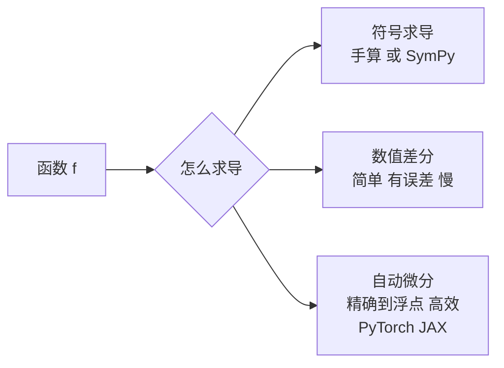

# 导数：变化率、数值微分与链式法则

> **免责声明**：本文是“河洛序”知识图谱 K2 批次的**初稿**，由 AI 辅助整理，仅供学习参考，不构成任何承诺或保证。版本信息截至 2026-10-14；文中示例已在 Python 3.15.0（数据结构与算法，纯标准库）或 Python 3.13 + 所列库版本（AI/ML 库与数学）下**实际运行**，输出为真实结果，但换机器、换版本时数字（尤其是耗时）会不同。
>
> 标注说明：**【有据可查】** 附官方文档 / 原始出处链接；**【社区共识】** 为业界普遍做法，没有唯一权威出处；**【待考察/推测】** 为未能核实或作者推断，请勿当作定论。

## 一句话定义

导数描述函数在某一点的**瞬时变化率**，几何上是曲线在该点切线的斜率：输入变化一点点，输出大约变化“导数 × 这一点点”。

$$
f'(x) = \lim_{h\to 0} \frac{f(x+h) - f(x)}{h}
$$

## 为什么重要

- 导数告诉我们“参数往哪边调、损失会下降”，是梯度（多元导数，见 [[k2.math.gradient]]）和所有优化算法的基础。
- 激活函数的导数决定了梯度能否顺利传播。

## 原理 / 图解

常用导数：

| 函数 | 导数 | AI 中的角色 |
|---|---|---|
| $x^n$ | $n x^{n-1}$ | 多项式、MSE |
| $e^x$ | $e^x$ | softmax |
| $\ln x$ | $1/x$ | 交叉熵 |
| $\sigma(x) = \frac{1}{1+e^{-x}}$ | $\sigma(x)(1-\sigma(x))$，最大 0.25 | 门控、二分类 |
| $\tanh x$ | $1-\tanh^2 x$ | RNN |
| $\operatorname{ReLU}(x)=\max(0,x)$ | $[x>0]$（0 处不可导） | 最常用激活函数 |

**链式法则**（复合函数求导，反向传播的数学基础）：

$$
\frac{d}{dx} f(g(x)) = f'(g(x))\cdot g'(x),\qquad \frac{d}{dx}\sin(x^2) = \cos(x^2)\cdot 2x
$$

**数值微分**：中心差分误差为 $O(h^2)$，优于前向差分的 $O(h)$：

$$
f'(x) \approx \frac{f(x+h) - f(x-h)}{2h}
$$

**二阶导数判别极值**：$f'(x)=0$ 时，$f''(x)>0$ 为极小值，$f''(x)<0$ 为极大值。



【有据可查】自动微分综述：Baydin 等, *Automatic Differentiation in Machine Learning: a Survey*：<https://arxiv.org/abs/1502.05767>

## 可运行示例

前向/中心差分在不同步长 h 下的误差、激活函数导数公式与数值验证、ReLU 在 0 处的问题、链式法则、二阶导数判别极值（Python 3.13 + numpy 实际运行）：

```python
# 文件：examples/36_derivative.py
# 导数：函数在某点的瞬时变化率 f'(x) = lim (f(x+h)-f(x))/h
import numpy as np

f = lambda x: x ** 3
print("f(x)=x³ 在 x=2 处，理论导数 3x² = 12")
for h in [1e-1, 1e-3, 1e-5, 1e-8, 1e-12]:
    fwd = (f(2 + h) - f(2)) / h
    ctr = (f(2 + h) - f(2 - h)) / (2 * h)
    print(f"  h={h:<7g} 前向差分 {fwd:.10f}  中心差分 {ctr:.10f}")
print("→ h 太大有截断误差，h 太小有浮点舍入误差；中心差分精度更高")

# 常用导数（AI 中最常见的几个激活函数）
x = np.array([-2., 0., 2.])
sig = 1 / (1 + np.exp(-x))
def num(fn, x, h=1e-5): return (fn(x + h) - fn(x - h)) / (2 * h)
checks = {
    "sigmoid' = σ(1-σ)": (sig * (1 - sig), num(lambda t: 1/(1+np.exp(-t)), x)),
    "tanh' = 1-tanh²": (1 - np.tanh(x)**2, num(np.tanh, x)),
    "ReLU' = [x>0]": ((x > 0).astype(float), num(lambda t: np.maximum(0, t), x)),
    "(eˣ)' = eˣ": (np.exp(x), num(np.exp, x)),
    "(ln x)' = 1/x (x=1,2,4)": (1/np.array([1., 2., 4.]), num(np.log, np.array([1., 2., 4.]))),
}
for name, (formula, numeric) in checks.items():
    print(f"{name:<24} 公式 {np.round(formula, 5)}  数值 {np.round(numeric, 5)}")
print("注意 ReLU 在 0 处不可导：数值差分给出 0.5，框架通常约定取 0")

# 链式法则：(sin(x²))' = cos(x²)·2x
x0 = 1.3
print(f"\n链式法则 d/dx sin(x²) at 1.3: 公式 {np.cos(x0**2)*2*x0:.8f} | 数值 {num(lambda t: np.sin(t**2), x0):.8f}")

# 二阶导数：判断极值类型
g = lambda t: t**3 - 3*t
for x0 in [-1., 1.]:
    d2 = (g(x0 + 1e-4) - 2*g(x0) + g(x0 - 1e-4)) / 1e-8
    print(f"g(x)=x³-3x 在 x={x0:+}: g'≈{num(g, x0):.2e}, g''≈{d2:.2f} → {'极大值' if d2 < 0 else '极小值'}")
```

输出：

```text
f(x)=x³ 在 x=2 处，理论导数 3x² = 12
  h=0.1     前向差分 12.6100000000  中心差分 12.0100000000
  h=0.001   前向差分 12.0060010000  中心差分 12.0000010000
  h=1e-05   前向差分 12.0000600003  中心差分 12.0000000002
  h=1e-08   前向差分 11.9999999271  中心差分 11.9999998827
  h=1e-12   前向差分 12.0010668070  中心差分 12.0010668070
→ h 太大有截断误差，h 太小有浮点舍入误差；中心差分精度更高
sigmoid' = σ(1-σ)        公式 [0.10499 0.25    0.10499]  数值 [0.10499 0.25    0.10499]
tanh' = 1-tanh²          公式 [0.07065 1.      0.07065]  数值 [0.07065 1.      0.07065]
ReLU' = [x>0]            公式 [0. 0. 1.]  数值 [0.  0.5 1. ]
(eˣ)' = eˣ               公式 [0.13534 1.      7.38906]  数值 [0.13534 1.      7.38906]
(ln x)' = 1/x (x=1,2,4)  公式 [1.   0.5  0.25]  数值 [1.   0.5  0.25]
注意 ReLU 在 0 处不可导：数值差分给出 0.5，框架通常约定取 0

链式法则 d/dx sin(x²) at 1.3: 公式 -0.30919608 | 数值 -0.30919608
g(x)=x³-3x 在 x=-1.0: g'≈9.99e-11, g''≈-6.00 → 极大值
g(x)=x³-3x 在 x=+1.0: g'≈9.99e-11, g''≈6.00 → 极小值
```

- h 从 0.1 减到 1e-5，误差变小；但 h=1e-12 时误差反而变大到 0.001——浮点舍入误差占主导。
- ReLU 在 0 处中心差分给出 0.5（左右导数的平均），而框架通常约定取 0。【有据可查】PyTorch autograd 对不可导点的约定：<https://docs.pytorch.org/docs/stable/notes/autograd.html#gradients-for-non-differentiable-functions>

## 常见误区

- **h 越小越精确**：存在最优 h（float64 下中心差分约 1e-5 量级）。
- **不可导点无所谓**：ReLU 的 0 点在实践中影响不大，但 `abs`、`max` 等在关键位置不可导时要注意梯度定义。
- **导数为 0 就是最优**：可能是极大值或拐点，需二阶条件或更多信息。
- **混淆导数与差分**：数值差分只是导数的近似。

## 与 AI 开发的关系

- **激活函数选择**：sigmoid 导数最大 0.25，深层网络易梯度消失；ReLU 在正区间导数为 1（见 [[k2.math.gradient]]）。
- **自动微分**：JAX 的 `grad(grad(f))` 可求高阶导数（见 [[k2.ml.jax]]）。
- **学习率与曲率**：二阶导数（Hessian）大的地方需要更小的步长（见 [[k2.math.optimization]]）。

## 延伸阅读

- 3Blue1Brown《微积分的本质》：<https://www.3blue1brown.com/topics/calculus>
- 自动微分综述：<https://arxiv.org/abs/1502.05767>
- 《动手学深度学习》微积分章节：<https://zh.d2l.ai/chapter_preliminaries/calculus.html>

## 无法核实 / 待考察点

- 【待考察/推测】中心差分最优步长约为 $\varepsilon^{1/3}$（$\varepsilon$ 为机器精度）是数值分析中的经验结论，未在本文严格推导。
