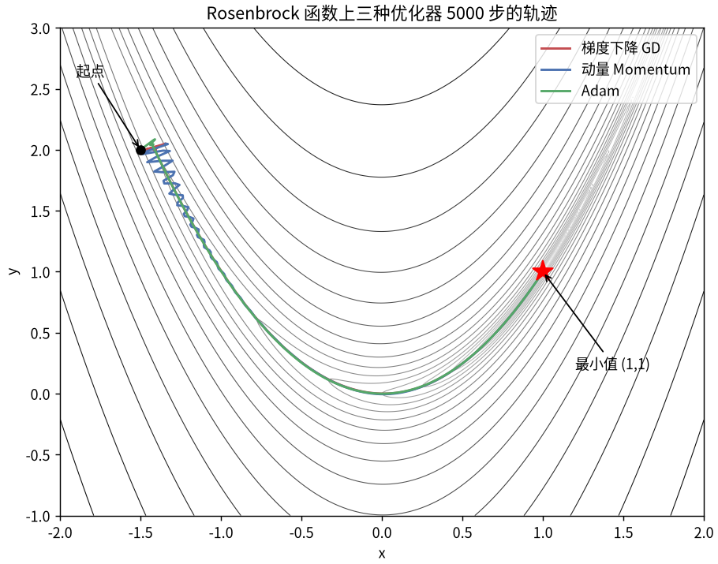
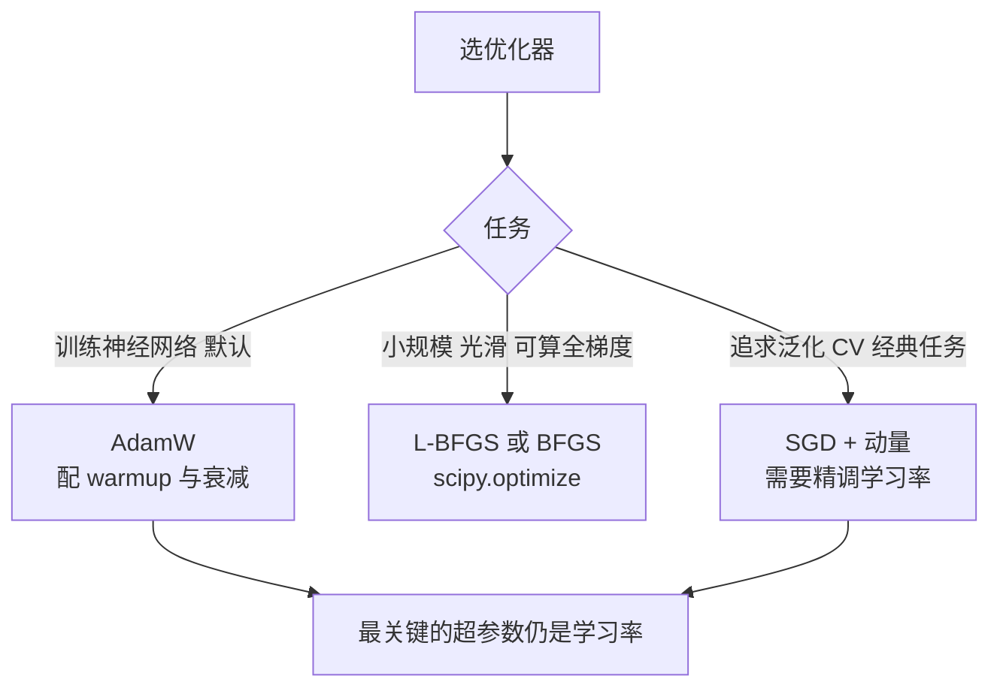

# 优化：梯度下降、动量与 Adam

> **免责声明**：本文是“河洛序”知识图谱 K2 批次的**初稿**，由 AI 辅助整理，仅供学习参考，不构成任何承诺或保证。版本信息截至 2026-10-14；文中示例已在 Python 3.15.0（数据结构与算法，纯标准库）或 Python 3.13 + 所列库版本（AI/ML 库与数学）下**实际运行**，输出为真实结果，但换机器、换版本时数字（尤其是耗时）会不同。
>
> 标注说明：**【有据可查】** 附官方文档 / 原始出处链接；**【社区共识】** 为业界普遍做法，没有唯一权威出处；**【待考察/推测】** 为未能核实或作者推断，请勿当作定论。

## 一句话定义

优化是**寻找让目标函数（通常是损失）最小的参数**。深度学习用一阶方法：梯度下降及其改进版（动量、Adam），每步沿负梯度方向调整参数。

$$
\boldsymbol{\theta}^* = \arg\min_{\boldsymbol{\theta}} L(\boldsymbol{\theta})
$$

## 为什么重要

- 选错优化器或学习率，模型可能根本训不动或直接发散（loss 变 NaN）。
- 大模型训练几乎都用 AdamW 一类自适应优化器，配合学习率预热（warmup）和衰减。【社区共识】

## 原理 / 图解

| 方法 | 更新规则 | 特点 |
|---|---|---|
| 梯度下降 GD | $\theta \leftarrow \theta - \eta g$ | 简单；狭长山谷中来回震荡 |
| 动量 Momentum | $v \leftarrow \beta v + g,\ \theta \leftarrow \theta - \eta v$ | 积累方向，冲过平坦区，减少震荡 |
| Adam | 见下式 | 每个参数自适应步长，鲁棒 |

Adam（Kingma & Ba, 2014）：

$$
m_t = \beta_1 m_{t-1} + (1-\beta_1) g_t,\quad v_t = \beta_2 v_{t-1} + (1-\beta_2) g_t^2
$$

$$
\hat m_t = \frac{m_t}{1-\beta_1^t},\quad \hat v_t = \frac{v_t}{1-\beta_2^t},\quad \theta_t = \theta_{t-1} - \eta \frac{\hat m_t}{\sqrt{\hat v_t} + \epsilon}
$$

【有据可查】Adam：<https://arxiv.org/abs/1412.6980> ；AdamW（解耦权重衰减）：<https://arxiv.org/abs/1711.05101> ；PyTorch 优化器文档：<https://docs.pytorch.org/docs/stable/optim.html>

测试函数 Rosenbrock（最小值在 (1,1)，位于一条弯曲狭长的山谷底部）：

$$
f(x,y) = (1-x)^2 + 100\,(y - x^2)^2
$$



*图：从 (−1.5, 2) 出发，三种优化器的 5000 步轨迹（由下方示例代码生成）。动量在山谷入口处来回震荡后冲向终点；GD 沿山谷缓慢前进，5000 步后仍未到达 (1,1)。*



## 可运行示例

在 Rosenbrock 函数上对比 GD / 动量 / Adam、学习率过大导致发散、SciPy 的 BFGS、非凸函数从不同起点落入不同局部最小值，并画出轨迹图（Python 3.13 + numpy + scipy + matplotlib 实际运行）：

```python
# 文件：examples/37_optimization.py
# 优化：找让目标函数最小的参数。对比 GD / Momentum / Adam 在"狭长山谷"上的表现
import numpy as np
from scipy.optimize import minimize

def rosen(p): x, y = p; return (1 - x)**2 + 100 * (y - x**2)**2       # Rosenbrock 函数，最小值在 (1,1)
def rosen_grad(p):
    x, y = p
    return np.array([-2*(1 - x) - 400*x*(y - x**2), 200*(y - x**2)])

def run(update, steps=5000):
    p, state = np.array([-1.5, 2.0]), {}
    for t in range(1, steps + 1):
        p = update(p, rosen_grad(p), state, t)
    return p, rosen(p)

def sgd(p, g, s, t, lr=1e-3): return p - lr * g
def momentum(p, g, s, t, lr=1e-3, beta=0.9):
    s["v"] = beta * s.get("v", 0) + g; return p - lr * s["v"]
def adam(p, g, s, t, lr=1e-2, b1=0.9, b2=0.999, eps=1e-8):
    s["m"] = b1 * s.get("m", 0) + (1 - b1) * g
    s["v"] = b2 * s.get("v", 0) + (1 - b2) * g * g
    mh, vh = s["m"] / (1 - b1**t), s["v"] / (1 - b2**t)
    return p - lr * mh / (np.sqrt(vh) + eps)

for name, fn in [("梯度下降 GD", sgd), ("动量 Momentum", momentum), ("Adam", adam)]:
    p, val = run(fn)
    print(f"{name:<14} 5000 步后 p = {np.round(p, 4)}, f = {val:.2e}")

# 学习率太大会发散
p = np.array([-1.5, 2.0])
with np.errstate(over="ignore", invalid="ignore"):
    for _ in range(50): p = p - 1e-2 * rosen_grad(p)
print("GD 学习率 0.01（太大）50 步后:", p, "← 发散")

# 用成熟优化库：拟牛顿法 BFGS
res = minimize(rosen, x0=[-1.5, 2.0], jac=rosen_grad, method="BFGS")
print(f"scipy BFGS: p = {np.round(res.x, 6)}, 迭代 {res.nit} 次, 成功 {res.success}")

# 非凸：不同起点落到不同局部最小值
g = lambda x: np.sin(3 * x) + 0.1 * x**2
dg = lambda x: 3 * np.cos(3 * x) + 0.2 * x
for x0 in [-2.0, 0.0, 2.0]:
    x = x0
    for _ in range(500): x -= 0.01 * dg(x)
    print(f"非凸函数 从 x0={x0:+} 出发 → 收敛到 x={x:+.4f}, f={g(x):+.4f}")

# 画出三种优化器在 Rosenbrock 等高线上的轨迹
import os, matplotlib
matplotlib.use("Agg")
import matplotlib.pyplot as plt
from matplotlib import font_manager
cjk = [f.name for f in font_manager.fontManager.ttflist if "CJK SC" in f.name]
if cjk: plt.rcParams["font.family"] = cjk[0]
plt.rcParams["axes.unicode_minus"] = False
def trajectory(update, steps=5000):
    p, state, pts = np.array([-1.5, 2.0]), {}, []
    for t in range(1, steps + 1):
        p = update(p, rosen_grad(p), state, t); pts.append(p.copy())
    return np.array(pts)
xx, yy = np.meshgrid(np.linspace(-2, 2, 400), np.linspace(-1, 3, 400))
zz = (1 - xx)**2 + 100 * (yy - xx**2)**2
fig, ax = plt.subplots(figsize=(7, 5.5), constrained_layout=True)
ax.contour(xx, yy, np.log10(zz + 1e-3), levels=30, cmap="Greys", linewidths=0.6)
for name, fn, c in [("梯度下降 GD", sgd, "#C44E52"), ("动量 Momentum", momentum, "#4C72B0"), ("Adam", adam, "#55A868")]:
    tr = trajectory(fn); ax.plot(tr[:, 0], tr[:, 1], c=c, lw=1.6, label=name)
ax.plot(-1.5, 2.0, "ko"); ax.annotate("起点", (-1.5, 2.0), xytext=(-1.9, 2.6), arrowprops=dict(arrowstyle="->"))
ax.plot(1, 1, "r*", ms=15); ax.annotate("最小值 (1,1)", (1, 1), xytext=(1.2, 0.2), arrowprops=dict(arrowstyle="->"))
ax.set(title="Rosenbrock 函数上三种优化器 5000 步的轨迹", xlabel="x", ylabel="y"); ax.legend(loc="upper right")
out = os.path.join(os.path.dirname(os.path.abspath(__file__)), "..", "img", "optimizers.png")
fig.savefig(out, dpi=130); print("已保存:", os.path.basename(out))
```

输出：

```text
梯度下降 GD        5000 步后 p = [0.9194 0.8449], f = 6.51e-03
动量 Momentum    5000 步后 p = [1. 1.], f = 1.99e-19
Adam           5000 步后 p = [1. 1.], f = 1.68e-17
GD 学习率 0.01（太大）50 步后: [nan nan] ← 发散
scipy BFGS: p = [1. 1.], 迭代 37 次, 成功 True
非凸函数 从 x0=-2.0 出发 → 收敛到 x=-2.5608, f=-0.3295
非凸函数 从 x0=+0.0 出发 → 收敛到 x=-0.5122, f=-0.9732
非凸函数 从 x0=+2.0 出发 → 收敛到 x=+1.5366, f=-0.7586
已保存: optimizers.png
```

- 同样 5000 步：GD 停在 (0.92, 0.84)，动量和 Adam 到达 (1, 1)。
- GD 学习率从 0.001 调到 0.01，50 步内就变成 NaN。
- 非凸函数 $\sin 3x + 0.1x^2$：三个起点收敛到三个不同的局部最小值，只有从 0 出发找到了最好的那个。

## 常见误区

- **只调优化器不调学习率**：学习率通常是影响最大的超参数。
- **Adam 的 weight_decay 等于 L2 正则**：在 Adam 中二者不等价，所以有了 AdamW。【有据可查】<https://arxiv.org/abs/1711.05101>
- **loss 变 NaN 就换模型**：先检查学习率、梯度裁剪、数据中的异常值、混合精度溢出。
- **以为找到的是全局最优**：神经网络损失非凸，找到的是“足够好”的点。
- **特征不做归一化**：病态的损失曲面会让 GD 极慢（见 [[k2.math.normalization]]）。

## 与 AI 开发的关系

- **微调大模型**：常见配置是 AdamW + 线性/余弦学习率衰减 + warmup；LoRA 微调学习率通常比全量微调大。【社区共识】
- **显存**：Adam 为每个参数保存 $m$ 和 $v$ 两份状态，优化器状态约为参数量的 2 倍（fp32 时），这是全量微调显存大的原因之一；8-bit 优化器、LoRA 可缓解（见 [[k2.ml.peft]]）。
- **超参数搜索**：学习率常在对数尺度上搜索。

## 延伸阅读

- Sebastian Ruder《An overview of gradient descent optimization algorithms》：<https://arxiv.org/abs/1609.04747>
- Distill《Why Momentum Really Works》：<https://distill.pub/2017/momentum/>
- PyTorch 优化器：<https://docs.pytorch.org/docs/stable/optim.html>
- SciPy 优化：<https://docs.scipy.org/doc/scipy/reference/optimize.html>

## 无法核实 / 待考察点

- 【待考察/推测】“LoRA 微调的学习率通常比全量微调大一个数量级”为社区经验，没有统一权威结论。
- 【待考察/推测】新优化器（如 Muon、Lion 等）在大模型训练中的采用情况变化很快，本文未纳入比较。
