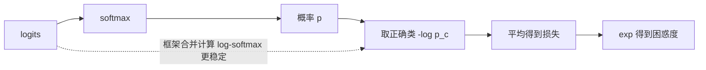

# 损失函数：MSE、交叉熵与困惑度

> **免责声明**：本文是“河洛序”知识图谱 K2 批次的**初稿**，由 AI 辅助整理，仅供学习参考，不构成任何承诺或保证。版本信息截至 2026-10-14；文中示例已在 Python 3.15.0（数据结构与算法，纯标准库）或 Python 3.13 + 所列库版本（AI/ML 库与数学）下**实际运行**，输出为真实结果，但换机器、换版本时数字（尤其是耗时）会不同。
>
> 标注说明：**【有据可查】** 附官方文档 / 原始出处链接；**【社区共识】** 为业界普遍做法，没有唯一权威出处；**【待考察/推测】** 为未能核实或作者推断，请勿当作定论。

## 一句话定义

损失函数用一个数衡量**模型预测与正确答案差多远**；训练就是最小化它（见 [[k2.math.optimization]]）。回归常用均方误差，分类和语言模型用交叉熵。

## 为什么重要

- 损失函数定义了“什么叫好”：选错损失，模型会朝错误方向优化。
- LLM 预训练的损失就是下一个 token 的交叉熵，它的指数就是常说的困惑度（perplexity）。
- 看懂损失数值才能判断训练是否正常：初始损失约等于 $\ln V$ 就说明模型初始化合理（见 [[k2.ml.transformers]] 示例）。

## 原理 / 图解

**回归损失**：

$$
\text{MSE} = \frac{1}{n}\sum (y_i - \hat y_i)^2,\qquad
\text{MAE} = \frac{1}{n}\sum \lvert y_i - \hat y_i \rvert
$$

$$
\text{Huber}_\delta(r) = \begin{cases} \tfrac12 r^2 & \lvert r\rvert \le \delta \\ \delta\left(\lvert r\rvert - \tfrac12\delta\right) & \text{否则} \end{cases}
$$

**分类：交叉熵**（$p$ 为 softmax 概率，$c$ 为正确类别）：

$$
L_{\text{CE}} = -\log p_c,\qquad \frac{\partial L}{\partial z_i} = p_i - [i = c]
$$

**困惑度**：平均交叉熵的指数，可理解为“模型在多少个选项中犹豫”：

$$
\text{PPL} = \exp\left(\frac{1}{N}\sum_{t=1}^{N} -\log p(x_t \mid x_{<t})\right)
$$

| 任务 | 常用损失 | PyTorch |
|---|---|---|
| 回归 | MSE / MAE / Huber | `MSELoss` / `L1Loss` / `HuberLoss` |
| 多分类、语言模型 | 交叉熵 | `CrossEntropyLoss`（输入 logits） |
| 二分类、多标签 | 二元交叉熵 | `BCEWithLogitsLoss`（输入 logits） |
| 扩散模型 | 预测噪声的 MSE | 见 [[k2.ml.diffusers]] |



【有据可查】PyTorch `CrossEntropyLoss`：<https://docs.pytorch.org/docs/stable/generated/torch.nn.CrossEntropyLoss.html> ；`BCEWithLogitsLoss`（说明其比 Sigmoid + BCELoss 数值更稳定）：<https://docs.pytorch.org/docs/stable/generated/torch.nn.BCEWithLogitsLoss.html>

## 可运行示例

三种回归损失及其对异常值的敏感度、交叉熵计算与梯度验证、困惑度、BCE 的数值稳定写法与朴素写法对比（Python 3.13 + numpy 实际运行）：

```python
# 文件：examples/38_loss_function.py
# 损失函数：衡量“预测离正确答案有多远”的数字，训练就是让它变小
import numpy as np
np.set_printoptions(precision=4, suppress=True)

# 回归：MSE / MAE / Huber，以及对异常值的敏感度
y = np.array([3.0, 5.0, 2.5, 7.0]); pred = np.array([2.5, 5.0, 3.0, 8.0])
def mse(y, p): return np.mean((y - p) ** 2)
def mae(y, p): return np.mean(np.abs(y - p))
def huber(y, p, d=1.0):
    e = np.abs(y - p); return np.mean(np.where(e <= d, 0.5 * e**2, d * (e - 0.5 * d)))
print(f"MSE {mse(y, pred):.4f} | MAE {mae(y, pred):.4f} | Huber {huber(y, pred):.4f}")
pred_out = pred.copy(); pred_out[3] = 27.0
print(f"一个预测离谱到 27 后：MSE {mse(y, pred_out):.2f}（暴涨）| MAE {mae(y, pred_out):.2f} | Huber {huber(y, pred_out):.2f}")

# 分类：交叉熵（与 softmax 搭配）
def softmax(z): z = z - z.max(axis=-1, keepdims=True); e = np.exp(z); return e / e.sum(axis=-1, keepdims=True)
def cross_entropy(logits, labels):
    logp = logits - logits.max(axis=1, keepdims=True)
    logp = logp - np.log(np.exp(logp).sum(axis=1, keepdims=True))     # log-softmax（数值稳定）
    return -np.mean(logp[np.arange(len(labels)), labels])
logits = np.array([[2.0, 0.5, -1.0], [0.1, 0.2, 3.0]]); labels = np.array([0, 2])
print("\nsoftmax 概率:\n", softmax(logits))
print(f"交叉熵 = {cross_entropy(logits, labels):.4f} = 平均 -log(正确类概率) = {np.mean(-np.log(softmax(logits)[[0,1],[0,2]])):.4f}")
for p in [0.99, 0.5, 0.01]:
    print(f"  正确类概率 {p:<4} → 损失 {-np.log(p):.3f}")
print(f"均匀猜 3 类的损失 ln3 = {np.log(3):.4f}；LLM 词表 10 万时的初始损失 ≈ ln(100000) = {np.log(100000):.2f}")

# 交叉熵的梯度极其简洁：softmax(z) - onehot(y)
z = logits[0]; onehot = np.eye(3)[0]
analytic = softmax(z[None])[0] - onehot
num = np.array([(cross_entropy((z + h)[None], labels[:1]) - cross_entropy((z - h)[None], labels[:1])) / 2e-6 for h in np.eye(3) * 1e-6])
print("交叉熵对 logits 的梯度 公式:", analytic, "数值:", num)

# 困惑度 perplexity = exp(平均交叉熵)，语言模型的常用指标
token_logprobs = np.log(np.array([0.5, 0.25, 0.8, 0.1]))
print(f"\n困惑度 PPL = exp({-token_logprobs.mean():.4f}) = {np.exp(-token_logprobs.mean()):.3f}")

# 二分类：BCE；数值稳定写法 BCE-with-logits
def bce_logits(z, t): return np.mean(np.maximum(z, 0) - z * t + np.log1p(np.exp(-np.abs(z))))
z, t = np.array([3.0, -2.0, 0.0, 50.0]), np.array([1.0, 0.0, 1.0, 0.0])
naive = -np.mean(t * np.log(1/(1+np.exp(-z))) + (1-t) * np.log(1 - 1/(1+np.exp(-z)) + 1e-300))
print(f"BCE-with-logits {bce_logits(z, t):.4f} | 朴素写法 {naive:.4f}（z=50 时 1-σ(z) 下溢为 0，需要加极小值兜底）")
```

输出：

```text
MSE 0.3750 | MAE 0.5000 | Huber 0.1875
一个预测离谱到 27 后：MSE 100.12（暴涨）| MAE 5.25 | Huber 4.94

softmax 概率:
 [[0.7856 0.1753 0.0391]
 [0.0493 0.0545 0.8962]]
交叉熵 = 0.1755 = 平均 -log(正确类概率) = 0.1755
  正确类概率 0.99 → 损失 0.010
  正确类概率 0.5  → 损失 0.693
  正确类概率 0.01 → 损失 4.605
均匀猜 3 类的损失 ln3 = 1.0986；LLM 词表 10 万时的初始损失 ≈ ln(100000) = 11.51
交叉熵对 logits 的梯度 公式: [-0.2144  0.1753  0.0391] 数值: [-0.2144  0.1753  0.0391]

困惑度 PPL = exp(1.1513) = 3.162
BCE-with-logits 12.7172 | 朴素写法 172.9110（z=50 时 1-σ(z) 下溢为 0，需要加极小值兜底）
```

- 一个预测离谱后，MSE 从 0.375 暴涨到 100，MAE 和 Huber 只到 5 左右：MSE 对异常值极敏感。
- 正确类概率 0.5 时损失 0.693 = ln 2；词表 10 万的语言模型初始损失约 11.51。
- 交叉熵对 logits 的梯度就是 `softmax − onehot`，与数值梯度一致。
- logit=50 时朴素 BCE 得到 172.9（因下溢加了兜底极小值），稳定写法得到正确的 12.72。

## 常见误区

- **对 `CrossEntropyLoss` 输入 softmax 后的概率**：它内部已包含 log-softmax，应输入原始 logits。
- **分类用 MSE**：梯度性质差，收敛慢。
- **损失下降就代表模型变好**：可能在过拟合（看验证集，见 [[k2.math.regularization]]）。
- **比较不同分词器模型的困惑度**：PPL 依赖词表与分词方式，跨模型直接比较不公平。【社区共识】

## 与 AI 开发的关系

- **LLM 训练与评估**：预训练/SFT 的损失是交叉熵；PPL 用于比较同一分词器下的模型。
- **只对回答部分算损失**：SFT 中常把提示部分的标签设为 −100（`ignore_index`），只对回答计算损失。【有据可查】`ignore_index` 参数见 CrossEntropyLoss 文档。
- **偏好优化**：DPO 等方法设计了基于对数概率差的新损失。【有据可查】DPO：<https://arxiv.org/abs/2305.18290>
- **对比学习**：嵌入模型常用 InfoNCE 损失（本质是对相似度做交叉熵）。

## 延伸阅读

- PyTorch 损失函数列表：<https://docs.pytorch.org/docs/stable/nn.html#loss-functions>
- Hugging Face 困惑度说明：<https://huggingface.co/docs/transformers/perplexity>
- Chris Olah《Visual Information Theory》：<https://colah.github.io/posts/2015-09-Visual-Information/>

## 无法核实 / 待考察点

- 【待考察/推测】Transformers v5 中 `loss_type` 配置的可选值与默认选择逻辑未逐条核实（与 [[k2.ml.transformers]] 示例中的警告有关）。
