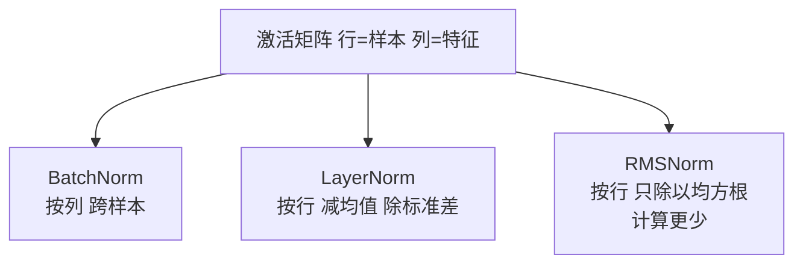

# 归一化：特征缩放、BatchNorm、LayerNorm 与 RMSNorm

> **免责声明**：本文是“河洛序”知识图谱 K2 批次的**初稿**，由 AI 辅助整理，仅供学习参考，不构成任何承诺或保证。版本信息截至 2026-10-14；文中示例已在 Python 3.15.0（数据结构与算法，纯标准库）或 Python 3.13 + 所列库版本（AI/ML 库与数学）下**实际运行**，输出为真实结果，但换机器、换版本时数字（尤其是耗时）会不同。
>
> 标注说明：**【有据可查】** 附官方文档 / 原始出处链接；**【社区共识】** 为业界普遍做法，没有唯一权威出处；**【待考察/推测】** 为未能核实或作者推断，请勿当作定论。

## 一句话定义

归一化是**把数据或中间激活缩放到统一、可控的范围**，常见做法是减去均值、除以标准差。它既用于输入特征预处理，也作为神经网络中的层（LayerNorm、RMSNorm 等）。

## 为什么重要

- **让优化更容易**：特征尺度相差悬殊时损失曲面狭长，梯度下降会非常慢（示例中从超过 10 万步降到 27 步）。
- **稳定深层网络训练**：几乎所有 Transformer 都在每个子层前后使用 LayerNorm 或 RMSNorm。
- **向量检索**：嵌入向量 L2 归一化后，点积就等于余弦相似度（见 [[k2.math.vector]]）。

## 原理 / 图解

**特征缩放**：

$$
\text{Min-Max: } x' = \frac{x - x_{\min}}{x_{\max} - x_{\min}},\qquad
\text{Z-score: } x' = \frac{x - \mu}{\sigma}
$$

**网络中的归一化层**（$\gamma,\beta$ 为可学习参数，$\epsilon$ 防止除零）：

$$
\text{LayerNorm}(\mathbf{x}) = \gamma \odot \frac{\mathbf{x} - \mu}{\sqrt{\sigma^2 + \epsilon}} + \beta,\qquad
\text{RMSNorm}(\mathbf{x}) = \gamma \odot \frac{\mathbf{x}}{\sqrt{\frac{1}{d}\sum_i x_i^2 + \epsilon}}
$$

| 方法 | 在哪个维度上算统计量 | 典型用途 |
|---|---|---|
| BatchNorm | 同一特征、跨 batch 中的样本 | CNN |
| LayerNorm | 同一样本、跨所有特征 | Transformer（BERT、GPT-2） |
| RMSNorm | 同一样本，只除以均方根、不减均值 | LLaMA 等许多新 LLM |



【有据可查】BatchNorm：<https://arxiv.org/abs/1502.03167> ；LayerNorm：<https://arxiv.org/abs/1607.06450> ；RMSNorm：<https://arxiv.org/abs/1910.07467> ；PyTorch `rms_norm`：<https://docs.pytorch.org/docs/stable/generated/torch.nn.functional.rms_norm.html>

## 可运行示例

Min-Max 与 Z-score、标准化前后的条件数与梯度下降步数、手写 BatchNorm / LayerNorm / RMSNorm 并与 PyTorch 对比、L2 归一化（Python 3.13 + numpy + torch 实际运行）：

```python
# 文件：examples/40_normalization.py
# 归一化：把数据或中间激活调整到统一尺度。特征缩放 / BatchNorm / LayerNorm / RMSNorm
import numpy as np
np.set_printoptions(precision=4, suppress=True)
rng = np.random.default_rng(0)

# 1) 特征缩放：面积(平方米) 与 房间数 尺度差百倍
X = np.c_[rng.uniform(30, 200, 6), rng.integers(1, 6, 6)]
minmax = (X - X.min(0)) / (X.max(0) - X.min(0))
zscore = (X - X.mean(0)) / X.std(0)
print("原始:\n", X[:3], "\nMin-Max 到 [0,1]:\n", minmax[:3], "\nZ-score（均值0方差1）:\n", zscore[:3])
print("Z-score 后各列均值", zscore.mean(0).round(6), "标准差", zscore.std(0))

# 2) 尺度不一致让梯度下降很难：条件数对比
def steps_to_converge(X, y, lr):
    w = np.zeros(X.shape[1])
    for t in range(1, 100_001):
        g = X.T @ (X @ w - y) / len(y); w -= lr * g
        if np.linalg.norm(g) < 1e-6: return t
    return ">100000"
Xr = np.c_[rng.uniform(30, 200, 200), rng.integers(1, 6, 200)]; yr = Xr @ np.array([0.5, 10.0])
Xs = (Xr - Xr.mean(0)) / Xr.std(0); ys = yr - yr.mean()
print(f"\n条件数：原始 {np.linalg.cond(Xr.T @ Xr):.0f} | 标准化后 {np.linalg.cond(Xs.T @ Xs):.2f}")
print("梯度下降收敛步数：原始(lr=1e-5)", steps_to_converge(Xr, yr, 1e-5), "| 标准化后(lr=0.5)", steps_to_converge(Xs, ys, 0.5))

# 3) BatchNorm vs LayerNorm vs RMSNorm：沿不同的轴做归一化
H = rng.normal(5, 3, size=(4, 6))                      # (batch=4, features=6)
eps = 1e-5
bn = (H - H.mean(0)) / np.sqrt(H.var(0) + eps)         # 每个特征跨 batch
ln = (H - H.mean(1, keepdims=True)) / np.sqrt(H.var(1, keepdims=True) + eps)   # 每个样本跨特征
rms = H / np.sqrt((H ** 2).mean(1, keepdims=True) + eps)                     # 只除以均方根，不减均值
print("\nBatchNorm 后每列均值:", bn.mean(0).round(6))
print("LayerNorm 后每行均值:", ln.mean(1).round(6), "每行标准差:", ln.std(1).round(4))
print("RMSNorm 后每行均方根:", np.sqrt((rms ** 2).mean(1)).round(4), "（均值不为 0:", rms.mean(1).round(3), ")")

# 4) 与 PyTorch 对照验证（如已安装）
try:
    import torch
    t = torch.tensor(H, dtype=torch.float32)
    print("与 torch.nn.functional.layer_norm 一致:", np.allclose(torch.nn.functional.layer_norm(t, (6,)).numpy(), ln, atol=1e-4))
    if hasattr(torch.nn.functional, "rms_norm"):
        print("与 torch.nn.functional.rms_norm 一致:", np.allclose(torch.nn.functional.rms_norm(t, (6,), eps=eps).numpy(), rms, atol=1e-4))
except ImportError:
    print("未安装 PyTorch，跳过对照")

# 5) 向量 L2 归一化：嵌入检索前的常见步骤
E = rng.normal(size=(3, 4)); En = E / np.linalg.norm(E, axis=1, keepdims=True)
print("\nL2 归一化后各向量长度:", np.linalg.norm(En, axis=1))
```

输出：

```text
原始:
 [[138.2835   3.    ]
 [ 75.8637   4.    ]
 [ 36.9655   5.    ]] 
Min-Max 到 [0,1]:
 [[0.6923 0.    ]
 [0.2826 0.5   ]
 [0.0273 1.    ]] 
Z-score（均值0方差1）:
 [[ 0.5269 -1.2127]
 [-0.4989  0.2425]
 [-1.1382  1.6977]]
Z-score 后各列均值 [-0. -0.] 标准差 [1. 1.]

条件数：原始 5046 | 标准化后 1.03
梯度下降收敛步数：原始(lr=1e-5) >100000 | 标准化后(lr=0.5) 27

BatchNorm 后每列均值: [-0. -0. -0. -0. -0. -0.]
LayerNorm 后每行均值: [-0. -0. -0. -0.] 每行标准差: [1. 1. 1. 1.]
RMSNorm 后每行均方根: [1. 1. 1. 1.] （均值不为 0: [0.849 0.914 0.916 0.926] )
与 torch.nn.functional.layer_norm 一致: True
与 torch.nn.functional.rms_norm 一致: True

L2 归一化后各向量长度: [1. 1. 1.]
```

- 条件数从 5046 降到 1.03（条件数是最大与最小特征值之比，衡量曲面有多“狭长”，见 [[k2.math.eigenvalue]]），梯度下降从超过 10 万步降到 27 步。
- BatchNorm 让每**列**均值为 0；LayerNorm 让每**行**均值 0、标准差 1；RMSNorm 让每行均方根为 1，但均值不为 0。
- 手写版本与 `torch.nn.functional.layer_norm` / `rms_norm` 结果一致。

## 常见误区

- **在全部数据上 fit 归一化参数**：会把测试集信息泄漏给训练，应只在训练集上 fit（见 [[k2.ml.sklearn]] 的 Pipeline）。
- **“归一化”与“标准化”混用**：不同资料用法不一，看公式而不是看名字。
- **树模型也必须标准化**：决策树/随机森林对单调缩放不敏感，一般不需要。
- **小 batch 用 BatchNorm**：统计量噪声大，Transformer 等序列模型多用 LayerNorm/RMSNorm。
- **推理时 BatchNorm 仍用当前 batch 统计**：应使用训练中累积的滑动均值（`model.eval()`）。

## 与 AI 开发的关系

- **Transformer 结构**：Pre-LN（子层前归一化）比原始 Post-LN 更易训练，是当前 LLM 的常见选择。【有据可查】<https://arxiv.org/abs/2002.04745>
- **RMSNorm**：计算更省，被 LLaMA 等模型采用。【有据可查】LLaMA 论文：<https://arxiv.org/abs/2302.13971>
- **嵌入检索**：存入向量库前做 L2 归一化，可以用点积代替余弦。
- **表格数据**：线性模型、SVM、KNN、神经网络的输入特征都应缩放。

## 延伸阅读

- sklearn 预处理：<https://scikit-learn.org/stable/modules/preprocessing.html>
- PyTorch `LayerNorm`：<https://docs.pytorch.org/docs/stable/generated/torch.nn.LayerNorm.html>
- RMSNorm 论文：<https://arxiv.org/abs/1910.07467>

## 无法核实 / 待考察点

- 【待考察/推测】各主流开源 LLM 当前使用 Pre-LN/RMSNorm 还是其他变体（如 QK-Norm、DeepNorm）的统计情况，未逐一核实。
