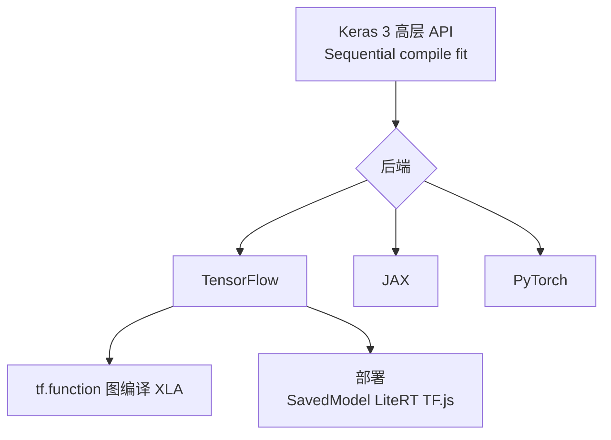

# TensorFlow 与 Keras

@@DISCLAIMER@@

## 一句话定义

TensorFlow 是 Google 开源的**端到端机器学习平台**，Keras 是其上的**高层神经网络 API**：用 `Sequential` 堆叠层、`compile` 配置、`fit` 训练，三步完成大多数模型；底层还有 `GradientTape` 自动求导和 `tf.function` 图编译。

## 为什么重要

- **大量存量项目与生产系统**：2015 年开源以来，许多工业系统、教材和移动端/嵌入式部署方案基于 TensorFlow。
- **端侧部署生态**：TensorFlow Lite（已更名为 LiteRT）、TensorFlow.js 在手机、浏览器、微控制器上运行模型。【有据可查】LiteRT 更名说明：<https://developers.googleblog.com/en/tensorflow-lite-is-now-litert/>
- **Keras 3 是多后端的**：同一份 Keras 代码可在 TensorFlow、JAX、PyTorch 后端上运行。【有据可查】<https://keras.io/getting_started/>

## 原理 / 图解

【有据可查】TensorFlow 2.21.0 于 2026-03-06 发布（移除 Python 3.9 支持、移除 TensorBoard 依赖等）：<https://github.com/tensorflow/tensorflow/releases/tag/v2.21.0> 。本文使用 tensorflow-cpu 2.21.0 + keras 3.15.1。

## 可运行示例

`GradientTape` 求导 + Keras 训练一个小分类网络 + `tf.function`（Python 3.13 + tensorflow-cpu 2.21.0 实际运行）：

@@CODE:03_tensorflow.py@@

输出（开头几行是 TensorFlow 自身打印到 stderr 的 oneDNN 提示，属正常现象）：

@@OUT:03_tensorflow@@

## 常见误区

- **把 TF1 教程当 TF2 用**：`tf.Session`、`placeholder` 是 TF1 写法，TF2 默认即时执行（eager）。
- **以为 Keras 只能配 TensorFlow**：Keras 3 支持多后端，`keras.backend.backend()` 可查看当前后端。
- **新项目不考虑生态趋势**：大模型生态目前以 PyTorch 为主，Hugging Face Transformers v5 已移除 TensorFlow 支持。【有据可查】<https://github.com/huggingface/transformers/blob/main/MIGRATION_GUIDE_V5.md>
- **GPU 安装踩坑**：TensorFlow 对 CUDA/cuDNN 版本有严格对应要求，应以官方安装页为准：<https://www.tensorflow.org/install/pip>

## 与 AI 开发的关系

- **维护存量模型**：推荐系统、CTR 预估、经典 CV 模型在很多公司仍运行在 TensorFlow 上。
- **端侧与浏览器推理**：LiteRT / TF.js 是把小模型部署到手机和网页的常见路径。
- **新学习者的选择**：【社区共识】若目标是大模型应用与微调，优先学 PyTorch；若工作涉及既有 TF 系统或端侧部署，再补 TensorFlow/Keras。

## 延伸阅读

- TensorFlow 教程：<https://www.tensorflow.org/tutorials>
- Keras 入门：<https://keras.io/getting_started/>
- `tf.function` 指南：<https://www.tensorflow.org/guide/function>
- TF 2.21 发布说明：<https://github.com/tensorflow/tensorflow/releases/tag/v2.21.0>

## 无法核实 / 待考察点

- 【待考察/推测】截至 2026-10-14，TensorFlow 自 2.21.0（2026-03）后未在 PyPI 发布新版本；其后续路线图（如 2.22 计划、长期维护策略）未找到官方明确说明。
