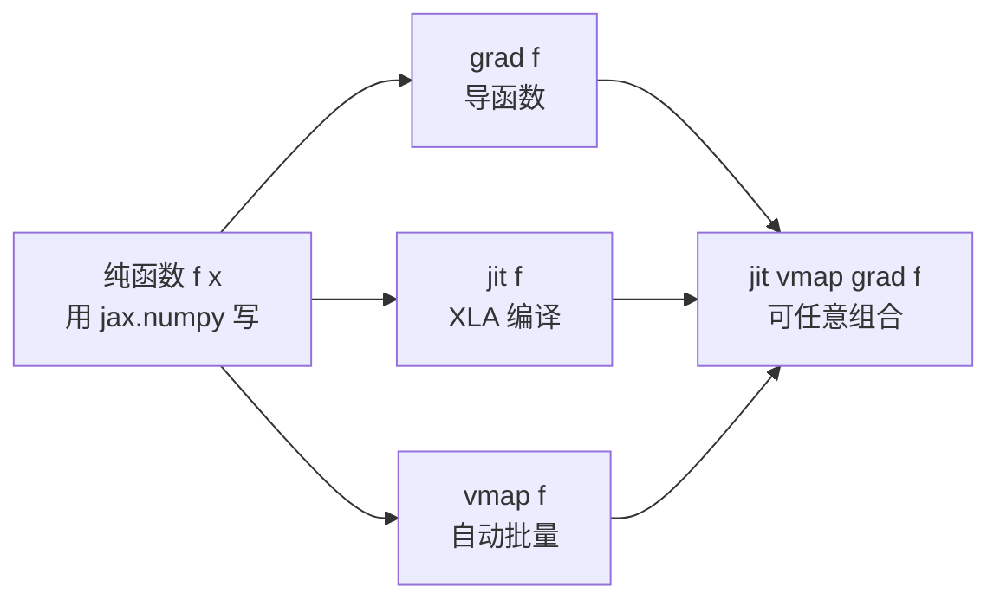

# JAX：可组合函数变换的数值计算库

@@DISCLAIMER@@

## 一句话定义

JAX 是 Google 开发的**“NumPy + 自动求导 + 编译”**库：用和 NumPy 几乎一样的 `jax.numpy` 写纯函数，再用 `grad`（求导）、`jit`（编译）、`vmap`（自动批量化）等**函数变换**把它变成梯度函数、高速函数或批量函数。

## 为什么重要

- **函数变换可以任意组合**：`jit(vmap(grad(f)))` 一行得到“编译过的、批量的梯度函数”。
- **大规模训练**：在 TPU/GPU 集群上训练大模型时被大量使用（Gemma 等模型的参考实现提供 JAX 版本）。【有据可查】Gemma JAX 实现：<https://github.com/google-deepmind/gemma>
- **科学计算**：物理模拟、可微分编程、概率编程等领域常用。

## 原理 / 图解

【有据可查】JAX 官方文档“关键概念”：<https://docs.jax.dev/en/latest/key-concepts.html> ；“常见坑”（Sharp Bits）：<https://docs.jax.dev/en/latest/notebooks/Common_Gotchas_in_JAX.html> 。本文使用 jax 0.11.2（PyPI 发布于 2026-09-17）。

`grad` 的含义：输入函数 $f$，返回导函数 $f'$。对 $f(x)=x^2+3x$：

$$
f'(x) = 2x + 3,\qquad f'(2.5) = 8,\qquad f''(x) = 2
$$

## 可运行示例

`grad`、二阶导、用梯度下降做线性回归、`jit` 加速对比、`vmap`、不可变数组（Python 3.13 + jax 0.11.2 CPU 实际运行）：

@@CODE:04_jax.py@@

输出：

@@OUT:04_jax@@

- 第一次调用 `jit` 函数包含编译时间，示例中先“预热”再计时；本机 CPU 上 jit 约快 3–4 倍，换硬件会不同。
- JAX 数组不可变，修改要用 `x.at[i].set(v)` 返回新数组（对照 [[k1.py.mutability]]）。

## 常见误区

- **在 jit 函数里写副作用**：`print`、修改全局变量只在“追踪（trace）”时执行一次，之后不再执行。调试用 `jax.debug.print`。
- **用 Python `if` 判断张量值**：jit 下值未知，会报错；改用 `jnp.where` 或 `jax.lax.cond`。
- **随机数用法**：JAX 没有全局随机状态，必须显式传 `key` 并用 `jax.random.split` 拆分。【有据可查】<https://docs.jax.dev/en/latest/random-numbers.html>
- **默认 float32**：与 NumPy 默认 float64 不同，需要双精度时设 `jax_enable_x64`。
- **计时不加 `block_until_ready()`**：JAX 异步执行，不等待结果会测出“假快”。

## 与 AI 开发的关系

- **训练框架生态**：Flax（神经网络）、Optax（优化器）、MaxText（大模型训练）构建于 JAX 之上。【有据可查】<https://github.com/AI-Hypercomputer/maxtext>
- **Keras 3 后端之一**：可以用 Keras 写模型、JAX 跑（见 [[k2.ml.tensorflow]]）。
- **Transformers v5 不再内置 JAX/Flax 模型**，JAX 用户需要通过其他生态工具（如 MaxText）使用开源模型。【有据可查】<https://github.com/huggingface/transformers/blob/main/MIGRATION_GUIDE_V5.md>

## 延伸阅读

- JAX 快速入门：<https://docs.jax.dev/en/latest/quickstart.html>
- JAX 的常见坑：<https://docs.jax.dev/en/latest/notebooks/Common_Gotchas_in_JAX.html>
- 自动微分说明：<https://docs.jax.dev/en/latest/automatic-differentiation.html>
- Flax 文档：<https://flax.readthedocs.io/>

## 无法核实 / 待考察点

- 【待考察/推测】jax 0.11 系列相对 0.10 的不兼容变化未逐条核实。
- 【待考察/推测】JAX 在 GPU/TPU 上相对 PyTorch 的性能优劣与模型和硬件强相关，没有通用结论。
