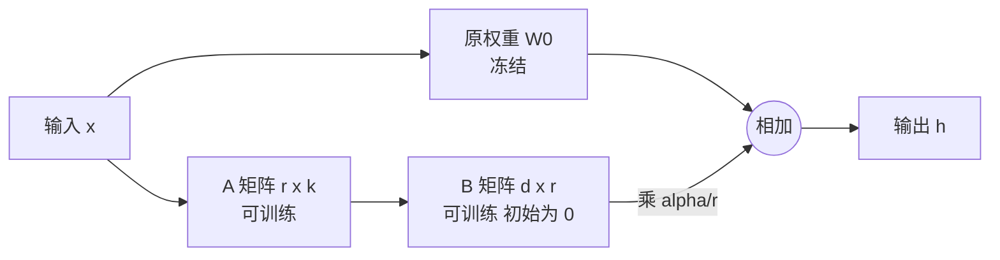

# PEFT 与 LoRA：参数高效微调

@@DISCLAIMER@@

## 一句话定义

PEFT（Parameter-Efficient Fine-Tuning，参数高效微调）是 Hugging Face 的库，也是一类方法的统称：**冻结预训练模型的大部分参数，只训练很少一部分新增参数**。其中最常用的是 LoRA——用两个小矩阵的乘积来表示权重的更新量。

## 为什么重要

- **省显存、省存储**：只训练约 0.1%–2% 的参数，优化器状态大幅减少；保存的适配器（adapter）只有几 MB 到几百 MB，而不是整个模型。
- **一个底座，多个适配器**：同一个基础模型可以挂载不同任务的 LoRA，按需切换。
- **个人与小团队做微调的主要方式**。【社区共识】

## 原理 / 图解

【有据可查】LoRA 论文（Hu 等，2021）：<https://arxiv.org/abs/2106.09685> ；PEFT 文档：<https://huggingface.co/docs/peft/index> 。本文使用 peft 0.21.2（PyPI 发布于 2026-10-01）。

LoRA 冻结原权重 $W_0 \in \mathbb{R}^{d\times k}$，学习低秩更新 $\Delta W = BA$：

$$
h = W_0 x + \Delta W x = W_0 x + \frac{\alpha}{r} B A x,\qquad B\in\mathbb{R}^{d\times r},\ A\in\mathbb{R}^{r\times k},\ r \ll \min(d,k)
$$

训练参数从 $dk$ 降到 $r(d+k)$。$B$ 初始化为 0，所以训练开始时 $\Delta W = 0$，模型输出与原模型完全相同。

| 方法 | 训练什么 | 特点 |
|---|---|---|
| 全量微调 | 所有参数 | 效果上限高，显存与存储开销最大 |
| LoRA | 低秩矩阵 A、B | 最常用，可合并回原权重，推理无额外开销 |
| QLoRA | 4-bit 量化底座 + LoRA | 进一步省显存（论文：<https://arxiv.org/abs/2305.14314>） |
| Prompt/Prefix Tuning | 软提示向量 | 参数极少，效果依任务而定 |

## 可运行示例

给微型 GPT-2 的注意力层 `c_attn` 加 LoRA（r=8），检查可训练参数比例、训练 100 步、保存适配器、合并回原模型并验证输出一致（Python 3.13 + peft 0.21.2 + torch CPU 实际运行）：

@@CODE:07_peft.py@@

输出：

@@OUT:07_peft@@

- 可训练参数 16,384 / 945,920 ≈ 1.73%；这里底座很小，真实大模型上比例通常更低。
- B 初始全 0 → 训练前输出与原模型一致；训练后词嵌入不变，证明底座确实冻结。
- 合并前后输出在 1e-5 内一致，说明 `merge_and_unload` 正确把 $BA$ 加回了 $W_0$。

## 常见误区

- **r 越大越好**：r 增大参数变多，但收益常常递减，常见取值 8–64；需按任务实验。【社区共识】
- **target_modules 写错**：不同架构的层名不同（GPT-2 是 `c_attn`，LLaMA 类常见 `q_proj`、`v_proj`），写错会报错或没有效果。用 `print(model)` 查看层名。
- **以为 LoRA 能“教会”模型全新知识**：LoRA 更擅长调整风格、格式和任务行为；大量新知识的注入效果有限，常配合检索（RAG）。【社区共识】
- **合并到量化模型时的精度问题**：量化底座上合并 LoRA 可能带来误差，按 PEFT 文档处理。
- **微调不能用来去除模型的安全对齐**：本文只讨论正当用途的微调。

## 与 AI 开发的关系

- **领域适配**：用业务数据让模型学会特定格式、术语和回答风格。
- **多租户服务**：同一底座加载多份 LoRA，按请求切换（vLLM 等推理框架支持多 LoRA）。【有据可查】<https://docs.vllm.ai/en/latest/features/lora.html>
- **图像风格 LoRA**：Diffusers 中同样广泛使用（见 [[k2.ml.diffusers]]）。

## 延伸阅读

- LoRA 论文：<https://arxiv.org/abs/2106.09685>
- QLoRA 论文：<https://arxiv.org/abs/2305.14314>
- PEFT 文档：<https://huggingface.co/docs/peft/index>
- PEFT LoRA 开发者指南：<https://huggingface.co/docs/peft/developer_guides/lora>

## 无法核实 / 待考察点

- 【待考察/推测】PEFT 0.21 支持的全部方法列表（如 DoRA、LoRA-FA 等变体）与各自适用场景未逐条核实。
- 【待考察/推测】“r 取 8–64”“LoRA 不擅长注入新知识”为社区经验，不同论文结论不完全一致。
