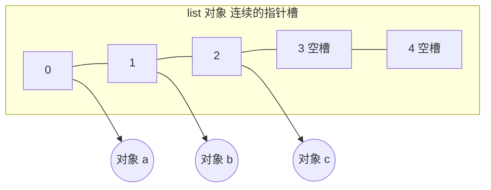

# 数组（Array）与 Python 列表

@@DISCLAIMER@@

## 一句话定义

数组是**在连续内存中按下标存放元素**的数据结构：知道下标就能一步算出地址，所以随机访问是 $O(1)$。Python 的 `list` 是**动态数组**——空间不够时自动申请更大的连续空间并搬迁。

## 为什么重要

- 几乎所有其他结构（栈、堆、哈希表、矩阵）的底层都是数组。
- 理解“连续内存”就能解释：为什么尾部追加快、头部插入慢；为什么 NumPy 比 list 快（见 [[k1.lib.numpy]]）。

## 原理 / 图解

【有据可查】CPython `list` 由指针数组实现，按比例**超额分配（over-allocation）**以使追加的摊还成本为常数：源码 <https://github.com/python/cpython/blob/main/Objects/listobject.c> ；官方时间复杂度表：<https://wiki.python.org/moin/TimeComplexity> 。

地址计算公式（这正是 $O(1)$ 随机访问的来源）：

$$
\text{addr}(i) = \text{base} + i \times \text{slot\_size}
$$

| 操作 | 复杂度 | 原因 |
|---|---|---|
| `a[i]` 读写 | $O(1)$ | 地址直接计算 |
| `append` / 尾部 `pop` | 摊还 $O(1)$ | 有空槽直接放，偶尔扩容 |
| `insert(0, x)` / `pop(0)` | $O(n)$ | 后面所有元素要挪一位 |
| `x in a` | $O(n)$ | 逐个比较 |

## 可运行示例

观察扩容过程、各操作的实际耗时、`array` 模块的紧凑存储，以及二维列表的经典陷阱（Python 3.15.0 实际运行）：

@@CODE:08_array.py@@

输出：

@@OUT:08_array@@

- `sys.getsizeof` 是阶梯式增长的（88 → 120 → 184 → 248 字节），说明不是每次 append 都扩容。
- 头部插入/删除比尾部慢上万倍：这就是 $O(n)$ 与 $O(1)$ 的差别。
- `list` 存的是指向对象的指针，`array('d')` 直接存 8 字节浮点数，内存约为前者的 1/4。

## 常见误区

- **`[[0]*3]*3` 建二维表**：三行是同一个列表对象，改一行三行一起变（见 [[k1.py.object-reference]]）。用 `[[0]*3 for _ in range(3)]`。
- **把 list 当队列用 `pop(0)`**：$O(n)$，改用 `collections.deque`（见 [[k2.ds.queue]]）。
- **以为 Python list 存的是“值”**：它存引用，元素可以是不同类型。
- **大量数值计算用 list 循环**：改用 NumPy 向量化。

## 与 AI 开发的关系

- **张量就是多维数组**：PyTorch/NumPy 张量的“形状 + 步长（stride）”就是在连续内存上做下标换算，`view`/`reshape`/`contiguous` 的区别都源于此。
- **批处理与预分配**：知道长度时预分配数组比反复 append 更省内存碎片。
- **Token 序列、嵌入表**本质上都是按下标访问的数组。

## 延伸阅读

- Python 官方：列表的更多用法 <https://docs.python.org/zh-cn/3/tutorial/datastructures.html>
- `array` 模块：<https://docs.python.org/3/library/array.html>
- Python Wiki 时间复杂度：<https://wiki.python.org/moin/TimeComplexity>

## 无法核实 / 待考察点

- 【待考察/推测】CPython 3.15 的 list 超额分配公式是否与 3.12 等版本一致未逐行比对源码；文中只依据实测的阶梯增长。
- 【待考察/推测】耗时数字受机器负载影响，只看数量级。
