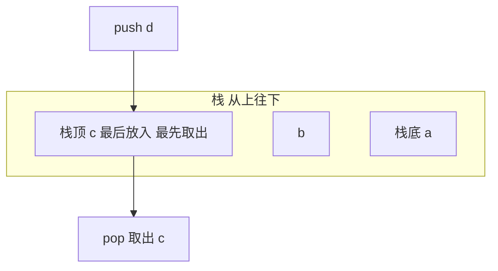

# 栈（Stack）

@@DISCLAIMER@@

## 一句话定义

栈是**后进先出（LIFO）**的容器：只能在一端（栈顶）放入（push）和取出（pop）。就像一摞盘子，最后放上去的最先拿走。

## 为什么重要

- **函数调用就是栈**：每次调用压入一个栈帧，返回时弹出；错误时看到的回溯（traceback）就是调用栈（见 [[k1.prog.stack-trace]]）。
- 括号匹配、表达式求值、撤销（Undo）、浏览器后退、深度优先搜索（见 [[k2.algo.dfs]]）都靠栈。

## 原理 / 图解

Python 中用 `list` 的 `append` / `pop()` 即可，二者都是摊还 $O(1)$。【有据可查】官方教程“将列表作为栈使用”：<https://docs.python.org/3/tutorial/datastructures.html#using-lists-as-stacks>

## 可运行示例

括号匹配、逆波兰表达式（RPN）求值、递归深度上限、用显式栈把递归改成循环（Python 3.15.0 实际运行）：

@@CODE:10_stack.py@@

输出：

@@OUT:10_stack@@

递归 1000 层就触发 `RecursionError`（默认递归上限约为 1000），改用显式栈后处理 10 万层也没问题。【有据可查】`sys.getrecursionlimit`：<https://docs.python.org/3/library/sys.html#sys.getrecursionlimit>

## 常见误区

- **`pop(0)` 当栈用**：那是从底部取，变成队列且是 $O(n)$。
- **空栈 pop**：会抛 `IndexError`，要先判空。
- **随意调大 `sys.setrecursionlimit`**：可能导致解释器真正的 C 栈溢出而崩溃；深递归应改迭代。
- **混淆“栈”数据结构和“栈内存”**：前者是抽象结构，后者是程序运行时的内存区域，二者相关但不是一回事。

## 与 AI 开发的关系

- **解析模型输出**：检查 LLM 生成的 JSON/代码括号是否配对、提取嵌套结构，常用栈。
- **结构化生成**：约束解码（按 JSON 语法生成）内部维护类似下推自动机的栈状态。【待考察/推测】具体实现因库而异。
- **Agent 任务分解**：子任务的“进入/返回”天然是栈式结构。

## 延伸阅读

- Python 教程：列表作为栈 <https://docs.python.org/3/tutorial/datastructures.html#using-lists-as-stacks>
- 逆波兰表示法（维基百科）：<https://en.wikipedia.org/wiki/Reverse_Polish_notation>

## 无法核实 / 待考察点

- 【待考察/推测】Python 3.12 起解释器对 Python 函数调用不再消耗 C 栈，对递归上限行为的影响细节未逐条核实。
