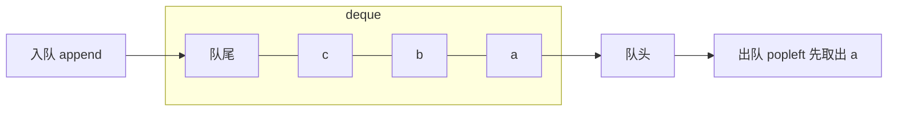

# 队列（Queue）

@@DISCLAIMER@@

## 一句话定义

队列是**先进先出（FIFO）**的容器：从队尾入队（enqueue），从队头出队（dequeue），像排队买票。双端队列（deque）两端都能进出。

## 为什么重要

- **广度优先搜索**的核心（见 [[k2.algo.bfs]]）。
- **任务调度与削峰**：请求排队、消息队列、线程/协程之间传递任务。
- **滑动窗口**：保留最近 N 条数据。

## 原理 / 图解

| Python 工具 | 适用场景 |
|---|---|
| `collections.deque` | 单线程，两端 $O(1)$，可设 `maxlen` |
| `queue.Queue` | 多线程，线程安全，可阻塞等待 |
| `asyncio.Queue` | 协程之间，非线程安全 |
| `heapq` / `queue.PriorityQueue` | 按优先级出队（见 [[k2.ds.heap]]） |

【有据可查】`queue` 模块文档：<https://docs.python.org/3/library/queue.html> ；`asyncio.Queue`：<https://docs.python.org/3/library/asyncio-queue.html>

## 可运行示例

deque 基本操作、`maxlen` 滑动窗口、多线程生产者/消费者、asyncio 队列（Python 3.15.0 实际运行）：

@@CODE:11_queue.py@@

输出：

@@OUT:11_queue@@

## 常见误区

- **`list.pop(0)` 做队列**：$O(n)$，数据多时很慢。
- **多线程共享 deque 做复杂操作**：单个 `append`/`popleft` 是线程安全的，但“先判断再取”这类组合操作不是；跨线程用 `queue.Queue`。
- **在协程里用 `queue.Queue` 阻塞等待**：会阻塞整个事件循环，应使用 `asyncio.Queue`（见 [[k1.py.async-await]]）。
- **无界队列**：生产快于消费时内存无限增长，生产环境要设 `maxsize` 实现背压（backpressure）。

## 与 AI 开发的关系

- **LLM API 调用限流**：把请求放入有界队列，由固定数量的 worker 消费，控制并发、遵守服务商的速率限制（本文不讨论绕过限额）。
- **推理服务的批处理**：vLLM 等推理引擎维护请求等待队列，按调度策略组批。【有据可查】<https://docs.vllm.ai/en/latest/design/arch_overview.html>
- **对话记忆窗口**：`deque(maxlen=N)` 只保留最近 N 轮对话。

## 延伸阅读

- `collections.deque`：<https://docs.python.org/3/library/collections.html#collections.deque>
- `queue` 模块：<https://docs.python.org/3/library/queue.html>
- `asyncio.Queue`：<https://docs.python.org/3/library/asyncio-queue.html>

## 无法核实 / 待考察点

- 【待考察/推测】在 free-threaded（无 GIL）构建下 deque 单操作的线程安全保证是否完全一致，未查到官方逐条说明。
