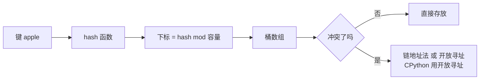

# 哈希表（Hash Table）与 dict / set

@@DISCLAIMER@@

## 一句话定义

哈希表用**哈希函数**把键（key）换算成数组下标，直接定位存放位置，从而实现平均 $O(1)$ 的插入、查找和删除。Python 的 `dict` 和 `set` 都是哈希表。

## 为什么重要

- **最常用的“提速”工具**：把 $O(n)$ 的“在列表里找”变成 $O(1)$ 的“在集合里查”，常常能让程序快几千倍。
- 缓存、去重、计数、索引、记忆化（见 [[k2.algo.dynamic-programming]]）都依赖它。

## 原理 / 图解

下标计算的基本形式：

$$
\text{index} = \text{hash}(k) \bmod m
$$

装载因子 $\alpha = n/m$（元素数 / 槽位数）越高，冲突越多；所以哈希表会在装满前扩容。

【有据可查】CPython 的 dict 采用开放寻址与紧凑存储（3.6 起保持插入顺序，3.7 起成为语言规范）：源码注释 <https://github.com/python/cpython/blob/main/Objects/dictobject.c> ；3.7 规范说明 <https://docs.python.org/3/whatsnew/3.7.html> 。字符串哈希默认随机化以防哈希碰撞攻击：<https://docs.python.org/3/reference/datamodel.html#object.__hash__> 。

## 可运行示例

list 与 set 查找对比、手写链地址法哈希表、可哈希性、`Counter` / `defaultdict` / 保序去重（Python 3.15.0 实际运行）：

@@CODE:12_hash_table.py@@

输出：

@@OUT:12_hash_table@@

- 10 万元素查找：list 656µs，set 64ns，相差约一万倍。
- `1`、`1.0`、`True` 相等且哈希值相同，所以在字典中是**同一个键**，最后结果只有 `{1: 'c'}`。
- 列表可变、不可哈希，不能做键（见 [[k1.py.mutability]]）。

## 常见误区

- **“哈希表永远 $O(1)$”**：这是平均情况；极端冲突时退化为 $O(n)$，扩容那一次也是 $O(n)$。
- **把可变对象当键**：自定义类如果重写了 `__eq__` 却没正确实现 `__hash__`，会导致查不到或无法哈希。
- **依赖 set 的遍历顺序**：set 不保证顺序；dict 保证插入顺序。
- **以为字符串的 `hash()` 每次运行都一样**：默认每个进程随机化（`PYTHONHASHSEED`），不能把 `hash()` 结果持久化当 ID 使用，持久化用 `hashlib`。

## 与 AI 开发的关系

- **分词表**：token 字符串 → id 的映射就是一个大字典。
- **缓存**：对相同 prompt 的 LLM 响应缓存、嵌入向量缓存（键可用 `hashlib.sha256(prompt)`）。
- **去重**：训练数据精确去重用哈希；近似去重用 MinHash/LSH 等“局部敏感哈希”。【有据可查】<https://en.wikipedia.org/wiki/Locality-sensitive_hashing>
- **特征哈希**：sklearn 的 `HashingVectorizer` 用哈希把文本映射到固定维度。【有据可查】<https://scikit-learn.org/stable/modules/feature_extraction.html#feature-hashing>

## 延伸阅读

- Python 字典文档：<https://docs.python.org/3/library/stdtypes.html#mapping-types-dict>
- `collections`（Counter、defaultdict）：<https://docs.python.org/3/library/collections.html>
- Raymond Hettinger 演讲 “Modern Python Dictionaries”（PyCon 2017）：<https://www.youtube.com/watch?v=npw4s1QTmPg>

## 无法核实 / 待考察点

- 【待考察/推测】CPython 3.15 dict 的扩容阈值（约 2/3 装载）与增长倍数是否有调整，未逐行核对源码。
