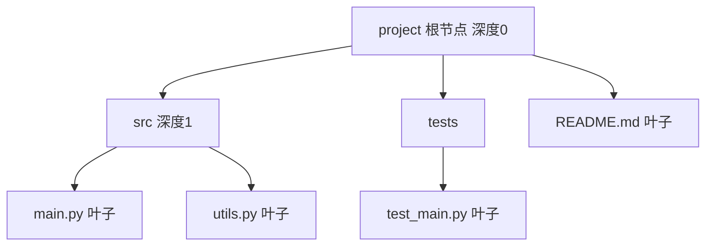

# 树（Tree）

@@DISCLAIMER@@

## 一句话定义

树是由节点和边组成的**层级结构**：有一个根节点，每个节点可以有多个子节点，除根以外每个节点恰好有一个父节点，并且没有环。

## 为什么重要

- **层级数据无处不在**：文件系统、HTML/DOM、JSON、组织架构、代码的语法树（AST）。
- 许多高效结构都是特化的树：二叉搜索树、堆、Trie、B 树（数据库索引）、决策树（机器学习模型）。

## 原理 / 图解

| 术语 | 含义 |
|---|---|
| 根（root） | 没有父节点的节点 |
| 叶子（leaf） | 没有子节点的节点 |
| 深度 / 高度 | 从根到该节点的边数 / 从根到最深叶子的层数 |
| 子树 | 任一节点及其所有后代 |

一棵有 $n$ 个节点的树恰好有 $n-1$ 条边。树天然适合**递归**：一棵树 = 根 + 若干棵子树。

## 可运行示例

用类表示文件树，递归打印、求高度与叶子数、查找路径；再看 Python 自带的语法树 `ast` 和 JSON 嵌套结构（Python 3.15.0 实际运行）：

@@CODE:13_tree.py@@

输出：

@@OUT:13_tree@@

`ast.dump` 显示 `(a + b) * 2` 的语法树：乘法是根，左子树是加法——括号决定了树的形状，也决定了计算顺序。【有据可查】`ast` 模块：<https://docs.python.org/3/library/ast.html>

## 常见误区

- **深度与高度的定义不统一**：有的教材从 0 计、有的从 1 计，读题时先确认。
- **很深的树用递归遍历**：可能触发递归上限（见 [[k2.ds.stack]]），可改用显式栈。
- **把有共享子节点的结构当树处理**：一个节点有两个父节点就是图（DAG）了（见 [[k2.ds.graph]]），遍历时要防重复。

## 与 AI 开发的关系

- **决策树与随机森林**：sklearn 的树模型（见 [[k2.ml.sklearn]]）、XGBoost/LightGBM 的梯度提升树。
- **代码智能**：代码分析、重构工具和部分代码模型基于 AST 或 tree-sitter 语法树。【有据可查】<https://tree-sitter.github.io/tree-sitter/>
- **思维树（Tree of Thoughts）**：把 LLM 推理组织为树状搜索。【有据可查】<https://arxiv.org/abs/2305.10601>
- **文档切分**：按标题层级（Markdown 树）切分文档用于 RAG。

## 延伸阅读

- 维基百科：树（数据结构）<https://en.wikipedia.org/wiki/Tree_(abstract_data_type)>
- Python `ast` 模块：<https://docs.python.org/3/library/ast.html>
- 《算法导论》第 10、12 章。

## 无法核实 / 待考察点

- 暂无需要特别标注的不确定事实；术语计数方式请以所用教材为准。
