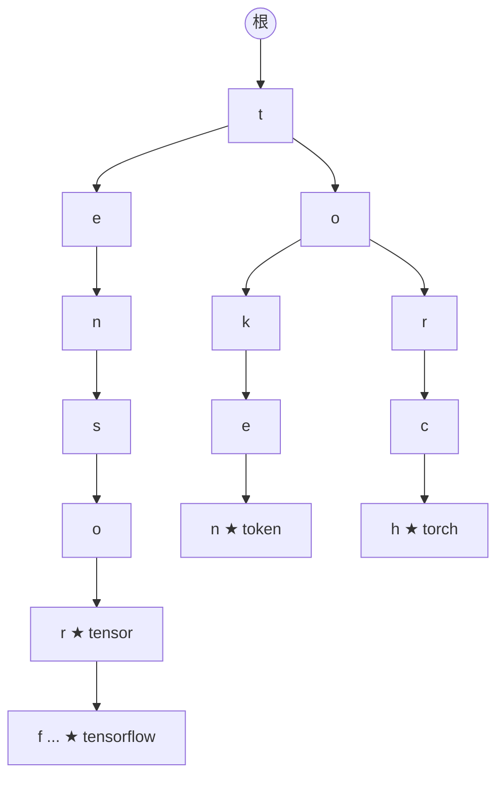

# Trie（前缀树 / 字典树）

@@DISCLAIMER@@

## 一句话定义

Trie 是专为**字符串前缀**设计的树：从根到某节点的路径拼起来就是一个前缀，共享前缀的单词共享同一段路径。查找一个长度为 $L$ 的词只需 $O(L)$，与词典大小无关。

## 为什么重要

- **自动补全、拼写检查、敏感词匹配、路由表（IP 最长前缀匹配）**的经典实现。
- **分词器**：最长前缀匹配（MaxMatch）类分词以及部分 tokenizer 的词表查找都用到前缀结构。

## 原理 / 图解

存入 `tensor`、`tensorflow`、`token`、`torch` 后的局部结构（★ 表示一个完整词结束）：

| 操作 | 哈希集合 | Trie |
|---|---|---|
| 精确查找 | 平均 $O(L)$（算哈希） | $O(L)$ |
| 列出某前缀的所有词 | 必须扫描全部词 | 走到前缀节点后只遍历子树 |
| 最长前缀匹配 | 尝试所有长度 | 一路向下走即可 |

## 可运行示例

用嵌套字典实现 Trie：插入、查找、自动补全、统计共享前缀节省的节点数、最长前缀匹配分词（Python 3.15.0 实际运行）：

@@CODE:17_trie.py@@

输出：

@@OUT:17_trie@@

`unhappiness` 被切成 `['unhappi', 'ness']`：贪心地每次取词表中最长的前缀。这说明了最长匹配“快但不一定符合语言直觉”的特点（对照 [[k2.algo.greedy]]）。

## 常见误区

- **Trie 一定省内存**：共享前缀多时省，但每个节点有字典开销，Python 实现往往比 `set` 更占内存；工业实现用双数组 Trie 等压缩结构。
- **忘记标记“词结束”**：否则无法区分 `tok`（前缀）和 `token`（完整词）。
- **把 BPE 分词等同于最长前缀匹配**：GPT 系列的 BPE 按合并规则优先级分词，不是简单的最长匹配；WordPiece 推理时才近似最长前缀匹配。【有据可查】Hugging Face 分词算法概述：<https://huggingface.co/docs/transformers/tokenizer_summary>

## 与 AI 开发的关系

- **分词器原理**：理解 token 是如何从字符串切出来的（见 [[k2.ml.transformers]]）。
- **约束解码**：只允许生成某个候选集合中的字符串（如枚举值、函数名）时，可用 Trie 限制每一步允许的 token。【待考察/推测】具体库的实现方式各不相同。
- **内容过滤**：多模式字符串匹配（Aho–Corasick 自动机）建立在 Trie 之上。【有据可查】<https://en.wikipedia.org/wiki/Aho%E2%80%93Corasick_algorithm>

## 延伸阅读

- 维基百科：Trie <https://en.wikipedia.org/wiki/Trie>
- Hugging Face 分词器概述：<https://huggingface.co/docs/transformers/tokenizer_summary>
- Hugging Face LLM 课程：WordPiece 分词 <https://huggingface.co/learn/llm-course/chapter6/6>

## 无法核实 / 待考察点

- 【待考察/推测】Hugging Face `tokenizers`（Rust）库内部对 WordPiece 词表查找是否使用 Trie 结构，未查阅源码核实。
