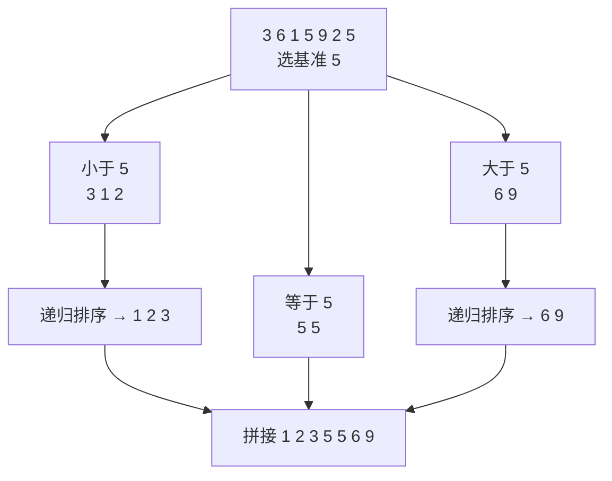

# 快速排序（Quicksort）

@@DISCLAIMER@@

## 一句话定义

快速排序是一种**分治**排序：选一个基准（pivot），把数组分成“比它小”和“比它大”两部分，再分别递归排序。平均 $O(n\log n)$，原地排序、常数小，但最坏情况 $O(n^2)$。

## 为什么重要

- C 标准库 `qsort`、C++ `std::sort`（内省排序 introsort 以快排为主）等大量系统级排序以它为基础。【有据可查】introsort：<https://en.wikipedia.org/wiki/Introsort>
- 是理解“分治 + 随机化”思想的经典例子；分区（partition）思想还用于快速选择第 k 小元素（quickselect）。

## 原理 / 图解

【有据可查】由 C. A. R. Hoare 于 1961 年发表（Algorithm 64: Quicksort, *Communications of the ACM*）：<https://doi.org/10.1145/366622.366644>

复杂度递推：每层分区 $O(n)$；若每次大致对半分，共 $\log n$ 层：

$$
T(n) = 2T(n/2) + O(n) \Rightarrow T(n) = O(n \log n)
$$

若每次基准都是最大/最小值（如对已排序数组总选末尾），则：

$$
T(n) = T(n-1) + O(n) \Rightarrow T(n) = O(n^2)
$$

## 可运行示例

简单版与原地分区版快排，统计三种情况下的比较次数，并与内置 `sorted` 比速度（Python 3.15.0 实际运行）：

@@CODE:19_quicksort.py@@

输出：

@@OUT:19_quicksort@@

- 随机数组约 4 万次比较，接近 $n\log_2 n$；**已排序数组 + 末尾基准**约 450 万次，正好是 $n^2/2$ 的最坏情况。
- 换成随机基准，最坏情况的概率变得极小，比较次数回到约 3.8 万。
- 手写 Python 快排比内置 `sorted` 慢约 9 倍：内置排序用 C 实现且算法不同（见 [[k2.algo.mergesort]]）。

## 常见误区

- **固定选第一个/最后一个当基准**：遇到有序或近乎有序的输入会退化。用随机基准或“三数取中”。
- **以为快排是稳定的**：不稳定，相等元素的相对顺序可能改变。
- **大量重复元素时退化**：用三路分区（小于/等于/大于）。
- **实际项目手写排序**：Python 里直接用 `sorted` / `list.sort`，需要按多字段排用 `key=`。

## 与 AI 开发的关系

- **Top-k 选择**：quickselect 平均 $O(n)$ 找第 k 大，是 `numpy.partition` 等的思路来源。【有据可查】`numpy.partition` 文档提及 introselect：<https://numpy.org/doc/stable/reference/generated/numpy.partition.html>
- **理解随机化算法**：随机基准用“概率”换掉“最坏输入”，与机器学习中的随机初始化、随机打乱思想相通。
- **按分数排序候选**：RAG 重排、推荐系统排序最终都调用高效的库排序。

## 延伸阅读

- 维基百科：快速排序 <https://en.wikipedia.org/wiki/Quicksort>
- VisuAlgo 排序动画：<https://visualgo.net/en/sorting>
- 《算法导论》第 7 章“快速排序”。

## 无法核实 / 待考察点

- 【待考察/推测】快排平均比较次数约为 $2n\ln n \approx 1.39\, n\log_2 n$ 是经典结论；本例实测略高于 $n\log_2 n$，与理论量级一致，但未做严格统计。
