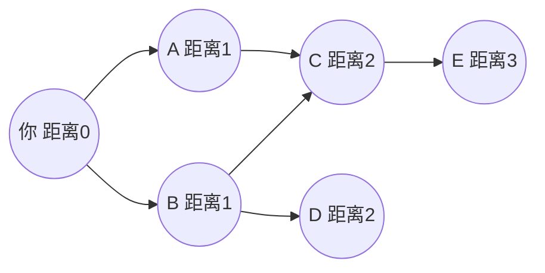
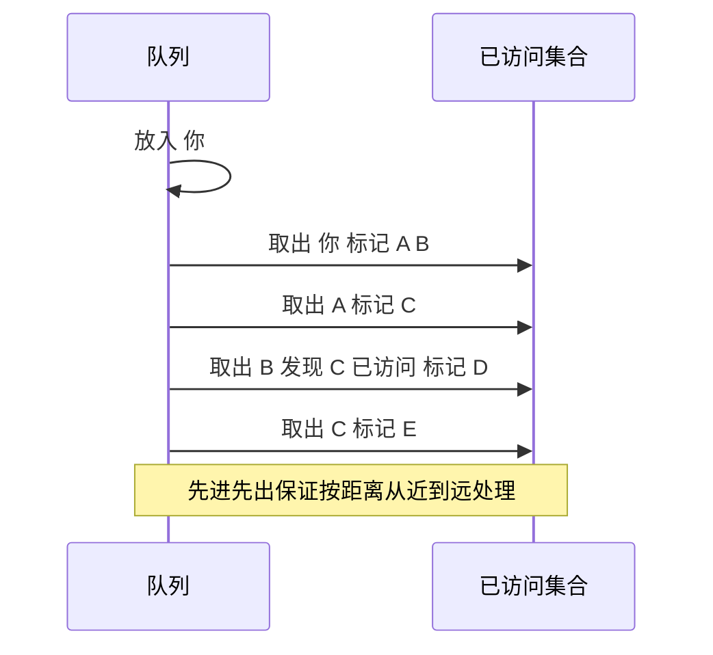

# 广度优先搜索（BFS）

@@DISCLAIMER@@

## 一句话定义

BFS 从起点出发，**一圈一圈向外扩展**：先访问所有距离 1 的节点，再访问距离 2 的，依此类推。它用**队列**实现，并且在无权图上找到的一定是**最短路径**（边数最少）。

## 为什么重要

- **无权最短路径**：迷宫最少步数、社交网络“几度好友”、网页爬虫按层抓取。
- 二叉树的层序遍历就是 BFS（见 [[k2.ds.binary-tree]]）。
- 是 Dijkstra 的“特例”：所有边权相等时，Dijkstra 退化为 BFS（见 [[k2.algo.dijkstra]]）。

## 原理 / 图解

时间复杂度 $O(V+E)$：每个顶点入队一次，每条边检查一次。

【有据可查】BFS 的早期描述之一见 E. F. Moore 1959 年的迷宫最短路径论文；概述：<https://en.wikipedia.org/wiki/Breadth-first_search>

## 可运行示例

网格迷宫最短路径（含路径还原与 ASCII 可视化）、社交网络“几度好友”（Python 3.15.0 实际运行）：

@@CODE:22_bfs.py@@

输出：

@@OUT:22_bfs@@

图中 `*` 是 BFS 找到的 12 步最短路径，`#` 是墙。BFS 只出队了 21 个格子就找到了终点。

## 常见误区

- **出队时才标记已访问**：同一节点可能被多次入队，浪费时间甚至爆内存；应在**入队时**标记。
- **用 list.pop(0) 当队列**：$O(n)$，改用 `deque.popleft()`。
- **在有权图上用 BFS 求最短路**：BFS 只数边数，不看权重，结果会错（见 [[k2.algo.shortest-path]] 示例）。
- **忘记记录前驱节点**：只能得到距离，无法还原路径。

## 与 AI 开发的关系

- **知识图谱多跳检索**：从实体出发 1 跳、2 跳扩展邻居，作为 GraphRAG 的候选上下文。
- **网页爬取与数据采集**：按层抓取站点（务必遵守 robots.txt 与网站条款）。
- **Agent 搜索**：在有限步数内按层枚举工具调用或状态，找最短操作序列。
- **依赖分析**：找出一个模块变更会影响的所有下游（按层扩散）。

## 延伸阅读

- 维基百科：广度优先搜索 <https://en.wikipedia.org/wiki/Breadth-first_search>
- VisuAlgo 图遍历动画：<https://visualgo.net/en/dfsbfs>
- Red Blob Games：寻路算法图解 <https://www.redblobgames.com/pathfinding/a-star/introduction.html>

## 无法核实 / 待考察点

- 【待考察/推测】BFS 最早的发明者归属（Moore 1959 与 Konrad Zuse 1945 年未发表的工作）存在不同说法，本文未查原始文献。
