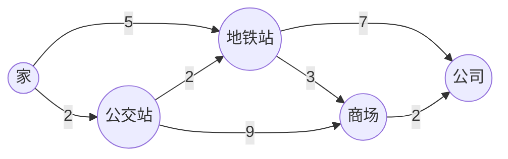

# Dijkstra 最短路径算法

@@DISCLAIMER@@

## 一句话定义

Dijkstra 算法求**非负权图**中一个起点到所有点的最短路径：每次从“尚未确定”的点里取出**当前距离最小**的一个，宣布它的距离已确定，再用它松弛邻居。配合最小堆，复杂度 $O((V+E)\log V)$。

## 为什么重要

- 地图导航、网络路由协议（如 OSPF 使用最短路径优先算法）的核心。【有据可查】OSPF RFC 2328：<https://www.rfc-editor.org/rfc/rfc2328>
- 贪心 + 优先队列的范例；A\* 搜索就是 Dijkstra 加上启发函数。

## 原理 / 图解

【有据可查】E. W. Dijkstra, “A note on two problems in connexion with graphs”, *Numerische Mathematik* 1, 269–271 (1959)：<https://doi.org/10.1007/BF01386390>

示例：从家到公司（边权为分钟）。

| 步骤 | 取出（确定） | 更新 |
|---|---|---|
| 1 | 家 = 0 | 地铁站 5，公交站 2 |
| 2 | 公交站 = 2 | 地铁站 min(5, 4) = 4，商场 11 |
| 3 | 地铁站 = 4 | 公司 11，商场 min(11, 7) = 7 |
| 4 | 商场 = 7 | 公司 min(11, 9) = 9 |
| 5 | 公司 = 9 | — |

**为什么正确**：所有边权非负时，当前最小的那个距离不可能再被“绕路”变小，因为任何绕路都只会再加非负的代价。数学上：

$$
d[u] = \min_{v \notin S} d[v],\quad w \ge 0 \Rightarrow \forall\ \text{其他路径 } P:\ \text{cost}(P) \ge d[u]
$$

这个论证依赖 $w \ge 0$；有负权边时就不成立了。

## 可运行示例

用 `heapq` 实现的 Dijkstra（懒删除版）+ 路径还原；再用“教科书版”（点一旦确定就不再更新）演示负权边下的错误结果；最后用 SciPy 交叉验证（Python 3.13 + scipy 1.18.1 实际运行）：

@@CODE:25_dijkstra.py@@

输出：

@@OUT:25_dijkstra@@

- 出堆顺序与上表一致，最短路线 9 分钟，SciPy 结果相同。
- 有负权边时，教科书版先确定了 A=2、C=3，之后经过 B 的 −4 边无法再修正已确定的点，得到错误的 3（真实为 2）。

## 常见误区

- **用于负权边**：会得到错误结果，且不报错；有负权改用 Bellman-Ford（见 [[k2.algo.shortest-path]]）。
- **懒删除版不跳过过期条目**：堆中同一个点可能有多个旧距离，弹出时要判断 `d > dist[u]` 则跳过。
- **以为 Dijkstra 只能求两点**：它一次求出起点到所有点的距离；只要两点时可在终点出堆时提前结束。
- **把“有些懒删除实现在负权图上碰巧结果正确”当成可以用**：那是因为节点被重复处理，失去了复杂度保证，也不保证正确。

## 与 AI 开发的关系

- **规划与搜索**：机器人、游戏 AI 的寻路使用 Dijkstra / A\*。
- **束搜索与最优解码**：在“状态 + 累积代价”上按最小代价扩展的思想与 Dijkstra 相通（代价为负对数概率，非负）。【社区共识】
- **图检索**：在加权知识图谱中找关联最强（代价最小）的路径。

## 延伸阅读

- Dijkstra 1959 原论文：<https://doi.org/10.1007/BF01386390>
- Red Blob Games：Dijkstra 与 A\* 图解 <https://www.redblobgames.com/pathfinding/a-star/introduction.html>
- SciPy `dijkstra`：<https://docs.scipy.org/doc/scipy/reference/generated/scipy.sparse.csgraph.dijkstra.html>

## 无法核实 / 待考察点

- 【待考察/推测】Dijkstra 本人回忆该算法于 1956 年构思、约 20 分钟想出（访谈资料），未查到原始访谈的权威链接。
