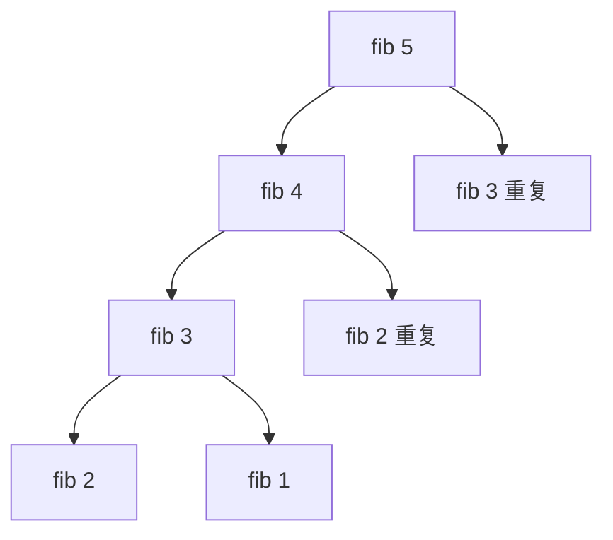

# 动态规划（Dynamic Programming）

@@DISCLAIMER@@

## 一句话定义

动态规划把一个问题拆成**相互重叠的子问题**，每个子问题只算一次并把结果存起来（记忆化或填表），再由小问题的最优解组合出大问题的最优解。

## 为什么重要

- 能把指数级的暴力搜索降到多项式级：朴素递归斐波那契 $O(2^n)$ → DP $O(n)$。
- 文本相似度（编辑距离）、序列比对（DNA）、资源分配（背包）、语音识别与分词（Viterbi）、强化学习（Bellman 方程）都是 DP。

## 原理 / 图解

【有据可查】“动态规划”一词由 Richard Bellman 于 1950 年代提出：<https://en.wikipedia.org/wiki/Dynamic_programming>

适用 DP 的两个条件：**最优子结构**（大问题的最优解由子问题最优解构成）和**重叠子问题**（同一子问题被反复求解）。

朴素递归把 fib(3)、fib(2) 算了多次；记忆化后每个只算一次。

**编辑距离**（把字符串 $a$ 变成 $b$ 的最少插入/删除/替换次数）的状态转移方程：

$$
D[i][j] = \min\begin{cases}
D[i-1][j] + 1 & \text{删除}\\
D[i][j-1] + 1 & \text{插入}\\
D[i-1][j-1] + [a_i \ne b_j] & \text{替换或相同}
\end{cases}
$$

**0/1 背包**（容量 $C$，物品重量 $w_i$、价值 $v_i$）：

$$
\text{best}[c] = \max\big(\text{best}[c],\ \text{best}[c - w_i] + v_i\big)
$$

DP 解题四步：① 定义状态 ② 写转移方程 ③ 确定初始值/边界 ④ 确定计算顺序。

## 可运行示例

斐波那契的朴素递归 vs `functools.cache` 记忆化、编辑距离与 DP 表、“显存背包”选择微调方案、最长公共子序列（Python 3.15.0 实际运行）：

@@CODE:26_dynamic_programming.py@@

输出：

@@OUT:26_dynamic_programming@@

- fib(27)：朴素递归 63 万次调用，记忆化只要 28 次。
- DP 表右下角的 3 就是 kitten → sitting 的编辑距离（k→s 替换、e→i 替换、末尾插入 g）。
- 背包例子的“显存/收益”数字是虚构的，只为演示 DP 如何在约束下选最优组合。

## 常见误区

- **状态定义不清**：DP 最难的一步。先用自然语言写清“`D[i][j]` 表示什么”。
- **记忆化缓存可变参数**：`functools.cache` 要求参数可哈希，传 list 会报错（见 [[k2.ds.hash-table]]）。
- **0/1 背包内层循环方向写错**：一维数组时容量要**从大到小**遍历，否则同一物品会被重复选。
- **以为 DP 一定比贪心好**：DP 正确但可能更慢；问题有贪心选择性质时贪心更简单（见 [[k2.algo.greedy]]）。

## 与 AI 开发的关系

- **文本评估**：编辑距离用于 OCR/ASR 的字错率（CER/WER）计算；LCS 是 ROUGE-L 指标的基础。【有据可查】ROUGE 论文：<https://aclanthology.org/W04-1013/>
- **Viterbi 解码**：HMM/CRF 序列标注（分词、命名实体识别）用 DP 求最优标签序列。【有据可查】<https://en.wikipedia.org/wiki/Viterbi_algorithm>
- **强化学习**：Bellman 方程、值迭代、策略迭代都是 DP 思想。
- **CTC 损失**：语音识别中用前向-后向 DP 对所有对齐路径求和。【有据可查】<https://distill.pub/2017/ctc/>
- **缓存 LLM 子任务结果**：Agent 中对重复子问题缓存结果，本质也是记忆化。

## 延伸阅读

- `functools.cache` / `lru_cache`：<https://docs.python.org/3/library/functools.html#functools.cache>
- 维基百科：动态规划 <https://en.wikipedia.org/wiki/Dynamic_programming>
- 维基百科：编辑距离 <https://en.wikipedia.org/wiki/Levenshtein_distance>

## 无法核实 / 待考察点

- 【待考察/推测】Bellman 自述选用“dynamic programming”一词是为了避开当时官员对“研究”一词的反感，此说法来自其自传，未查原书。
