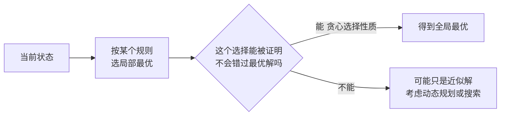

# 贪心算法（Greedy）

@@DISCLAIMER@@

## 一句话定义

贪心算法每一步都做**当前看起来最好**的选择，并且不回头。它简单、快速，但只有在问题满足“贪心选择性质”时才能得到全局最优解。

## 为什么重要

- 很多经典算法本质是贪心：Dijkstra（每次取最近的点）、Huffman 编码、Prim/Kruskal 最小生成树、区间调度。
- **知道贪心何时失效同样重要**：例如 LLM 的贪心解码不一定得到整体概率最高的句子。

## 原理 / 图解

| 问题 | 贪心规则 | 是否最优 |
|---|---|---|
| 区间调度（最多会议） | 按**结束时间**最早选 | 是（可证明） |
| 找零（人民币面额） | 每次取最大面额 | 是（该面额体系下） |
| 找零（面额 1,3,4） | 每次取最大面额 | **否** |
| 哈夫曼编码 | 每次合并频率最小的两个 | 是 |
| LLM 贪心解码 | 每步取概率最大的 token | **否**（序列概率不一定最大） |

【有据可查】Huffman, “A Method for the Construction of Minimum-Redundancy Codes”, *Proceedings of the IRE*, 1952：<https://doi.org/10.1109/JRPROC.1952.273898>

贪心解码失败的原因：序列概率是各步条件概率的乘积，局部最大不等于乘积最大：

$$
P(y_1, y_2) = P(y_1)\,P(y_2 \mid y_1),\qquad 0.6 \times 0.5 = 0.30 \;<\; 0.4 \times 0.9 = 0.36
$$

## 可运行示例

区间调度、两种面额体系下的找零（贪心 vs DP）、哈夫曼编码、贪心解码的反例（Python 3.15.0 实际运行）：

@@CODE:27_greedy.py@@

输出：

@@OUT:27_greedy@@

- 面额 [1,3,4] 凑 6：贪心选 4+1+1（3 枚），最优是 3+3（2 枚）。
- `abracadabra` 用哈夫曼编码只需 23 bit，定长 3 bit 编码需 33 bit。
- 第一步选“我”（0.6）看似更好，但“我们”总概率只有 0.30，不如“你好”的 0.36。

## 常见误区

- **没证明就用贪心**：贪心“看起来对”最容易出错，至少要用反例检验或给出交换论证。
- **区间调度按开始时间或长度排序**：都会出错，正确规则是按结束时间。
- **把贪心和 DP 对立**：许多问题先想 DP，再发现可以简化为贪心；两者都依赖最优子结构。

## 与 AI 开发的关系

- **解码策略**：`do_sample=False` 时是贪心解码（确定、可复现）；束搜索（beam search）是保留多个候选的“宽一点的贪心”；采样（temperature/top-p）引入随机性（见 [[k2.math.probability]]）。【有据可查】<https://huggingface.co/docs/transformers/generation_strategies>
- **BPE 分词训练**：每轮贪心地合并出现次数最多的符号对。【有据可查】Sennrich 等 2016：<https://arxiv.org/abs/1508.07909>
- **特征选择**：前向逐步选择每次加入使指标提升最多的特征（sklearn `SequentialFeatureSelector`）。
- **上下文压缩**：在 token 预算内按“相关度/长度”贪心挑选文档片段，是 RAG 中常见的近似做法。【社区共识】

## 延伸阅读

- 维基百科：贪心算法 <https://en.wikipedia.org/wiki/Greedy_algorithm>
- Hugging Face 生成策略文档：<https://huggingface.co/docs/transformers/generation_strategies>
- 《算法导论》第 16 章“贪心算法”。

## 无法核实 / 待考察点

- 【待考察/推测】“人民币面额下贪心找零总是最优”是基于该面额体系（典范币制）的已知性质，本文仅对示例金额验证，未给出证明。
