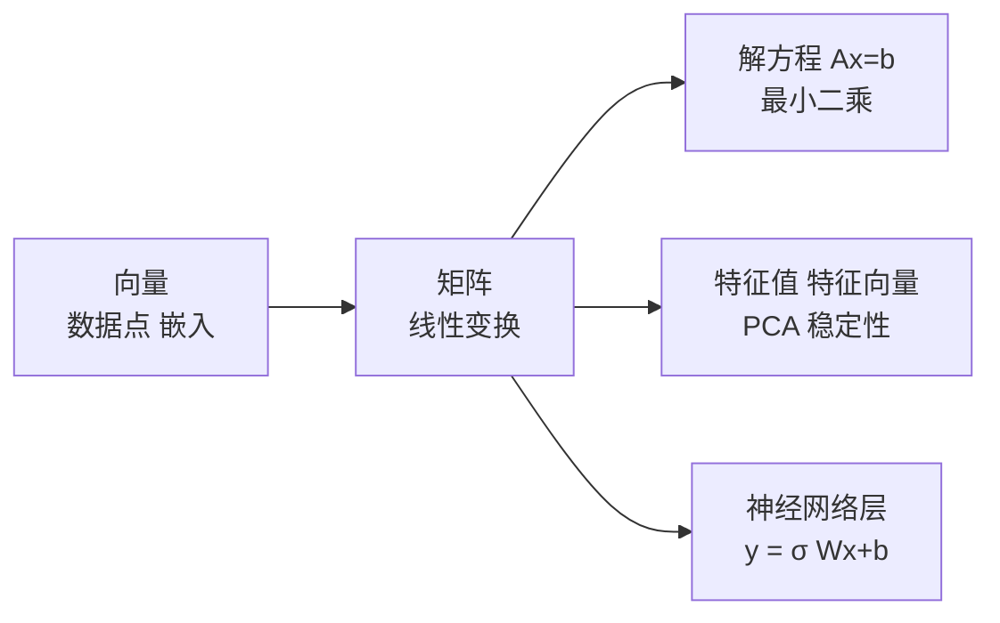

# 线性代数总览：线性方程组、线性变换与秩

@@DISCLAIMER@@

## 一句话定义

线性代数研究**向量、矩阵以及“线性”的变换**：满足“加法和数乘可以先做也可以后做”的变换。神经网络的每一层本质上是“线性变换 + 非线性激活”。

## 为什么重要

- 深度学习的计算 90% 以上是矩阵乘法；GPU 之所以适合 AI，就是因为擅长并行做线性代数。
- 嵌入、注意力、PCA、LoRA、推荐系统的矩阵分解……都需要线性代数的语言。
- 本篇是总览；向量、矩阵、特征值分别见 [[k2.math.vector]]、[[k2.math.matrix]]、[[k2.math.eigenvalue]]。

## 原理 / 图解

**线性变换**的定义：

$$
T(\alpha \mathbf{u} + \beta \mathbf{w}) = \alpha T(\mathbf{u}) + \beta T(\mathbf{w})
$$

每个线性变换都可以写成矩阵乘法 $T(\mathbf{x}) = A\mathbf{x}$。**线性方程组**写成矩阵形式：

$$
\begin{cases} 2x + y = 5 \\ x - 3y = -1 \end{cases}
\iff
\begin{bmatrix} 2 & 1 \\ 1 & -3 \end{bmatrix}
\begin{bmatrix} x \\ y \end{bmatrix} =
\begin{bmatrix} 5 \\ -1 \end{bmatrix}
$$

**秩（rank）**是矩阵中线性无关的行（列）数，代表变换后空间的“维数”。$n\times n$ 矩阵满秩 ⇔ 行列式 $\det A \ne 0$ ⇔ 可逆 ⇔ 方程组有唯一解。

方程数多于未知数（如拟合直线）时通常无精确解，求**最小二乘解**：

$$
\hat{\mathbf{x}} = \arg\min_{\mathbf{x}} \lVert A\mathbf{x} - \mathbf{b} \rVert^2 = (A^\top A)^{-1} A^\top \mathbf{b}
$$

【有据可查】`numpy.linalg` 文档：<https://numpy.org/doc/stable/reference/routines.linalg.html> ；3Blue1Brown《线性代数的本质》：<https://www.3blue1brown.com/topics/linear-algebra>

## 可运行示例

用 NumPy 验证：解线性方程组、旋转与缩放（顺序很重要）、线性性、秩与行列式、最小二乘与正规方程、一层神经网络（Python 3.13 + numpy 2.5.4 实际运行）：

@@CODE:28_linear_algebra.py@@

输出：

@@OUT:28_linear_algebra@@

- 解 $x=2, y=1$，代回验证成立。
- “先旋转再缩放”与“先缩放再旋转”结果不同：矩阵乘法不可交换。
- `M` 的秩为 1、行列式为 0：两行成比例，变换把平面压扁成一条线，不可逆。
- `lstsq` 与正规方程结果一致。

## 常见误区

- **用 `inv(A) @ b` 解方程**：数值上不如 `np.linalg.solve` 稳定且更慢。【有据可查】`solve` 文档：<https://numpy.org/doc/stable/reference/generated/numpy.linalg.solve.html>
- **以为 `*` 是矩阵乘法**：NumPy/PyTorch 中 `*` 是逐元素乘，矩阵乘法是 `@`。
- **行列式接近 0 就当成 0**：判断“几乎奇异”要看条件数 `np.linalg.cond`，而不是行列式的绝对大小。
- **把带偏置的 $Wx+b$ 当作线性变换**：严格说是**仿射**变换；加一维常数 1 可写成线性形式。

## 与 AI 开发的关系

- **全连接层**：$\mathbf{y} = \sigma(W\mathbf{x} + \mathbf{b})$，PyTorch 的 `nn.Linear` 就是它（见 [[k2.ml.pytorch]]）。
- **线性回归**：最小二乘是最基本的机器学习模型。
- **低秩近似**：LoRA 假设权重更新矩阵的秩很低（见 [[k2.ml.peft]]）。
- **线性探针（linear probe）**：用一个线性分类器检查模型内部表示中是否“线性可读”某种信息。【社区共识】

## 延伸阅读

- 3Blue1Brown《线性代数的本质》：<https://www.3blue1brown.com/topics/linear-algebra>
- Gilbert Strang MIT 18.06 线性代数公开课：<https://ocw.mit.edu/courses/18-06-linear-algebra-spring-2010/>
- 《动手学深度学习》线性代数章节：<https://zh.d2l.ai/chapter_preliminaries/linear-algebra.html>

## 无法核实 / 待考察点

- 【待考察/推测】“深度学习计算中 90% 以上是矩阵乘法”是常见的粗略说法，具体比例依模型与实现而异，未找到统一权威统计。
