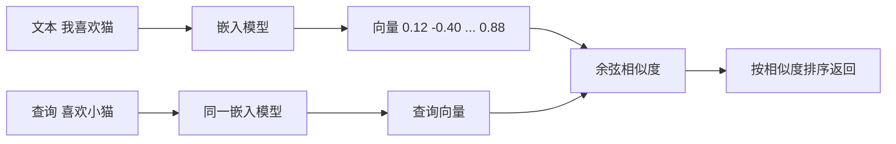

# 向量：范数、点积与余弦相似度

@@DISCLAIMER@@

## 一句话定义

向量是**一组有序的数**，既可以看作空间中的一个点或箭头（有大小和方向），也可以看作一个对象的特征表示。AI 中的“嵌入（embedding）”就是用向量表示词、句子、图片。

## 为什么重要

- **语义搜索 / RAG 的核心**：把文本变成向量，用余弦相似度找“意思相近”的内容。
- 范数是正则化（见 [[k2.math.regularization]]）和归一化（见 [[k2.math.normalization]]）的基础。
- 点积是注意力机制里“查询与键有多匹配”的计算方式。

## 原理 / 图解

| 概念 | 公式 | 直觉 |
|---|---|---|
| L2 范数（长度） | $\lVert \mathbf{a} \rVert_2 = \sqrt{\sum_i a_i^2}$ | 箭头有多长 |
| L1 范数 | $\lVert \mathbf{a} \rVert_1 = \sum_i \lvert a_i \rvert$ | 城市街区距离 |
| 点积 | $\mathbf{a}\cdot\mathbf{b} = \sum_i a_i b_i$ | 方向一致程度 × 长度 |

点积的几何意义与余弦相似度：

$$
\mathbf{a}\cdot\mathbf{b} = \lVert \mathbf{a} \rVert\,\lVert \mathbf{b} \rVert \cos\theta
\quad\Rightarrow\quad
\cos\theta = \frac{\mathbf{a}\cdot\mathbf{b}}{\lVert \mathbf{a} \rVert\,\lVert \mathbf{b} \rVert} \in [-1, 1]
$$

$\mathbf{b}$ 在 $\mathbf{a}$ 方向上的投影：

$$
\text{proj}_{\mathbf{a}}\mathbf{b} = \frac{\mathbf{a}\cdot\mathbf{b}}{\mathbf{a}\cdot\mathbf{a}}\,\mathbf{a}
$$

## 可运行示例

用 NumPy 验证范数、点积、余弦、正交、投影；用玩具词向量演示 king − man + woman ≈ queen；观察高维随机向量“几乎都正交”（Python 3.13 + numpy 实际运行）：

@@CODE:29_vector.py@@

输出：

@@OUT:29_vector@@

- $\mathbf{a}=(3,4)$ 的长度为 5，余弦 0.96 对应夹角约 16°。
- 词向量类比使用的是**手工构造的玩具向量**，只演示运算方式；真实嵌入中类比关系是否成立因模型而异。
- 维度从 2 升到 4096，随机向量之间的平均 |余弦| 从 0.64 降到 0.012：高维空间中随机方向几乎都互相正交，这也是为什么相似度阈值不能跨模型照搬。

## 常见误区

- **用欧氏距离比较未归一化的嵌入**：长度差异会干扰语义比较；单位化后欧氏距离与余弦等价（$\lVert \hat a - \hat b \rVert^2 = 2 - 2\cos\theta$）。
- **余弦为负就是“意思相反”**：不一定，很多嵌入模型的余弦集中在一个较窄的正区间。【社区共识】
- **不同模型的向量混用**：不同嵌入模型的向量空间不可比较。
- **把余弦相似度阈值（如 0.8）当通用标准**：要在自己的数据上标定。

## 与 AI 开发的关系

- **RAG 检索**：向量数据库按余弦或点积返回 Top-k 文档（见 [[k2.ds.heap]]）。
- **注意力分数**：$\mathbf{q}\cdot\mathbf{k}/\sqrt{d}$，除以 $\sqrt{d}$ 是为了抵消高维点积方差随维度增大。【有据可查】<https://arxiv.org/abs/1706.03762>
- **词向量**：word2vec 类比现象的原始论文：<https://arxiv.org/abs/1301.3781>

## 延伸阅读

- 3Blue1Brown：向量是什么 <https://www.3blue1brown.com/lessons/vectors>
- Sentence Transformers 语义搜索文档：<https://sbert.net/examples/sentence_transformer/applications/semantic-search/README.html>
- word2vec 论文：<https://arxiv.org/abs/1301.3781>

## 无法核实 / 待考察点

- 【待考察/推测】“很多嵌入模型的余弦相似度集中在窄的正区间（各向异性）”为社区与部分论文的观察，不同模型差异大。
