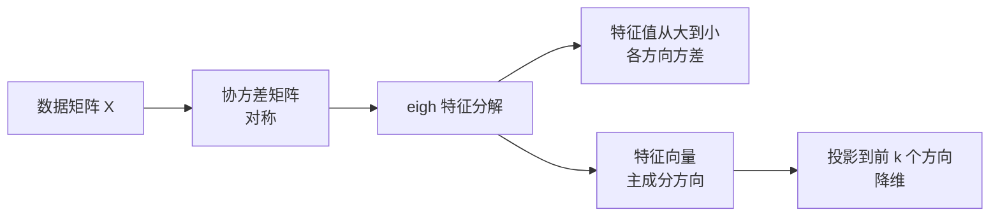

# 特征值与特征向量

@@DISCLAIMER@@

## 一句话定义

对方阵 $A$，若某个非零向量 $\mathbf{v}$ 经过变换后**方向不变、只被拉伸 $\lambda$ 倍**，即 $A\mathbf{v} = \lambda\mathbf{v}$，则 $\mathbf{v}$ 是特征向量，$\lambda$ 是对应的特征值。

## 为什么重要

- **PCA 降维**：协方差矩阵的特征向量是数据变化最大的方向，特征值是该方向上的方差。
- **稳定性分析**：反复乘同一个矩阵（RNN、深层网络、迭代算法）时，最大特征值的绝对值（谱半径）决定结果是爆炸还是消失。
- 谱聚类、PageRank、优化中的 Hessian 曲率分析都用到它。

## 原理 / 图解

定义与求法：

$$
A\mathbf{v} = \lambda \mathbf{v} \iff (A - \lambda I)\mathbf{v} = \mathbf{0} \;\Rightarrow\; \det(A - \lambda I) = 0
$$

两个重要恒等式：

$$
\sum_i \lambda_i = \operatorname{tr}(A),\qquad \prod_i \lambda_i = \det(A)
$$

实对称矩阵可以正交对角化（谱定理），$Q$ 的列是互相正交的特征向量：

$$
A = Q \Lambda Q^\top,\qquad Q^\top Q = I
$$

例：$A = \begin{bmatrix} 2 & 1 \\ 1 & 2 \end{bmatrix}$，特征值 3 和 1，特征向量 $(1,1)/\sqrt2$ 与 $(-1,1)/\sqrt2$。

【有据可查】**NumPy 2.5 起，`np.linalg.eig` 和 `eigvals` 总是返回复数数组**（此前取决于特征值是否恰好为实数）；对称/厄米矩阵应使用 `eigh` / `eigvalsh`，保证返回实数：<https://numpy.org/doc/stable/release/2.5.0-notes.html>

## 可运行示例

验证 $A\mathbf{v}=\lambda\mathbf{v}$、迹与行列式恒等式、谱分解还原、幂迭代、用特征分解做 PCA、谱半径对反复相乘的影响（Python 3.13 + numpy 2.5.4 实际运行）：

@@CODE:31_eigenvalue.py@@

输出：

@@OUT:31_eigenvalue@@

- 第一行说明了 NumPy 2.5 的行为变化：即使是实对称矩阵，`eig` 也返回 complex128。
- 特征值和 3+1=4 等于迹，积 3 等于行列式。
- PCA：第一主成分解释了 97.4% 的方差，方向与数据构造时的旋转角 0.5 弧度一致（符号可正可负）。
- 谱半径 0.9 时连乘 50 次衰减到 0.007，1.1 时放大到 166：这就是梯度消失/爆炸的线性代数解释。

## 常见误区

- **对称矩阵用 `eig`**：应该用 `eigh`，更快、更稳，并返回实数且按升序排列。
- **以为特征向量是唯一的**：乘以任意非零常数（包括 −1）仍是特征向量；PCA 方向的符号在不同库中可能相反。
- **非方阵求特征值**：只有方阵有特征值；非方阵用奇异值分解（SVD）。
- **假设 `eig` 结果有序**：`eig` 不保证顺序，需要自行排序。

## 与 AI 开发的关系

- **嵌入可视化与压缩**：PCA 把 768/4096 维嵌入降到 2D 查看，或降维后存储（见 [[k2.ml.sklearn]]）。
- **训练稳定性**：权重矩阵的谱半径与梯度爆炸/消失相关；正交初始化、谱归一化（spectral normalization）都基于此。【有据可查】谱归一化论文：<https://arxiv.org/abs/1802.05957>
- **LoRA 的低秩假设**：权重更新的奇异值谱衰减很快，所以低秩近似有效（见 [[k2.ml.peft]]）。
- **损失曲面**：Hessian 的最大特征值反映曲率，与可用学习率上限有关（见 [[k2.math.optimization]]）。

## 延伸阅读

- 3Blue1Brown：特征向量与特征值 <https://www.3blue1brown.com/lessons/eigenvalues>
- NumPy `eigh` 文档：<https://numpy.org/doc/stable/reference/generated/numpy.linalg.eigh.html>
- NumPy 2.5.0 发布说明：<https://numpy.org/doc/stable/release/2.5.0-notes.html>
- sklearn PCA 用户指南：<https://scikit-learn.org/stable/modules/decomposition.html#pca>

## 无法核实 / 待考察点

- 【待考察/推测】NumPy 2.5 的这一变化对 SciPy、scikit-learn 等下游库中调用 `eig` 的代码有哪些具体影响，未逐一核实。
