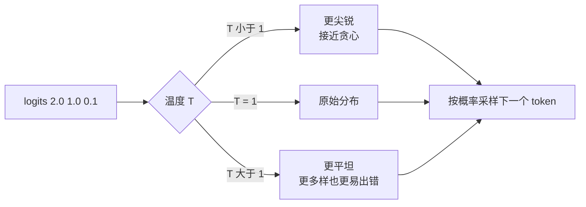

# 概率：随机变量、分布与 softmax 采样

@@DISCLAIMER@@

## 一句话定义

概率用 0 到 1 之间的数描述**事件发生的可能性**。随机变量把随机结果映射成数，概率分布描述它取各个值的可能性。语言模型的输出就是“下一个 token 的概率分布”。

## 为什么重要

- **LLM 生成就是在分布上采样**：temperature、top-k、top-p 都是在改造这个分布。
- 交叉熵损失、困惑度、贝叶斯推断、扩散模型的噪声都建立在概率之上。
- 理解“随机性”才能正确解读模型评估结果和 A/B 实验（见 [[k2.math.statistics]]）。

## 原理 / 图解

| 概念 | 公式 | 例子（骰子） |
|---|---|---|
| 概率 | $P(A) = \frac{\text{有利结果数}}{\text{总结果数}}$（等可能时） | $P(6)=1/6$ |
| 条件概率 | $P(A\mid B) = \frac{P(A\cap B)}{P(B)}$ | $P(\text{偶}\mid >3) = 2/3$ |
| 期望 | $\mathbb{E}[X] = \sum_x x\,P(x)$ | 3.5 |
| 方差 | $\operatorname{Var}(X) = \mathbb{E}[(X-\mathbb{E}X)^2]$ | 35/12 ≈ 2.917 |

常见分布：

$$
\text{二项}\ P(X=k) = \binom{n}{k} p^k (1-p)^{n-k},\qquad
\text{正态}\ p(x) = \frac{1}{\sqrt{2\pi}\sigma} e^{-\frac{(x-\mu)^2}{2\sigma^2}}
$$

**softmax** 把任意实数打分（logits）变成概率分布；温度 $T$ 控制分布的“尖锐”程度：

$$
p_i = \frac{e^{z_i/T}}{\sum_j e^{z_j/T}},\qquad \sum_i p_i = 1
$$

【有据可查】`numpy.random.Generator` 文档：<https://numpy.org/doc/stable/reference/random/generator.html>

## 可运行示例

用蒙特卡洛模拟验证理论值：骰子、条件概率、期望方差、二项与正态分布、生日问题；再观察 softmax 温度和按概率采样（Python 3.13 + numpy 实际运行）：

@@CODE:32_probability.py@@

输出：

@@OUT:32_probability@@

- 所有模拟值与理论值吻合到小数点后 2–3 位（大数定律）。
- 生日问题：23 人中至少两人同生日的概率约 50.7%，远高于直觉。
- 温度 0.5 时最高项概率 0.864，温度 2.0 时降到 0.502；按 softmax 采样 100 万次的频率与概率一致。

## 常见误区

- **把概率当频率的保证**：概率 0.1 的事 10 次里不一定恰好发生 1 次。
- **混淆 $P(A\mid B)$ 与 $P(B\mid A)$**：见 [[k2.math.bayes]] 的检测例子。
- **以为温度 0 是“最准确”**：只是确定性（贪心），不代表更正确；而且贪心不一定得到整体最优序列（见 [[k2.algo.greedy]]）。
- **直接对 logits 取 exp**：数值溢出，应先减去最大值（softmax 的平移不变性）。
- **“独立”与“互斥”混淆**：互斥事件（不能同时发生）通常不独立。

## 与 AI 开发的关系

- **采样参数**：temperature、top-k、top-p（nucleus）都作用于 softmax 分布。【有据可查】top-p 出自 Holtzman 等 2019：<https://arxiv.org/abs/1904.09751>
- **评估的随机性**：采样生成的结果每次不同，评测需多次运行取平均或固定种子。
- **扩散模型**：前向过程就是加高斯噪声（见 [[k2.ml.diffusers]]）。
- **校准（calibration）**：模型给出的置信度是否等于实际正确率。

## 延伸阅读

- 《动手学深度学习》概率章节：<https://zh.d2l.ai/chapter_preliminaries/probability.html>
- Seeing Theory（交互式概率可视化）：<https://seeing-theory.brown.edu/>
- Hugging Face 生成策略：<https://huggingface.co/docs/transformers/generation_strategies>

## 无法核实 / 待考察点

- 【待考察/推测】各家 LLM API 对 temperature 的具体实现（是否与 top-p 同时生效、取值上限）并不统一，以各自文档为准。
