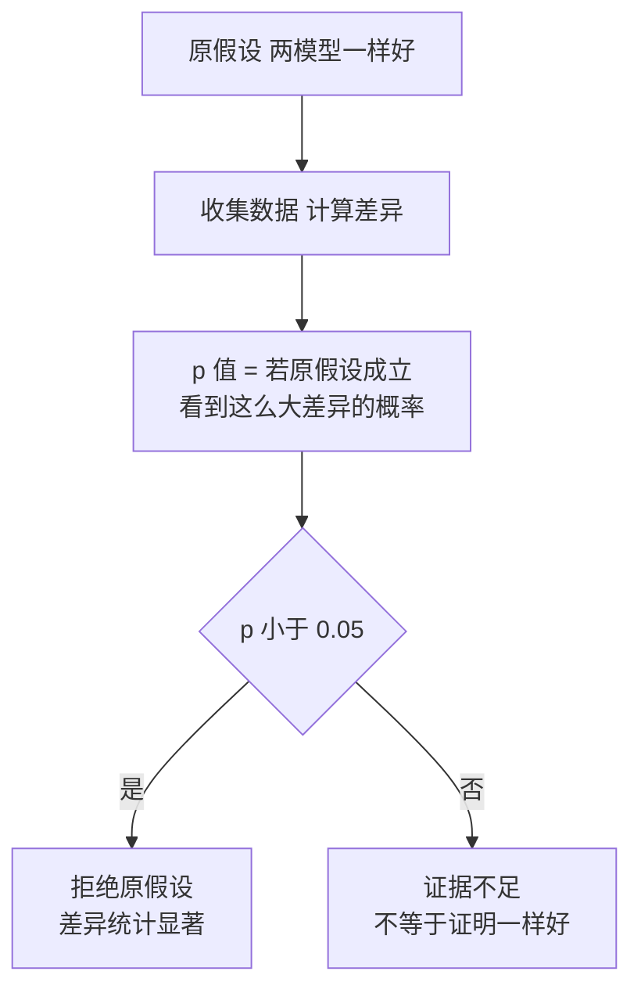

# 统计学：描述统计、置信区间与假设检验

@@DISCLAIMER@@

## 一句话定义

统计学研究**如何从有限的样本数据中总结规律并对总体做出推断**，同时量化这种推断有多不确定。

## 为什么重要

- **判断“模型 A 是否真的比 B 好”**：在 200 道题上高 7.5 个百分点，可能只是运气。
- **监控线上服务**：延迟要看 P90/P99，而不是平均值。
- **数据探索**：均值、方差、相关系数是理解数据集的第一步（配合 [[k1.lib.pandas]]）。

## 原理 / 图解

| 指标 | 公式 / 含义 | 特点 |
|---|---|---|
| 均值 | $\bar x = \frac{1}{n}\sum x_i$ | 受极端值影响大 |
| 中位数 | 排序后中间的值 | 稳健 |
| 标准差 | $s = \sqrt{\frac{1}{n-1}\sum (x_i-\bar x)^2}$ | 离散程度 |
| 分位数 P90/P99 | 90%/99% 的数据不超过它 | 看长尾 |

**中心极限定理（CLT）**：样本均值的分布近似正态，标准误为

$$
\operatorname{SE}(\bar x) = \frac{\sigma}{\sqrt{n}}
$$

由此得到均值差的 95% 置信区间（近似）：

$$
(\hat p_A - \hat p_B) \pm 1.96 \sqrt{\frac{\hat p_A(1-\hat p_A)}{n_A} + \frac{\hat p_B(1-\hat p_B)}{n_B}}
$$

【有据可查】`scipy.stats` 文档：<https://docs.scipy.org/doc/scipy/reference/stats.html> ；美国统计协会关于 p 值的声明（2016）：<https://doi.org/10.1080/00031305.2016.1154108>

## 可运行示例

模拟 API 延迟的描述统计与分位数、验证 CLT 的标准误、两个模型准确率的置信区间 / t 检验 / bootstrap、一个异常点对相关系数的影响（Python 3.13 + numpy + scipy 实际运行）：

@@CODE:33_statistics.py@@

输出：

@@OUT:33_statistics@@

- 延迟数据右偏：均值 921ms 大于中位数 765ms，P99 达 3 秒。
- 样本均值标准差实测 0.1116，与理论 $\sigma/\sqrt n$ = 0.1115 几乎一致。
- 模型 A 比 B 高 7.5 个百分点，但置信区间包含 0、p=0.087：**不能断言 A 更好**，需要更多测试题。
- 加入一个异常点，皮尔逊相关从 0.43 变成 −0.71，斯皮尔曼（基于排名）几乎不变。

## 常见误区

- **p 值是“原假设为真的概率”**：不是。它是在原假设成立的前提下观察到这么极端数据的概率。
- **不显著 = 没差异**：只是证据不足。
- **多次比较不校正**：同时比较 20 组，偶然出现一个 p<0.05 很正常（需 Bonferroni 等校正）。
- **只报均值不报分布**：偏态数据报中位数和分位数。
- **相关即因果**：相关系数只说明线性（皮尔逊）或单调（斯皮尔曼）关系。

## 与 AI 开发的关系

- **模型评测**：基准分数应带置信区间；小测试集上的排行榜差异常常不显著。【有据可查】Anthropic《Adding Error Bars to Evals》：<https://arxiv.org/abs/2411.00640>
- **线上监控**：LLM 服务的首 token 延迟、总延迟看 P50/P95/P99。
- **数据质量**：用分位数和 z-score 发现异常样本（见 [[k2.math.normalization]]）。
- **A/B 实验**：提示词或模型版本上线前，用统计检验判断改进是否真实。

## 延伸阅读

- `scipy.stats`：<https://docs.scipy.org/doc/scipy/reference/stats.html>
- 《Adding Error Bars to Evals》：<https://arxiv.org/abs/2411.00640>
- Seeing Theory：<https://seeing-theory.brown.edu/>

## 无法核实 / 待考察点

- 【待考察/推测】示例中两个模型的答题结果是**独立模拟**的，所以用了独立样本 t 检验（把 0/1 当连续变量是常见近似）。真实评测中两个模型做的是同一套题，《Adding Error Bars to Evals》建议用**逐题配对差**计算标准误（【有据可查】<https://arxiv.org/abs/2411.00640> 第 4.2 节），本文未演示配对版本。
