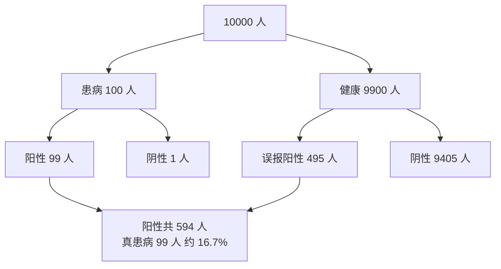

# 贝叶斯定理与贝叶斯推断

@@DISCLAIMER@@

## 一句话定义

贝叶斯定理告诉我们**如何用新证据更新原有的信念**：后验 ∝ 似然 × 先验。

$$
P(H\mid E) = \frac{P(E\mid H)\,P(H)}{P(E)},\qquad P(E) = \sum_h P(E\mid h)P(h)
$$

## 为什么重要

- 纠正“基础比率谬误”：检测准确率 99%，阳性也不代表 99% 患病。
- 朴素贝叶斯分类器、贝叶斯优化（调超参）、贝叶斯 A/B 测试都以此为基础。
- 正则化可以理解为给参数加了先验（见 [[k2.math.regularization]]）。

## 原理 / 图解

疾病检测例子：患病率 1%，灵敏度 99%，误报率 5%。设想 10000 人：

$$
P(\text{病}\mid +) = \frac{0.99 \times 0.01}{0.99\times 0.01 + 0.05 \times 0.99} = \frac{0.0099}{0.0594} \approx 0.1667
$$

**序贯更新**：第一次的后验成为第二次的先验，再阳性一次，概率升到约 0.80。

**Beta-二项共轭**：点击率先验 $\text{Beta}(\alpha,\beta)$，观察到 $k$ 次点击 / $n$ 次展示后：

$$
\text{后验} = \text{Beta}(\alpha + k,\ \beta + n - k)
$$

【有据可查】贝叶斯定理概述：<https://en.wikipedia.org/wiki/Bayes%27_theorem> ；sklearn 朴素贝叶斯：<https://scikit-learn.org/stable/modules/naive_bayes.html>

## 可运行示例

公式计算与 200 万人模拟验证检测例子、序贯更新、手写朴素贝叶斯垃圾邮件分类（对数概率 + 拉普拉斯平滑）、Beta 后验可信区间随数据量收窄（Python 3.13 + numpy + scipy 实际运行）：

@@CODE:34_bayes.py@@

输出：

@@OUT:34_bayes@@

- 公式 0.1667，模拟 0.1656，一致。
- 观察 3/10 时，95% 可信区间为 [0.11, 0.61]，很宽；到 300/1000 时收窄到 [0.27, 0.33]。

## 常见误区

- **忽略先验（基础比率）**：罕见事件即使检测很准，阳性中也可能大部分是误报。
- **朴素贝叶斯的“朴素”被当真**：它假设特征条件独立，现实中几乎不成立，但分类效果常常仍然可用。
- **概率连乘不取对数**：很多小概率相乘会下溢为 0，要在对数空间求和。
- **未见过的词概率为 0**：需要拉普拉斯平滑。
- **把可信区间与置信区间混为一谈**：贝叶斯可信区间可以直接解释为“参数落在此区间的概率为 95%”，频率学派置信区间不能这样解释。

## 与 AI 开发的关系

- **垃圾信息与文本分类基线**：朴素贝叶斯训练极快，适合作为基线（见 [[k2.ml.sklearn]]）。
- **贝叶斯优化**：用高斯过程等代理模型选择下一个要尝试的超参数。【有据可查】Optuna 等工具文档中的 TPE 采样器：<https://optuna.readthedocs.io/en/stable/reference/samplers/generated/optuna.samplers.TPESampler.html>
- **不确定性**：在 Agent 决策中，把“模型说了什么”当作证据而非结论，结合先验判断可信度。【社区共识】
- **正则化 = 先验**：L2 正则对应高斯先验，L1 对应拉普拉斯先验（MAP 估计）。

## 延伸阅读

- 3Blue1Brown：贝叶斯定理 <https://www.3blue1brown.com/lessons/bayes-theorem>
- sklearn 朴素贝叶斯：<https://scikit-learn.org/stable/modules/naive_bayes.html>
- 《Think Bayes》（免费在线）：<https://allendowney.github.io/ThinkBayes2/>

## 无法核实 / 待考察点

- 【待考察/推测】示例的检测参数（1%、99%、5%）是教学用的假设数字，不对应任何真实检测。
