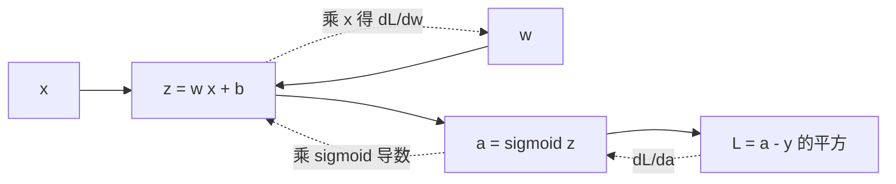

# 梯度与反向传播

@@DISCLAIMER@@

## 一句话定义

梯度是多元函数对每个变量的**偏导数组成的向量**，指向函数值**增长最快**的方向；它的反方向就是下降最快的方向。神经网络训练就是反复“算梯度 → 沿负梯度走一小步”。

## 为什么重要

- **所有深度学习训练的核心**：`loss.backward()` 算的就是损失对每个参数的梯度（见 [[k2.ml.pytorch]]）。
- 理解梯度才能理解学习率、梯度消失/爆炸、梯度裁剪等训练问题。

## 原理 / 图解

对 $f(x,y) = x^2 + 3y^2 + 2xy$：

$$
\nabla f = \begin{bmatrix} \dfrac{\partial f}{\partial x} \\[2mm] \dfrac{\partial f}{\partial y} \end{bmatrix}
= \begin{bmatrix} 2x + 2y \\ 6y + 2x \end{bmatrix},\qquad \nabla f(1,2) = \begin{bmatrix} 6 \\ 14 \end{bmatrix}
$$

沿单位方向 $\mathbf{u}$ 的变化率（方向导数）是 $\nabla f \cdot \mathbf{u}$，当 $\mathbf{u}$ 与梯度同向时最大。梯度下降的更新规则：

$$
\boldsymbol{\theta} \leftarrow \boldsymbol{\theta} - \eta\, \nabla_{\boldsymbol{\theta}} L
$$

**反向传播**是对计算图高效地应用链式法则：从损失出发，把“上游梯度 × 本地导数”逐层传回去。

$$
\frac{\partial L}{\partial w} = \underbrace{2(a-y)}_{\partial L/\partial a}\cdot \underbrace{\sigma(z)(1-\sigma(z))}_{\partial a/\partial z} \cdot \underbrace{x}_{\partial z/\partial w}
$$

【有据可查】反向传播经典论文：Rumelhart, Hinton & Williams, *Nature* 1986：<https://doi.org/10.1038/323533a0>

## 可运行示例

解析梯度 vs 数值梯度、沿不同方向的变化量、梯度下降收敛、手写一个神经元的反向传播并用数值差分验证、sigmoid 链式连乘导致的梯度消失（Python 3.13 + numpy 实际运行）：

@@CODE:35_gradient.py@@

输出：

@@OUT:35_gradient@@

- 解析梯度 [6, 14] 与数值梯度一致——**梯度检查（gradient check）**是验证手写反向传播的标准方法。
- 同样走 0.001，沿梯度方向 f 增加最多，沿负梯度方向减少最多。
- 反向传播结果 −0.294268 与数值差分完全一致。
- sigmoid 导数最大 0.25，10 层连乘上界约 $10^{-6}$：梯度消失的直观原因。

## 常见误区

- **梯度指向最小值**：它指向**局部**上升最快方向；负梯度只保证局部下降，不直接指向全局最小值。
- **梯度为 0 就是最小值**：也可能是最大值或鞍点（高维中鞍点很常见）。
- **学习率随便设**：太大发散，太小太慢（见 [[k2.math.optimization]]）。
- **数值梯度用于训练**：每个参数都要前向两次，太慢，只用于检查。

## 与 AI 开发的关系

- **自动微分框架**：PyTorch autograd、JAX `grad`、TF `GradientTape` 都在自动做反向传播（见 [[k2.ml.jax]]）。
- **梯度裁剪**：大模型训练中限制梯度范数防止爆炸（`torch.nn.utils.clip_grad_norm_`）。【有据可查】<https://docs.pytorch.org/docs/stable/generated/torch.nn.utils.clip_grad_norm_.html>
- **梯度消失的工程解法**：ReLU 系激活、残差连接、归一化层（见 [[k2.math.normalization]]）。【有据可查】ResNet：<https://arxiv.org/abs/1512.03385>
- **显存**：反向传播需要保存前向的中间激活；梯度检查点（gradient checkpointing）用重算换显存。

## 延伸阅读

- 3Blue1Brown 神经网络系列（反向传播）：<https://www.3blue1brown.com/lessons/backpropagation>
- Andrej Karpathy《micrograd》：<https://github.com/karpathy/micrograd>
- CS231n 反向传播笔记：<https://cs231n.github.io/optimization-2/>

## 无法核实 / 待考察点

- 【待考察/推测】反向传播的“发明者”在学术史上有争议（Linnainmaa 1970 的自动微分、Werbos 1974 等），本文只引用了广为人知的 1986 年论文。
