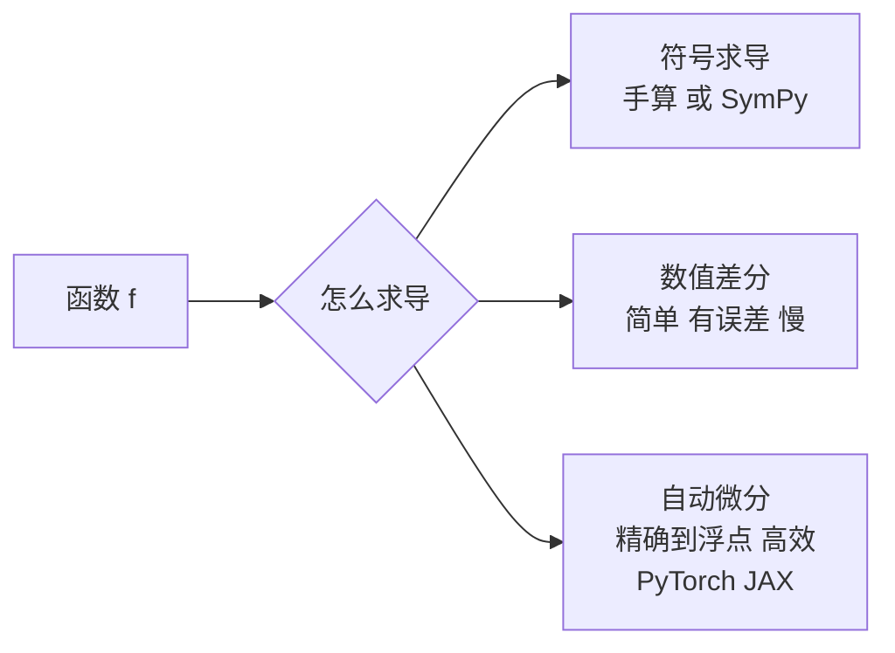

# 导数：变化率、数值微分与链式法则

@@DISCLAIMER@@

## 一句话定义

导数描述函数在某一点的**瞬时变化率**，几何上是曲线在该点切线的斜率：输入变化一点点，输出大约变化“导数 × 这一点点”。

$$
f'(x) = \lim_{h\to 0} \frac{f(x+h) - f(x)}{h}
$$

## 为什么重要

- 导数告诉我们“参数往哪边调、损失会下降”，是梯度（多元导数，见 [[k2.math.gradient]]）和所有优化算法的基础。
- 激活函数的导数决定了梯度能否顺利传播。

## 原理 / 图解

常用导数：

| 函数 | 导数 | AI 中的角色 |
|---|---|---|
| $x^n$ | $n x^{n-1}$ | 多项式、MSE |
| $e^x$ | $e^x$ | softmax |
| $\ln x$ | $1/x$ | 交叉熵 |
| $\sigma(x) = \frac{1}{1+e^{-x}}$ | $\sigma(x)(1-\sigma(x))$，最大 0.25 | 门控、二分类 |
| $\tanh x$ | $1-\tanh^2 x$ | RNN |
| $\operatorname{ReLU}(x)=\max(0,x)$ | $[x>0]$（0 处不可导） | 最常用激活函数 |

**链式法则**（复合函数求导，反向传播的数学基础）：

$$
\frac{d}{dx} f(g(x)) = f'(g(x))\cdot g'(x),\qquad \frac{d}{dx}\sin(x^2) = \cos(x^2)\cdot 2x
$$

**数值微分**：中心差分误差为 $O(h^2)$，优于前向差分的 $O(h)$：

$$
f'(x) \approx \frac{f(x+h) - f(x-h)}{2h}
$$

**二阶导数判别极值**：$f'(x)=0$ 时，$f''(x)>0$ 为极小值，$f''(x)<0$ 为极大值。

【有据可查】自动微分综述：Baydin 等, *Automatic Differentiation in Machine Learning: a Survey*：<https://arxiv.org/abs/1502.05767>

## 可运行示例

前向/中心差分在不同步长 h 下的误差、激活函数导数公式与数值验证、ReLU 在 0 处的问题、链式法则、二阶导数判别极值（Python 3.13 + numpy 实际运行）：

@@CODE:36_derivative.py@@

输出：

@@OUT:36_derivative@@

- h 从 0.1 减到 1e-5，误差变小；但 h=1e-12 时误差反而变大到 0.001——浮点舍入误差占主导。
- ReLU 在 0 处中心差分给出 0.5（左右导数的平均），而框架通常约定取 0。【有据可查】PyTorch autograd 对不可导点的约定：<https://docs.pytorch.org/docs/stable/notes/autograd.html#gradients-for-non-differentiable-functions>

## 常见误区

- **h 越小越精确**：存在最优 h（float64 下中心差分约 1e-5 量级）。
- **不可导点无所谓**：ReLU 的 0 点在实践中影响不大，但 `abs`、`max` 等在关键位置不可导时要注意梯度定义。
- **导数为 0 就是最优**：可能是极大值或拐点，需二阶条件或更多信息。
- **混淆导数与差分**：数值差分只是导数的近似。

## 与 AI 开发的关系

- **激活函数选择**：sigmoid 导数最大 0.25，深层网络易梯度消失；ReLU 在正区间导数为 1（见 [[k2.math.gradient]]）。
- **自动微分**：JAX 的 `grad(grad(f))` 可求高阶导数（见 [[k2.ml.jax]]）。
- **学习率与曲率**：二阶导数（Hessian）大的地方需要更小的步长（见 [[k2.math.optimization]]）。

## 延伸阅读

- 3Blue1Brown《微积分的本质》：<https://www.3blue1brown.com/topics/calculus>
- 自动微分综述：<https://arxiv.org/abs/1502.05767>
- 《动手学深度学习》微积分章节：<https://zh.d2l.ai/chapter_preliminaries/calculus.html>

## 无法核实 / 待考察点

- 【待考察/推测】中心差分最优步长约为 $\varepsilon^{1/3}$（$\varepsilon$ 为机器精度）是数值分析中的经验结论，未在本文严格推导。
