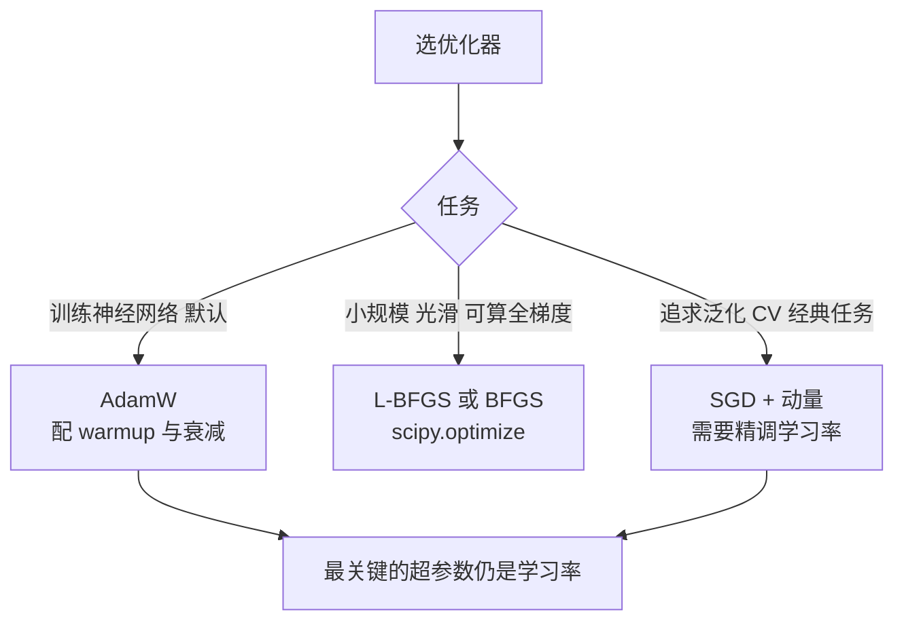

# 优化：梯度下降、动量与 Adam

@@DISCLAIMER@@

## 一句话定义

优化是**寻找让目标函数（通常是损失）最小的参数**。深度学习用一阶方法：梯度下降及其改进版（动量、Adam），每步沿负梯度方向调整参数。

$$
\boldsymbol{\theta}^* = \arg\min_{\boldsymbol{\theta}} L(\boldsymbol{\theta})
$$

## 为什么重要

- 选错优化器或学习率，模型可能根本训不动或直接发散（loss 变 NaN）。
- 大模型训练几乎都用 AdamW 一类自适应优化器，配合学习率预热（warmup）和衰减。【社区共识】

## 原理 / 图解

| 方法 | 更新规则 | 特点 |
|---|---|---|
| 梯度下降 GD | $\theta \leftarrow \theta - \eta g$ | 简单；狭长山谷中来回震荡 |
| 动量 Momentum | $v \leftarrow \beta v + g,\ \theta \leftarrow \theta - \eta v$ | 积累方向，冲过平坦区，减少震荡 |
| Adam | 见下式 | 每个参数自适应步长，鲁棒 |

Adam（Kingma & Ba, 2014）：

$$
m_t = \beta_1 m_{t-1} + (1-\beta_1) g_t,\quad v_t = \beta_2 v_{t-1} + (1-\beta_2) g_t^2
$$

$$
\hat m_t = \frac{m_t}{1-\beta_1^t},\quad \hat v_t = \frac{v_t}{1-\beta_2^t},\quad \theta_t = \theta_{t-1} - \eta \frac{\hat m_t}{\sqrt{\hat v_t} + \epsilon}
$$

【有据可查】Adam：<https://arxiv.org/abs/1412.6980> ；AdamW（解耦权重衰减）：<https://arxiv.org/abs/1711.05101> ；PyTorch 优化器文档：<https://docs.pytorch.org/docs/stable/optim.html>

测试函数 Rosenbrock（最小值在 (1,1)，位于一条弯曲狭长的山谷底部）：

$$
f(x,y) = (1-x)^2 + 100\,(y - x^2)^2
$$

*图：从 (−1.5, 2) 出发，三种优化器的 5000 步轨迹（由下方示例代码生成）。动量在山谷入口处来回震荡后冲向终点；GD 沿山谷缓慢前进，5000 步后仍未到达 (1,1)。*

## 可运行示例

在 Rosenbrock 函数上对比 GD / 动量 / Adam、学习率过大导致发散、SciPy 的 BFGS、非凸函数从不同起点落入不同局部最小值，并画出轨迹图（Python 3.13 + numpy + scipy + matplotlib 实际运行）：

@@CODE:37_optimization.py@@

输出：

@@OUT:37_optimization@@

- 同样 5000 步：GD 停在 (0.92, 0.84)，动量和 Adam 到达 (1, 1)。
- GD 学习率从 0.001 调到 0.01，50 步内就变成 NaN。
- 非凸函数 $\sin 3x + 0.1x^2$：三个起点收敛到三个不同的局部最小值，只有从 0 出发找到了最好的那个。

## 常见误区

- **只调优化器不调学习率**：学习率通常是影响最大的超参数。
- **Adam 的 weight_decay 等于 L2 正则**：在 Adam 中二者不等价，所以有了 AdamW。【有据可查】<https://arxiv.org/abs/1711.05101>
- **loss 变 NaN 就换模型**：先检查学习率、梯度裁剪、数据中的异常值、混合精度溢出。
- **以为找到的是全局最优**：神经网络损失非凸，找到的是“足够好”的点。
- **特征不做归一化**：病态的损失曲面会让 GD 极慢（见 [[k2.math.normalization]]）。

## 与 AI 开发的关系

- **微调大模型**：常见配置是 AdamW + 线性/余弦学习率衰减 + warmup；LoRA 微调学习率通常比全量微调大。【社区共识】
- **显存**：Adam 为每个参数保存 $m$ 和 $v$ 两份状态，优化器状态约为参数量的 2 倍（fp32 时），这是全量微调显存大的原因之一；8-bit 优化器、LoRA 可缓解（见 [[k2.ml.peft]]）。
- **超参数搜索**：学习率常在对数尺度上搜索。

## 延伸阅读

- Sebastian Ruder《An overview of gradient descent optimization algorithms》：<https://arxiv.org/abs/1609.04747>
- Distill《Why Momentum Really Works》：<https://distill.pub/2017/momentum/>
- PyTorch 优化器：<https://docs.pytorch.org/docs/stable/optim.html>
- SciPy 优化：<https://docs.scipy.org/doc/scipy/reference/optimize.html>

## 无法核实 / 待考察点

- 【待考察/推测】“LoRA 微调的学习率通常比全量微调大一个数量级”为社区经验，没有统一权威结论。
- 【待考察/推测】新优化器（如 Muon、Lion 等）在大模型训练中的采用情况变化很快，本文未纳入比较。
