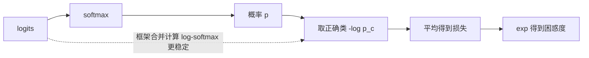

# 损失函数：MSE、交叉熵与困惑度

@@DISCLAIMER@@

## 一句话定义

损失函数用一个数衡量**模型预测与正确答案差多远**；训练就是最小化它（见 [[k2.math.optimization]]）。回归常用均方误差，分类和语言模型用交叉熵。

## 为什么重要

- 损失函数定义了“什么叫好”：选错损失，模型会朝错误方向优化。
- LLM 预训练的损失就是下一个 token 的交叉熵，它的指数就是常说的困惑度（perplexity）。
- 看懂损失数值才能判断训练是否正常：初始损失约等于 $\ln V$ 就说明模型初始化合理（见 [[k2.ml.transformers]] 示例）。

## 原理 / 图解

**回归损失**：

$$
\text{MSE} = \frac{1}{n}\sum (y_i - \hat y_i)^2,\qquad
\text{MAE} = \frac{1}{n}\sum \lvert y_i - \hat y_i \rvert
$$

$$
\text{Huber}_\delta(r) = \begin{cases} \tfrac12 r^2 & \lvert r\rvert \le \delta \\ \delta\left(\lvert r\rvert - \tfrac12\delta\right) & \text{否则} \end{cases}
$$

**分类：交叉熵**（$p$ 为 softmax 概率，$c$ 为正确类别）：

$$
L_{\text{CE}} = -\log p_c,\qquad \frac{\partial L}{\partial z_i} = p_i - [i = c]
$$

**困惑度**：平均交叉熵的指数，可理解为“模型在多少个选项中犹豫”：

$$
\text{PPL} = \exp\left(\frac{1}{N}\sum_{t=1}^{N} -\log p(x_t \mid x_{<t})\right)
$$

| 任务 | 常用损失 | PyTorch |
|---|---|---|
| 回归 | MSE / MAE / Huber | `MSELoss` / `L1Loss` / `HuberLoss` |
| 多分类、语言模型 | 交叉熵 | `CrossEntropyLoss`（输入 logits） |
| 二分类、多标签 | 二元交叉熵 | `BCEWithLogitsLoss`（输入 logits） |
| 扩散模型 | 预测噪声的 MSE | 见 [[k2.ml.diffusers]] |

【有据可查】PyTorch `CrossEntropyLoss`：<https://docs.pytorch.org/docs/stable/generated/torch.nn.CrossEntropyLoss.html> ；`BCEWithLogitsLoss`（说明其比 Sigmoid + BCELoss 数值更稳定）：<https://docs.pytorch.org/docs/stable/generated/torch.nn.BCEWithLogitsLoss.html>

## 可运行示例

三种回归损失及其对异常值的敏感度、交叉熵计算与梯度验证、困惑度、BCE 的数值稳定写法与朴素写法对比（Python 3.13 + numpy 实际运行）：

@@CODE:38_loss_function.py@@

输出：

@@OUT:38_loss_function@@

- 一个预测离谱后，MSE 从 0.375 暴涨到 100，MAE 和 Huber 只到 5 左右：MSE 对异常值极敏感。
- 正确类概率 0.5 时损失 0.693 = ln 2；词表 10 万的语言模型初始损失约 11.51。
- 交叉熵对 logits 的梯度就是 `softmax − onehot`，与数值梯度一致。
- logit=50 时朴素 BCE 得到 172.9（因下溢加了兜底极小值），稳定写法得到正确的 12.72。

## 常见误区

- **对 `CrossEntropyLoss` 输入 softmax 后的概率**：它内部已包含 log-softmax，应输入原始 logits。
- **分类用 MSE**：梯度性质差，收敛慢。
- **损失下降就代表模型变好**：可能在过拟合（看验证集，见 [[k2.math.regularization]]）。
- **比较不同分词器模型的困惑度**：PPL 依赖词表与分词方式，跨模型直接比较不公平。【社区共识】

## 与 AI 开发的关系

- **LLM 训练与评估**：预训练/SFT 的损失是交叉熵；PPL 用于比较同一分词器下的模型。
- **只对回答部分算损失**：SFT 中常把提示部分的标签设为 −100（`ignore_index`），只对回答计算损失。【有据可查】`ignore_index` 参数见 CrossEntropyLoss 文档。
- **偏好优化**：DPO 等方法设计了基于对数概率差的新损失。【有据可查】DPO：<https://arxiv.org/abs/2305.18290>
- **对比学习**：嵌入模型常用 InfoNCE 损失（本质是对相似度做交叉熵）。

## 延伸阅读

- PyTorch 损失函数列表：<https://docs.pytorch.org/docs/stable/nn.html#loss-functions>
- Hugging Face 困惑度说明：<https://huggingface.co/docs/transformers/perplexity>
- Chris Olah《Visual Information Theory》：<https://colah.github.io/posts/2015-09-Visual-Information/>

## 无法核实 / 待考察点

- 【待考察/推测】Transformers v5 中 `loss_type` 配置的可选值与默认选择逻辑未逐条核实（与 [[k2.ml.transformers]] 示例中的警告有关）。
