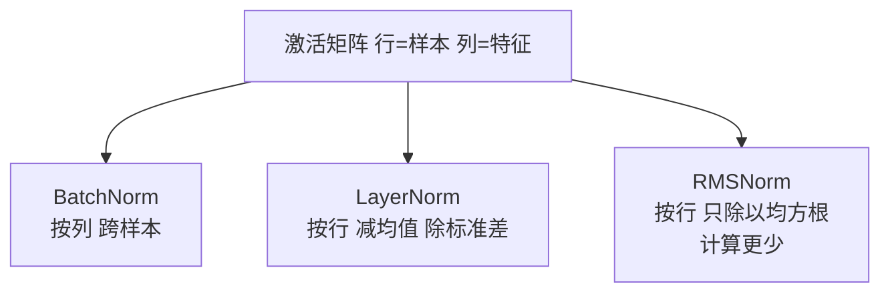

# 归一化：特征缩放、BatchNorm、LayerNorm 与 RMSNorm

@@DISCLAIMER@@

## 一句话定义

归一化是**把数据或中间激活缩放到统一、可控的范围**，常见做法是减去均值、除以标准差。它既用于输入特征预处理，也作为神经网络中的层（LayerNorm、RMSNorm 等）。

## 为什么重要

- **让优化更容易**：特征尺度相差悬殊时损失曲面狭长，梯度下降会非常慢（示例中从超过 10 万步降到 27 步）。
- **稳定深层网络训练**：几乎所有 Transformer 都在每个子层前后使用 LayerNorm 或 RMSNorm。
- **向量检索**：嵌入向量 L2 归一化后，点积就等于余弦相似度（见 [[k2.math.vector]]）。

## 原理 / 图解

**特征缩放**：

$$
\text{Min-Max: } x' = \frac{x - x_{\min}}{x_{\max} - x_{\min}},\qquad
\text{Z-score: } x' = \frac{x - \mu}{\sigma}
$$

**网络中的归一化层**（$\gamma,\beta$ 为可学习参数，$\epsilon$ 防止除零）：

$$
\text{LayerNorm}(\mathbf{x}) = \gamma \odot \frac{\mathbf{x} - \mu}{\sqrt{\sigma^2 + \epsilon}} + \beta,\qquad
\text{RMSNorm}(\mathbf{x}) = \gamma \odot \frac{\mathbf{x}}{\sqrt{\frac{1}{d}\sum_i x_i^2 + \epsilon}}
$$

| 方法 | 在哪个维度上算统计量 | 典型用途 |
|---|---|---|
| BatchNorm | 同一特征、跨 batch 中的样本 | CNN |
| LayerNorm | 同一样本、跨所有特征 | Transformer（BERT、GPT-2） |
| RMSNorm | 同一样本，只除以均方根、不减均值 | LLaMA 等许多新 LLM |

【有据可查】BatchNorm：<https://arxiv.org/abs/1502.03167> ；LayerNorm：<https://arxiv.org/abs/1607.06450> ；RMSNorm：<https://arxiv.org/abs/1910.07467> ；PyTorch `rms_norm`：<https://docs.pytorch.org/docs/stable/generated/torch.nn.functional.rms_norm.html>

## 可运行示例

Min-Max 与 Z-score、标准化前后的条件数与梯度下降步数、手写 BatchNorm / LayerNorm / RMSNorm 并与 PyTorch 对比、L2 归一化（Python 3.13 + numpy + torch 实际运行）：

@@CODE:40_normalization.py@@

输出：

@@OUT:40_normalization@@

- 条件数从 5046 降到 1.03（条件数是最大与最小特征值之比，衡量曲面有多“狭长”，见 [[k2.math.eigenvalue]]），梯度下降从超过 10 万步降到 27 步。
- BatchNorm 让每**列**均值为 0；LayerNorm 让每**行**均值 0、标准差 1；RMSNorm 让每行均方根为 1，但均值不为 0。
- 手写版本与 `torch.nn.functional.layer_norm` / `rms_norm` 结果一致。

## 常见误区

- **在全部数据上 fit 归一化参数**：会把测试集信息泄漏给训练，应只在训练集上 fit（见 [[k2.ml.sklearn]] 的 Pipeline）。
- **“归一化”与“标准化”混用**：不同资料用法不一，看公式而不是看名字。
- **树模型也必须标准化**：决策树/随机森林对单调缩放不敏感，一般不需要。
- **小 batch 用 BatchNorm**：统计量噪声大，Transformer 等序列模型多用 LayerNorm/RMSNorm。
- **推理时 BatchNorm 仍用当前 batch 统计**：应使用训练中累积的滑动均值（`model.eval()`）。

## 与 AI 开发的关系

- **Transformer 结构**：Pre-LN（子层前归一化）比原始 Post-LN 更易训练，是当前 LLM 的常见选择。【有据可查】<https://arxiv.org/abs/2002.04745>
- **RMSNorm**：计算更省，被 LLaMA 等模型采用。【有据可查】LLaMA 论文：<https://arxiv.org/abs/2302.13971>
- **嵌入检索**：存入向量库前做 L2 归一化，可以用点积代替余弦。
- **表格数据**：线性模型、SVM、KNN、神经网络的输入特征都应缩放。

## 延伸阅读

- sklearn 预处理：<https://scikit-learn.org/stable/modules/preprocessing.html>
- PyTorch `LayerNorm`：<https://docs.pytorch.org/docs/stable/generated/torch.nn.LayerNorm.html>
- RMSNorm 论文：<https://arxiv.org/abs/1910.07467>

## 无法核实 / 待考察点

- 【待考察/推测】各主流开源 LLM 当前使用 Pre-LN/RMSNorm 还是其他变体（如 QK-Norm、DeepNorm）的统计情况，未逐一核实。
